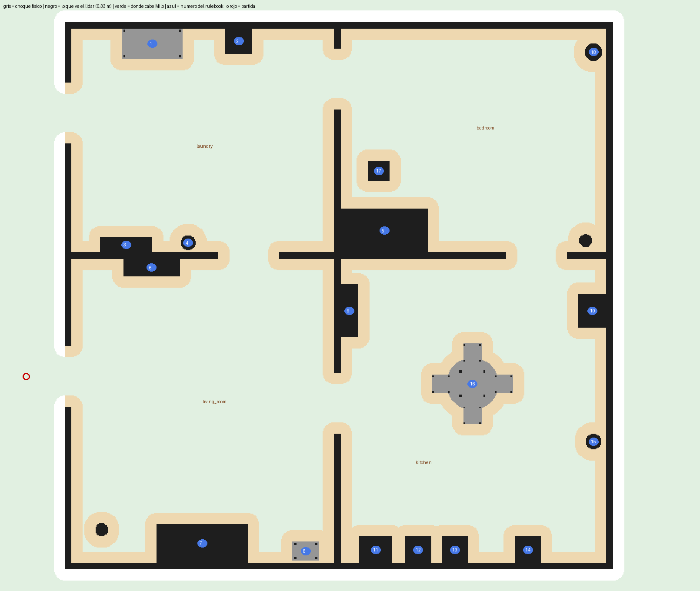

<div align="center">

# 🤖 milo_ws

**Workspace de Milo, el robot de AndesRobot para RoboCup@Home**


-E95420?logo=ubuntu&logoColor=white)


Simulación y robot real con el **mismo código**: mapeo con SLAM, navegación autónoma con Nav2,
filtro de seguridad y brazo con cinemática inversa.



<sub>La casa del rulebook en Gazebo: Laundry, Bedroom, Living room y Kitchen, con los 18 muebles.</sub>

</div>

---

##  Contenido

1. [Instalar (una vez por computador)](#1--instalar-una-vez-por-computador)
2. [Simulación: arena de mapeo](#2--simulación-arena-de-mapeo)
3. [Simulación: casa RoboCup@Home + navegación autónoma](#3--simulación-casa-robocuphome--navegación-autónoma)
4. [Brazo (solo simulación)](#4--brazo-solo-simulación)
5. [Milo físico](#5--milo-físico)
6. [Todos los comandos](#6--todos-los-comandos)
7. [Qué hay en el repo](#7--qué-hay-en-el-repo)
8. [Problemas comunes](#8--problemas-comunes)

> Todo corre dentro de **Docker** (Ubuntu 22.04 + ROS 2 Humble), así que funciona igual en
> cualquier Ubuntu. Tu código vive en tu PC (`~/milo_ws/ros2_ws`) y el contenedor lo ve como
> `/ros2_ws`: editas en tu PC y compilas/corres dentro de Docker con `./sim.sh`.

---

## 1.  Instalar (una vez por computador)

### Docker

```bash
sudo apt update
sudo apt install -y docker.io docker-compose-v2 docker-buildx git x11-xserver-utils
sudo usermod -aG docker $USER
```

Después **reinicia** el computador (o cierra sesión y vuelve a entrar). Para ver si quedó bien:

```bash
docker run --rm hello-world
```

Tiene que decir `Hello from Docker!`. Si dice *permission denied*, falta reiniciar.

<details>
<summary><b>Solo si tu computador tiene tarjeta NVIDIA</b> (clic para ver)</summary>

```bash
curl -fsSL https://nvidia.github.io/libnvidia-container/gpgkey | sudo gpg --dearmor -o /usr/share/keyrings/nvidia-container-toolkit-keyring.gpg
curl -s -L https://nvidia.github.io/libnvidia-container/stable/deb/nvidia-container-toolkit.list | sed 's#deb https://#deb [signed-by=/usr/share/keyrings/nvidia-container-toolkit-keyring.gpg] https://#g' | sudo tee /etc/apt/sources.list.d/nvidia-container-toolkit.list
sudo apt update
sudo apt install -y nvidia-container-toolkit
sudo nvidia-ctk runtime configure --runtime=docker
sudo systemctl restart docker
```

Sin esto igual funciona, pero Gazebo dibuja con la CPU (más lento).
</details>

### El workspace

```bash
git clone https://github.com/alejapinzonf/Navegation_ws ~/milo_ws
cd ~/milo_ws
```

> La **primera vez** que corras `./sim.sh` se demora harto: descarga la imagen de Docker y
> compila todo. Después parte en segundos.

---

## 2.  Simulación: arena de mapeo

Una arena de 24 × 18 m (hall, oficina, bodega, zona con escombros y pilares).

| Terminal | Comando | Qué hace |
|:-:|---|---|
| 1 | `./sim.sh` | Gazebo + Milo + filtro de seguridad + SLAM + RViz |
| 2 | `./sim.sh teleop` | manejar a Milo con el teclado |
| 3 | `./sim.sh mapa nombre_del_mapa` | guardar el mapa (**antes** de cerrar la terminal 1) |

**Teclas del teleop** (la terminal del teleop tiene que estar seleccionada: haz clic en ella):

```
   u    i    o          i = adelante        , = atrás
   j    k    l          j / l = girar       k = frenar
   m    ,    .          q / z = más rápido / más lento
```

El mapa queda en `ros2_ws/src/andesrobot_slam/maps/` como `nombre.pgm` (imagen) + `nombre.yaml`.

**Apagar:** `Ctrl+C` en la terminal 1 y después `./sim.sh stop`.

---

## 3.  Simulación: casa RoboCup@Home + navegación autónoma

La casa del rulebook: **12.6 × 12.6 m**, puertas de **1.4 m**, centrada en el (0, 0) de Gazebo.
Milo parte **afuera de la puerta del living**, mirando hacia adentro.

El ejercicio completo tiene 4 pasos: **mapear → anotar los lugares → mandar a Milo → medir**.

### Paso 1 · Mapear la casa

| Terminal | Comando |
|:-:|---|
| 1 | `./sim.sh casa` |
| 2 | `./sim.sh teleop` — recorre **todas** las piezas, despacio |
| 3 | `./sim.sh mapa casa` — **antes** de cerrar la terminal 1 |

### Paso 2 · Anotar dónde queda cada cosa

El mapa solo sabe qué está libre y qué está ocupado; no sabe qué es "el sofá". Un **lugar** es
una pose en el mapa: `x`, `y` y hacia dónde mira Milo (`yaw`). Se anotan así, **con la terminal 1
todavía abierta**:

```bash
./sim.sh shell
ros2 run tf2_ros tf2_echo map base_footprint
```

Lleva a Milo con el teleop frente a cada lugar, mirándolo, y lee:

```
- Translation: [-3.147, -4.026, -0.000]          ← x, y   (los 2 primeros)
- Rotation: in RPY (radian) [0.000, -0.000, -1.551]   ← yaw (el último)
```

Anótalo en `ros2_ws/src/andesrobot_slam/maps/casa_lugares.yaml`, una línea por lugar:

```yaml
sofa: {x: -3.15, y: -4.03, yaw: -1.55}
dining_table: {x: 1.572, y: -2.738, yaw: 0.398}
```

> En la simulación el mapa coincide con el mundo de Gazebo, así que estas poses sirven siempre
> que vuelvas a abrir la casa.

### Paso 3 · Mandar a Milo a un lugar

**a) A mano, sobre el SLAM que sigue abierto** (para entender qué pasa por dentro):

```bash
./sim.sh shell
ros2 launch /ros2_ws/src/andesrobot_navigation/launch/nav_sobre_slam.launch.py
```

y en otra terminal (`./sim.sh shell`):

```bash
ros2 action send_goal /navigate_to_pose nav2_msgs/action/NavigateToPose \
  "{pose: {header: {frame_id: map}, pose: {position: {x: 1.572, y: -2.738}, orientation: {z: 0.1977, w: 0.9803}}}}" --feedback
```

Nav2 no recibe el `yaw` directo sino como cuaternión: **`z = sin(yaw/2)`, `w = cos(yaw/2)`**.
Mientras Nav2 maneja, no toques el teleop (los dos escriben en el mismo tópico).

**b) La forma completa** (mapa guardado + AMCL, sin SLAM):

| Terminal | Comando | Qué hace |
|:-:|---|---|
| 1 | `./sim.sh nav casa` | Gazebo + AMCL + Nav2 + RViz con el mapa `casa` |
| 2 | `./sim.sh ir --lista` | ver tus lugares |
| 2 | `./sim.sh ir sofa` | ir al sofá |
| 2 | `./sim.sh ir sofa base dining_table` | varios seguidos |

También sirve **2D Goal Pose** en RViz (clic en el mapa y arrastrar para la dirección).
Si tocas el teleop le quitas el control a Nav2 mientras aprietes teclas.

### Paso 4 · Experimentos

```bash
./sim.sh tour        # visita todos tus lugares en orden aleatorio
./sim.sh tour 3      # lo mismo, 3 veces
```

Guarda un CSV en `ros2_ws/resultados/` con: éxito, tiempo, metros recorridos, largo del plan,
error final (m y grados) y recuperaciones de Nav2.

<details>
<summary><b>Cómo fluyen las velocidades</b> (clic para ver)</summary>

```
Nav2 ──────────── /nav/cmd_vel ──┐
                                 ├─► twist_mux ─► /safety/cmd_vel_in ─► filtro de seguridad ─► /cmd_vel ─► Milo
teclado ──────── /cmd_vel_teleop ─┘   (el teclado tiene prioridad)
```

El filtro de seguridad sigue activo en navegación (`andesrobot_safety/config/safety_nav.yaml`).
</details>

<details>
<summary><b>Cambiar la casa</b> (muebles, tamaño, puertas)</summary>

La casa se genera con un script; **no edites el `.world` a mano**.

1. Edita `ros2_ws/src/andesrobot_gazebo/tools/gen_casa_robocup.py` (`ESCALA`, `DOOR`, muebles).
2. Córrelo:
   ```bash
   ./sim.sh shell
   python3 /ros2_ws/src/andesrobot_gazebo/tools/gen_casa_robocup.py
   ```
   Revisa que Milo quepa por las puertas y pueda llegar y girar frente a cada mueble
   (`Verificación: OK`), y actualiza el plano PNG.
3. Copia la línea `Partida de Milo` que imprime a `CASA_SPAWN` en `sim.sh`.
4. Rehaz el mapa y los lugares (pasos 1 y 2).
</details>

---

## 4.  Brazo (solo simulación)

```bash
./sim.sh brazo
```

En RViz elige la herramienta **Interact** (tecla `i`), arrastra la esfera naranja que está en la
pinza y suelta: **MoveIt** busca un camino sin chocar con la mesa ni con el propio robot, y el
brazo (y el lift) van ahí. Si no se mueve, esa pose no se alcanza o choca con algo: clic derecho en
la esfera → *Volver a la pinza*. En RViz se ven en verde los obstáculos que conoce MoveIt (la mesa y
lo que ve la cámara).

Sobre la pinza va la cámara **Orbbec**, y frente a Milo una mesa con 3 objetos. En RViz se ven sus
imágenes (color, profundidad, infrarrojo) y la nube de puntos. Para guardar una imagen de cada
canal:

```bash
./sim.sh shell
ros2 run andesrobot_arm capturar_camara     # quedan en ros2_ws/capturas/
```

Mandar poses a mano, abrir/cerrar la pinza, la cámara, medidas y ecuaciones:
[`andesrobot_arm/docs/BRAZO.md`](ros2_ws/src/andesrobot_arm/docs/BRAZO.md).

>  Los límites de las articulaciones del brazo son **provisorios**. No usar con el brazo real
> hasta medirlos.

**Apagar:** `Ctrl+C` y después `./sim.sh stop`.

---

## 5.  Milo físico

En el portátil que va arriba de Milo. Conecta el lidar y el cable USB del hoverboard.

**Ver en qué puerto quedó cada uno:**

```bash
./robot.sh puertos
```

El que dice `idVendor "10c4"` es el **lidar**; el otro es el **hoverboard**. Anota los nombres
(por ejemplo `/dev/ttyUSB0` y `/dev/ttyUSB1`).

| Terminal | Comando |
|:-:|---|
| 1 | `LIDAR=/dev/ttyUSB0 HOVER=/dev/ttyUSB1 ./robot.sh` (con tus puertos) |
| 2 | `./robot.sh teleop` |
| 3 | `./robot.sh mapa nombre_del_mapa` |

>  **La primera vez, con Milo levantado y las ruedas en el aire:** con `i` las dos ruedas tienen
> que ir hacia adelante y con `j` tiene que girar a la izquierda. Si eso anda bien, recién ahí
> al suelo.

**Navegación autónoma con Milo real** ( sin probar todavía):

```bash
./robot.sh nav <mapa>     # con un mapa hecho con ./robot.sh mapa
./robot.sh ir <lugar>     # los lugares se anotan en el lugar real, igual que en la sim
```

**Apagar:** `Ctrl+C` en la terminal 1 y después `./robot.sh stop`.

---

## 6.  Todos los comandos

| Comando | Qué hace |
|---|---|
| `./sim.sh` | mapeo en la arena (Gazebo + SLAM + RViz) |
| `./sim.sh casa` | mapeo en la casa RoboCup@Home |
| `./sim.sh nav <mapa> [arena]` | navegación autónoma (AMCL + Nav2) con un mapa guardado |
| `./sim.sh ir <lugar> [...]` / `--lista` | mandar a Milo a un lugar con nombre |
| `./sim.sh tour [veces]` | visitar todos los lugares y guardar un CSV |
| `./sim.sh brazo` | simulación del brazo: MoveIt (sin choques) + cámara + mesa de prueba |
| `./sim.sh teleop` | manejar con el teclado |
| `./sim.sh mapa [nombre]` | guardar el mapa |
| `./sim.sh shell` | terminal dentro de Docker |
| `./sim.sh build` | recompilar si cambiaste código |
| `./sim.sh stop` | apagar el contenedor |
| `./sim.sh cpu` / `software` / `sin-gazebo` | sin NVIDIA / render por CPU / sin ventana de Gazebo |
| `./sim.sh gpu` | con qué tarjeta gráfica está dibujando |

`./robot.sh` tiene los mismos (`teleop`, `mapa`, `shell`, `build`, `stop`, `nav`, `ir`) más
`puertos` y `rviz`.

---

## 7.  Qué hay en el repo

```
milo_ws/
├── sim.sh / robot.sh         todo se lanza desde aquí
├── docker/                   imagen de Docker (Ubuntu 22.04 + ROS 2 Humble + Gazebo + Nav2)
├── docs/
│   ├── informe/              informe del brazo
│   ├── navegacion/           informe de mapeo y navegación
│   ├── literatura/           repaso de literatura del brazo (métodos y referencias)
│   ├── tecnologias/          repaso de tecnologías del brazo (herramientas, lazos, NBV)
│   └── hardware/             datasheets y manuales (solo el índice va al repo)
└── ros2_ws/src/
    ├── andesrobot_description  URDF del robot (base, lift, brazo, pinza, sensores)
    ├── andesrobot_gazebo       mundos (arena, casa RoboCup) y spawn en Gazebo
    ├── andesrobot_bringup      launches de alto nivel (sim y robot)
    ├── andesrobot_slam         filtro del lidar + slam_toolbox + mapas guardados
    ├── andesrobot_navigation   Nav2, lugares con nombre, ir_a / tour
    ├── andesrobot_safety       filtro de seguridad (no deja chocar)
    ├── andesrobot_arm          cinemática inversa del brazo, cliente de MoveIt, cámara
    ├── andesrobot_moveit_config  configuración de MoveIt 2 del brazo
    └── drivers/                driver del hoverboard (ros2_control)
```

**Hardware de Milo:** base diferencial con motores de hoverboard · RPLIDAR C1 · IMU · lift
vertical · brazo de 6 GDL · pinza de 2 dedos · cámara Orbbec en la pinza.

**Filtro de seguridad:** Milo no se acerca a menos de **30 cm** de las cosas. Para cambiarlo:
`ros2_ws/src/andesrobot_safety/config/safety.yaml` (teleop) y `safety_nav.yaml` (navegación).

**Informes técnicos** (con la teoría, fórmulas y figuras):
[brazo](docs/informe/README.md) · [mapeo y navegación](docs/navegacion/README.md)

---

## 8.  Problemas comunes

| Problema | Solución |
|---|---|
| Gazebo o RViz se ven **negros** | `./sim.sh stop` y después `./sim.sh software` |
| `permission denied` con Docker | falta reiniciar después de `usermod -aG docker` |
| Gazebo no abre (`exit 255`) | quedó un Gazebo colgado: `./sim.sh stop` (o `killall gzserver gzclient`) |
| El teleop no responde | haz clic en la terminal del teleop antes de apretar teclas |
| Cambié código y no se nota | `./sim.sh build` (con la simulación abierta en otra terminal) |
| `cd: ~/Descargas: No such file` | tu Ubuntu está en inglés: usa `~/Downloads` |
| Milo se frena en las puertas | es el filtro de seguridad: no deja girar si algo está a menos de ~0.66 m |

---

<div align="center">
<sub>AndesRobot · RoboCup@Home 2027</sub>
</div>
