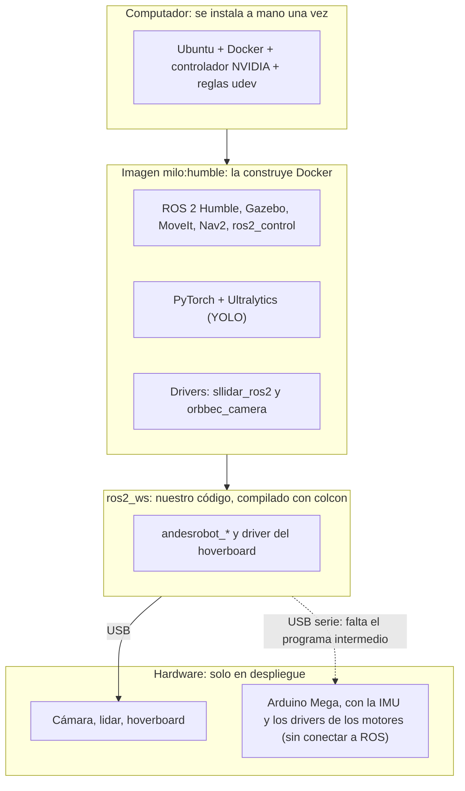
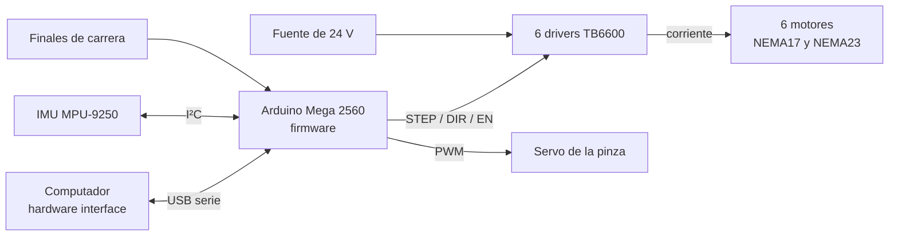

# Dependencias de Milo: software, drivers y hardware

Todo lo que tiene que estar instalado o conectado para que Milo funcione, separado por etapa:
**desarrollo** (programar y simular en un PC) y **despliegue** (correr en el robot real). Las
versiones se leyeron el 1 de noviembre de 2026 de la imagen `milo:humble` y del PC de desarrollo.

> **En palabras simples:** casi todo el software viene dentro de una "caja" llamada imagen de
> Docker, así que no se instala a mano. Fuera de la caja solo quedan cuatro cosas: Docker, el
> controlador de la tarjeta gráfica, los permisos USB y el hardware. El simulador se puede usar
> hoy. En el robot real ya funcionan la base y la cámara, pero **el brazo todavía no se mueve**:
> falta el programa que conecta ROS con los motores.

**Cómo leer el estado:** ✅ en uso y probado · 🔶 existe, pero sin probar del todo · ❌ falta.

Documentos relacionados: [repaso de tecnologías](../tecnologias/README.md) (qué opciones hay y por
qué), [hardware](../hardware/README.md) (fichas técnicas) y
[`BRAZO.md`](../../ros2_ws/src/andesrobot_arm/docs/BRAZO.md) (cómo usar el brazo y la cámara).

## Contenido

1. [Qué necesita cada etapa](#1-qué-necesita-cada-etapa)
2. [El computador, fuera de Docker](#2-el-computador-fuera-de-docker)
3. [La imagen de Docker](#3-la-imagen-de-docker)
4. [Drivers externos](#4-drivers-externos)
5. [Paquetes de Milo y de qué dependen](#5-paquetes-de-milo-y-de-qué-dependen)
6. [Hardware](#6-hardware)
7. [Lo que falta para mover el brazo real](#7-lo-que-falta-para-mover-el-brazo-real)
8. [Etapa de desarrollo: pasos](#8-etapa-de-desarrollo-pasos)
9. [Etapa de despliegue: pasos](#9-etapa-de-despliegue-pasos)
10. [Riesgos: lo que se puede romper](#10-riesgos-lo-que-se-puede-romper)
11. [Glosario](#11-glosario)

---

## 1. Qué necesita cada etapa



| Qué | Desarrollo (`./sim.sh`) | Despliegue (`./robot.sh`) |
|---|---|---|
| Docker y la imagen `milo:humble` | sí | sí |
| Tarjeta NVIDIA | opcional: sin ella Gazebo dibuja más lento (`./sim.sh cpu`) | opcional: solo para YOLO con GPU |
| Pantalla (X11) | sí, para Gazebo y RViz | no: sin pantalla, RViz no se abre |
| Internet | para construir la imagen y para bajar pesos de YOLO | no al correr, si la imagen y los pesos ya están |
| Reglas udev | solo si se conecta la cámara | sí |
| Acceso a USB (`compose.robot.yaml`) | no | sí |
| Hardware | ninguno | cámara, lidar, hoverboard y, a futuro, el brazo |
| Pruebas (`pytest`, prueba de Gazebo) | sí | no aplica |

La cámara es un caso intermedio: `./robot.sh camara` la usa en cualquier PC con la regla udev, sin
lidar ni ruedas. Así se puede probar en el escritorio.

---

## 2. El computador, fuera de Docker

Se instala una vez por computador. Los comandos están en el
[`README` principal](../../README.md#1--instalar-una-vez-por-computador).

| Componente | Para qué | Versión en el PC de desarrollo | Etapa |
|---|---|---|---|
| Ubuntu | sistema operativo; el contenedor es igual aunque cambie | 22.04.5, kernel 6.8 | ambas |
| Docker y Compose | construir y correr el contenedor | Docker 29.9.2, Compose 5.6.1 | ambas |
| `docker-buildx` | lo usa Compose para construir la imagen | se instala con el `README` | ambas |
| Git | bajar el repositorio | | ambas |
| `x11-xserver-utils` (`xhost`) | dejar que el contenedor abra ventanas | 7.7 | con pantalla |
| Controlador NVIDIA | usar la GPU | 580.178.04, RTX 3070 Laptop de 8 GB | opcional |
| `nvidia-container-toolkit` | pasar la GPU al contenedor | 1.20.1 | opcional |
| `usbutils` (`lsusb`) y `udev` | `./robot.sh camara` y `./robot.sh puertos` los usan | del sistema | despliegue |
| Arduino IDE o PlatformIO | grabar el firmware en el Arduino; no hace falta para correr el robot | sin instalar: el firmware aún no existe | a futuro, con el brazo real |

No hace falta instalar ROS en el computador: todo corre en el contenedor. **Nunca hay que compilar
con el ROS del computador dentro de `ros2_ws`**, porque rompe la compilación que usa el contenedor
(ver `CLAUDE.md`).

### Reglas udev

Son archivos del computador, no del contenedor, y requieren `sudo`.
[Instrucciones](../../docker/udev/README.md).

| Archivo | Dispositivos | Para qué | Estado |
|---|---|---|---|
| `docker/udev/99-gemini.rules` | `2bc5:0511` y `2bc5:0614` | permiso para abrir la cámara sin ser root | ✅ instalada en el PC de desarrollo; falta en cada PC nuevo |
| `docker/udev/99-milo.rules` | `10c4:ea60` (lidar) y el adaptador del hoverboard | nombres fijos `/dev/rplidar` y `/dev/hoverboard` | 🔶 hay que completar los `CAMBIAR_...` con `./robot.sh puertos` |
| Regla para el Arduino | Arduino Mega | nombre fijo, por ejemplo `/dev/arduino`, para no confundirlo con los otros puertos serie | ❌ por agregar a `99-milo.rules` cuando se conecte; `./robot.sh puertos` entrega sus datos |

### Disco y datos fuera de git

| Qué | Tamaño | Cómo se obtiene |
|---|---|---|
| Imagen `milo:humble` | 16.9 GB | `./sim.sh` la construye si falta; después, solo con `./sim.sh imagen` |
| `ros2_ws/modelos/` (pesos de YOLO) | 767 MB | ver abajo |
| `ros2_ws/modelos/entrenamientos/manija_pose/weights/best.pt` | 23 MB | **solo existe en este PC**: si se pierde hay que volver a entrenar |
| `ros2_ws/datasets/` | 96 MB | `scripts/generar_dataset_manija.py` |
| `docs/hardware/` (manuales y CAD) | | volver a bajarlos desde las fuentes de su [`README`](../hardware/README.md) |

Los pesos preentrenados se descargan solos la primera vez, si hay internet.

---

## 3. La imagen de Docker

La receta es [`docker/Dockerfile`](../../docker/Dockerfile). Parte de `osrf/ros:humble-desktop`
(Ubuntu 22.04, solo para PC amd64), fijada por su digest a la versión del 10 de septiembre de 2026.
Cada grupo de abajo es una capa aparte, para no rehacer todo al cambiar una parte.

### ROS 2 y simulación (apt)

| Para qué | Paquete | Versión | Desarrollo | Despliegue |
|---|---|---|---|---|
| Base | ROS 2 Humble (`desktop`), DDS `rmw_fastrtps_cpp` | 0.10.0, 6.2.10 | sí | sí |
| Simulador | Gazebo Classic | 11.10.2 | sí | no |
| Puente con el simulador | `gazebo_ros_pkgs`, `gazebo_ros2_control` | 3.9.0, 0.4.10 | sí | no |
| Modelo del robot | `xacro`, `robot_state_publisher`, `joint_state_publisher(_gui)` | xacro 2.1.1 | sí | sí |
| Control | `ros2_control`, `ros2_controllers` | 2.54.2, 2.54.0 | sí | sí |
| Planificación del brazo | `moveit`, `moveit_ros_perception` (OctoMap), `moveit_configs_utils` | 2.5.10 | sí | sí |
| Asistente de MoveIt | `moveit_setup_assistant` (regenera el SRDF) | 2.5.10 | sí | no |
| Mapeo | `slam_toolbox`, `laser_filters`, `nav2_map_server` | 2.6.10, 2.0.9 | sí | sí |
| Navegación | `navigation2`, `nav2_bringup`, `nav2_simple_commander`, `twist_mux` | 1.1.20, twist_mux 4.3.0 | sí | sí |
| Manejo | `teleop_twist_keyboard` | | sí | sí |
| Visualización | `rviz2`, `mesa-utils` (`glxinfo`) | | sí | con pantalla |
| Compilación | `colcon`, `vcstool`, `git`, `libboost-system-dev` | | sí | sí |
| Dependencia del driver de la cámara | `image_publisher` | 3.0.9 | si se usa la cámara | sí |

### Visión (pip)

Todas las versiones están fijadas en
[`docker/requisitos_vision.txt`](../../docker/requisitos_vision.txt), incluidas las dependencias que
no aparecen aquí.

| Paquete | Versión | Notas |
|---|---|---|
| `torch` / `torchvision` | 2.14.1+cu130 / 0.29.2+cu132 | con CUDA 13; comprobado: ve la RTX 3070 dentro del contenedor. Compiladas para CUDA distintos ([revisión](#revisión-de-versiones-2-de-noviembre-de-2026)) |
| `ultralytics` | 8.4.194 | YOLOv8, YOLO11 y YOLOE; no instala paquetes por su cuenta (`YOLO_AUTOINSTALL=false`) |
| `clip` | 1.0 | el de Ultralytics, desde git, commit `7ffa84b` fijado en el Dockerfile; lo necesita YOLOE |
| `numpy` | 1.26.4 | **tiene que ser `<2`**: ROS Humble está compilado con numpy 1.x |
| `opencv-python` | 4.11.0.86 | lo trae Ultralytics; `cv_bridge` funciona con él (comprobado) |
| `sympy` | 1.14.0 | lo trae Ultralytics; reemplaza al de apt |
| `setuptools` | 59.6.0 (apt) | **tiene que ser el de apt**: colcon falla con `setuptools >= 80` |

`matplotlib` 3.5.1, `Pillow` 9.0.1 y `scipy` 1.8.0 vienen de apt. El orden de instalación importa, y
está explicado en el comentario del Dockerfile. Conviene no moverlo.

---

## 4. Drivers externos

Se descargan al construir la imagen, con versión exacta, en `/opt/milo_drivers`.

| Driver | Hardware | Versión | Dónde se fija | Estado |
|---|---|---|---|---|
| `sllidar_ros2` | RPLIDAR C1 | commit `3430009` | [`docker/milo.repos`](../../docker/milo.repos) | ✅ |
| `orbbec_camera` (`OrbbecSDK_ROS2`) | Gemini Plus | tag `v1.2.9`, commit `c5ccfad`, SDK 1.6.3 | [`docker/camara.repos`](../../docker/camara.repos) + [parche](../../docker/parches/README.md) | ✅ a 30 Hz |
| `hoverboard_hardware_interface` | ruedas | código propio | `ros2_ws/src/drivers/` | ✅ en el robot |
| Driver del brazo | motores del brazo | **no existe** | [sección 7](#7-lo-que-falta-para-mover-el-brazo-real) | ❌ |

**Cuidado con la versión de la cámara.** Las ramas nuevas del repositorio de Orbbec pueden no
soportar la Gemini Plus. Antes de cambiarla, hay que revisar que traiga `launch/gemini.launch.xml`,
que el parche todavía aplique, y probar con la cámara conectada.

### Lo que se hizo para poder usar la cámara

La cámara real no funcionó con solo conectarla. Estos son los problemas y su solución; todo queda
automático al construir la imagen, salvo la regla udev, que se instala a mano en cada computador.

| Problema | Qué se hizo | Dónde queda | Cuándo se aplica |
|---|---|---|---|
| Las ramas nuevas del driver pueden no soportar la Gemini Plus, y la versión del ZIP de Hiwonder (1.2.5) no existe en GitHub | se fijó y se probó la `v1.2.9`, la más cercana | [`docker/camara.repos`](../../docker/camara.repos) | al construir la imagen |
| El driver necesita `image_publisher`, que la imagen no traía | se instala con apt | [`docker/Dockerfile`](../../docker/Dockerfile) | al construir la imagen |
| Cambiar el driver no debe reinstalar PyTorch, que pesa varios GB y no tiene versión fija | el driver se compila en una capa propia, después de YOLO | [`docker/Dockerfile`](../../docker/Dockerfile) | al construir la imagen |
| El driver falla con esta cámara: ajuste no soportado (`id=2025`), `camera_info` sin frame ni hora y frames incorrectos en el modo alineado | se le aplica un parche antes de compilarlo | [`docker/parches/`](../../docker/parches/README.md) | al construir la imagen |
| El contenedor corre con tu usuario y el driver no puede abrir la cámara (`OB_USB_STATUS_ACCESS`), aunque el contenedor sea privilegiado | regla de permiso USB en el computador | [`docker/udev/99-gemini.rules`](../../docker/udev/README.md) | **a mano, una vez por computador** |
| Los topics y frames deben llamarse igual que en la simulación, y los frames no deben tener dos publicadores | launch con `camera_name:=gripper_camera` y `publish_tf:=false`; `orbbec_camera` queda como dependencia de `andesrobot_arm` | [`camara_real.launch.py`](../../ros2_ws/src/andesrobot_arm/launch/camara_real.launch.py) | al lanzar |
| Sin cable o sin permiso, el error del driver se entiende poco | `./robot.sh camara` revisa ambas cosas antes de levantar el contenedor | [`robot.sh`](../../robot.sh) | al lanzar |
| Un `rviz2` aparte en modo *Reliable* bajó las imágenes de 30 a menos de 2 Hz | configuración de RViz en *Best Effort*, que se abre con `rviz:=true` | [`camara_real.rviz`](../../ros2_ws/src/andesrobot_arm/rviz/camara_real.rviz) | al lanzar |

**Sigue sin resolver:**

- Falta medir la calidad de la profundidad a 0.2–1 m: solo se probó a unos 2 m, contra una superficie
  oscura.
- Falta la calibración respecto a la pinza.
- Con `alineada:=true`, `ir/camera_info` trae datos que no corresponden a la imagen IR. En ese modo
  no hay que usarlos.
- No se sabe por qué RViz con *Reliable* frenó las imágenes. En la prueba cambiaron dos cosas a la
  vez: *Best Effort* y correr RViz dentro del contenedor.

---

## 5. Paquetes de Milo y de qué dependen

Salen de cada `package.xml`, sin contar la biblioteca estándar de ROS (`rclpy`, `launch`, mensajes).

| Paquete | Depende de | Desarrollo | Despliegue |
|---|---|---|---|
| `andesrobot_description` | `xacro`, `robot_state_publisher`, `joint_state_publisher(_gui)`, `rviz2` | sí | sí |
| `andesrobot_arm` | `andesrobot_description`, `andesrobot_gazebo`, `andesrobot_moveit_config`, MoveIt, `ros2_control`, `gazebo_ros2_control`, `orbbec_camera`, `interactive_markers`, numpy, PIL, matplotlib | sí | hoy solo la cámara |
| `andesrobot_moveit_config` | `moveit_ros_move_group`, OMPL, KDL, `moveit_ros_perception`, `moveit_simple_controller_manager`, `moveit_ros_visualization` | sí | a futuro, con el brazo real |
| `andesrobot_gazebo` | `gazebo_ros`, `gazebo_plugins` | sí | no |
| `andesrobot_bringup` | `andesrobot_description`, `andesrobot_gazebo`, `andesrobot_navigation`, `andesrobot_safety`, `andesrobot_slam`, `sllidar_ros2`, `hoverboard_hardware_interface`, `diff_drive_controller`, `teleop_twist_keyboard` | sí | sí |
| `andesrobot_safety` | numpy, `tf2_ros` | sí | sí |
| `andesrobot_slam` | `slam_toolbox`, `laser_filters`, `nav2_map_server` | sí | sí |
| `andesrobot_navigation` | Nav2, `twist_mux`, `python3-yaml` | sí | 🔶 sin probar en el robot |
| `hoverboard_hardware_interface` | `hardware_interface`, `pluginlib`, `libboost-system-dev` | se compila | sí |

**YOLO no aparece en ningún `package.xml`:** los scripts `generar_dataset_manija.py` y
`entrenar_manija.py` lo usan, pero aún no hay un nodo de detección.

---

## 6. Hardware

### Conectado a ROS hoy

| Pieza | Conexión | Software que necesita | Permiso | Estado |
|---|---|---|---|---|
| **Orbbec Gemini Plus** (pinza) | USB: color `2bc5:0511`, profundidad e IR `2bc5:0614`. Se conectó por USB 2.0 | `orbbec_camera` con parche | `99-gemini.rules` | ✅ color, profundidad, IR y nube a 30 Hz. 🔶 falta medir la calidad a 0.2–1 m y calibrar respecto a la pinza |
| **RPLIDAR C1** (base) | USB serie, adaptador `10c4:ea60`, 460800 baudios | `sllidar_ros2` | `99-milo.rules` o `LIDAR=...` | ✅ |
| **Hoverboard** (ruedas) | USB serie, 115200 baudios | firmware [`hoverboard-firmware-hack-FOC`](https://github.com/hoverboard-robotics/hoverboard-firmware-hack-FOC) (`VARIANT_USART`) grabado en la placa + `hoverboard_hardware_interface` | `99-milo.rules` o `HOVER=...` | ✅ |

### Del brazo, todavía sin conectar a ROS

Las fichas y motores de cada articulación están en el [índice de hardware](../hardware/README.md).
El Arduino es el centro de esta parte: el computador le habla por USB, y él maneja los drivers de los
motores y lee la IMU.



| Pieza | Función | Se conecta a | Software que necesita | Estado |
|---|---|---|---|---|
| Arduino Mega 2560 | generar los pulsos y leer los sensores | computador, por USB serie | firmware por escribir | ❌ sin montar |
| 6 drivers TB6600 | dar corriente a los motores | Arduino (STEP/DIR/EN) y fuente de 24 V | ninguno; se configuran con interruptores | ❌ sin conectar |
| Brazo EB300 (6 motores paso a paso NEMA17 y NEMA23) | moverse | un driver TB6600 por motor | driver del brazo (sección 7) | ❌ sin conectar |
| IMU MPU-9250 (pinza) | verificar la orientación | Arduino, por I²C (pines 20 y 21 del Mega) | firmware, `imu_sensor_broadcaster`, `imu_filter_madgwick` | ❌ por montar; ver [riesgos](#10-riesgos-lo-que-se-puede-romper) |
| Fuente de 24 V y 15 A, con fusible por driver | alimentar los motores | drivers TB6600 | ninguno | 🔶 es la que pide el EB300; confirmar si ya está montada |
| Parada de emergencia | cortar la potencia de los motores | entre la fuente y los drivers | ninguno, debe funcionar sin software | ❌ **obligatoria antes de energizar** |
| Finales de carrera | hallar la posición de cada eje al encender | Arduino | firmware (homing) | ❌ sin ellos el robot no sabe dónde está |
| Pinza EBG-20 (servo MG99x) | abrir y cerrar | Arduino, por PWM | firmware | ❌ sin conectar |
| Lift vertical | subir y bajar el brazo | **sin definir** | **sin definir** | ❌ el repo no documenta su actuador real |

Las conexiones de los finales de carrera y del servo son las previstas en el
[repaso de tecnologías](../tecnologias/README.md); falta el plano eléctrico que las confirme.

Los **límites de articulaciones del URDF son provisionales** (±π, 20 N·m, 1 rad/s). No sirven para
hardware real: hay que medirlos antes de mover el brazo.

---

## 7. Lo que falta para mover el brazo real

| Pieza que falta | Qué es | Dependencia nueva | Instalación |
|---|---|---|---|
| Hardware interface del brazo | plugin en C++ que traduce los comandos de `ros2_control` al puerto serie y entrega las lecturas de la IMU | ninguna: `hardware_interface`, `pluginlib` y Boost ya están | en `ros2_ws/src/drivers/`, igual que el del hoverboard |
| Firmware del Arduino | recibe posiciones por serie, genera pulsos y homing, y lee la IMU para enviarla por el mismo cable | `AccelStepper`, `Wire` (viene con Arduino) y una biblioteca para el MPU-9250, por elegir | Arduino IDE o PlatformIO, **fuera** de la imagen |
| Publicar la IMU en ROS | saca sus lecturas del hardware interface a un topic | `imu_sensor_broadcaster` 2.54.0 (ya está) | se configura en el archivo de controladores |
| Filtro de la IMU | calcula la orientación | `imu_filter_madgwick` | apt, una capa nueva del Dockerfile |
| Calibración mano-ojo | mide dónde está la cámara respecto a la pinza | `easy_handeye2` | código externo, otro archivo `.repos` |
| Pruebas con registro | grabar y graficar pruebas | `rosbag2` (ya está), `plotjuggler_ros` | apt |

Comprobado en la imagen: `imu_filter_madgwick`, `easy_handeye2`, `plotjuggler_ros`,
`trac_ik_kinematics_plugin` y `depth_image_proc` **no están instalados**. Los dos últimos son
opcionales: el primero mejora la cinemática inversa, y el segundo no hace falta porque el driver ya
entrega la nube. Las razones de cada elección están en el
[repaso de tecnologías](../tecnologias/README.md#5-electrónica-microcontrolador-drivers-y-sensores).

**La IMU y los motores comparten un solo cable USB.** Solo un programa puede abrir el puerto serie
del Arduino, así que el hardware interface tiene que encargarse de los dos: no sirve un nodo aparte
para leer la IMU. El contenedor ya tiene lo necesario para abrir ese puerto (grupo `dialout` y `/dev`
visible con `compose.robot.yaml`).

---

## 8. Etapa de desarrollo: pasos

1. Instalar Docker, y NVIDIA si corresponde
   ([`README`](../../README.md#1--instalar-una-vez-por-computador)).
2. Bajar el repositorio. **Ojo:** el `README` apunta a `alejapinzonf/Navegation_ws`; la rama del
   brazo está en `Ivan1721/milo_ws`.

   ```bash
   git clone -b brazo https://github.com/Ivan1721/milo_ws.git ~/milo_ws
   ```

3. Levantar la simulación del brazo. La primera vez construye la imagen y compila:

   ```bash
   ./sim.sh brazo
   ```

4. Comprobar que funciona, en otra terminal:

   ```bash
   ./sim.sh gpu
   ```

   ```bash
   ./sim.sh shell
   ```

   Y ya dentro del contenedor:

   ```bash
   cd /ros2_ws/src/andesrobot_arm && python3 -m pytest -q test
   ```

   ```bash
   python3 -c "import torch; print(torch.cuda.is_available())"
   ```

   | Comprobación | Resultado esperado |
   |---|---|
   | `./sim.sh gpu` | el nombre de tu tarjeta; `llvmpipe` significa que dibuja con la CPU |
   | `pytest` | 11 tests pasan |
   | `torch.cuda` | `True`, si hay NVIDIA |

5. Para la prueba completa en Gazebo (unos 2 minutos, sin otra simulación abierta), dentro del
   contenedor:

   ```bash
   bash /ros2_ws/src/andesrobot_arm/scripts/prueba_gazebo.sh
   ```

**Al programar:** los cambios en archivos existentes `.py`, `.xacro` y `.yaml` se aplican al volver a
lanzar. Los archivos nuevos requieren `./sim.sh build`. Un cambio en el Dockerfile, en un `.repos` o en
`requisitos_vision.txt` requiere reconstruir la imagen con `./sim.sh imagen`; al arrancar, `./sim.sh`
solo avisa que hay cambios.

---

## 9. Etapa de despliegue: pasos

**Hoy solo se despliegan la base y la cámara.** Esta lista vale para ellas; el brazo real se agrega
cuando exista lo de la [sección 7](#7-lo-que-falta-para-mover-el-brazo-real).

### Preparar el computador de Milo (con internet)

1. Instalar Docker y bajar el repositorio, como en desarrollo.
2. Instalar las reglas udev ([instrucciones](../../docker/udev/README.md)):
   - `./robot.sh puertos` entrega los datos para completar `99-milo.rules`.
   - `99-gemini.rules` no hay que completarla.
3. Construir la imagen: con la cámara conectada, `./robot.sh camara` la construye sola si falta.
4. Copiar lo que no está en git, si se va a usar: `ros2_ws/modelos/` con `best.pt`.

### Comprobar en el robot

```bash
./robot.sh puertos
```

```bash
./robot.sh camara rviz:=true
```

| Comprobación | Resultado esperado |
|---|---|
| `./robot.sh puertos` | aparecen `/dev/rplidar` y `/dev/hoverboard` |
| `./robot.sh camara` | no dice "Sin permiso"; los tres canales se ven en RViz |
| `./robot.sh` | ruedas, lidar, filtro de seguridad y SLAM arriba |

### Diferencias con desarrollo

| Tema | Desarrollo | Despliegue |
|---|---|---|
| Archivos de Compose | `compose.yaml` | se suma `compose.robot.yaml`: privilegiado y con todo `/dev` |
| Odometría y lidar | plugins de Gazebo | `diff_drive_controller` y `sllidar_ros2`, con los mismos topics |
| Cámara | plugin de Gazebo a 15 Hz, profundidad `32FC1` en metros, IR `mono8`, nube con color | driver real a 30 Hz, profundidad `16UC1` en mm, IR `mono16`, nube sin color |
| Otro PC mirando | no aplica | `./robot.sh rviz` en la misma red y con el mismo `ROS_DOMAIN_ID` |

**RViz con la cámara real:** hay que usar `rviz:=true` o poner cada panel en *Best Effort*. Un `rviz2`
abierto aparte en modo *Reliable* bajó las imágenes de 30 a menos de 2 Hz.

### Desplegar sin internet

Con la imagen ya construida, arrancar no reconstruye nada: `milo_up` usa `docker compose up -d`, sin
`--build`. Se comprobó que arranca sin reconstruir, pero **no se ha probado con el computador
desconectado de verdad**; conviene hacerlo antes de una competencia.

**Lo más seguro es dejar la imagen construida en el computador de Milo y no borrarla.** También se
puede llevar con `docker save` y `docker load`, pero no se ha probado. La imagen guarda el UID del
usuario que la construyó, así que el usuario del otro computador debería tener el mismo.

---

## 10. Riesgos: lo que se puede romper

| Riesgo | Qué puede pasar | Cómo protegerse |
|---|---|---|
| **Sin versión fija:** los paquetes apt, incluidos los de ROS | construir la imagen en otro PC o rehacer esas capas puede traer otras versiones | no borrar la imagen que funciona; comparar con la sección 3 y repetir las pruebas tras construirla |
| `numpy >= 2` o `setuptools >= 80` | se rompen ROS y colcon | no instalar nada con `pip` a mano en el contenedor; mantener el orden del Dockerfile |
| Controlador NVIDIA antiguo | PyTorch con CUDA 13 puede no ver la GPU, y YOLO corre con CPU | comprobar `torch.cuda.is_available()` en cada PC. Funciona con el 580.178.04; no se han probado otros |
| Gazebo Classic sin soporte desde enero de 2025 | no recibe arreglos | funciona; migrar a Harmonic solo cuando haga falta |
| Computador que no sea amd64, como una Jetson | la imagen actual no corre | hay que partir de `ros:humble-ros-base` |
| USB 2.0 con la cámara | 1280×800 baja a 7 fps según la ficha | usar 640×400; el puerto y el cable importan en el robot |
| Voltaje de la IMU: el Mega trabaja a 5 V y el MPU-9250 a 3.3 V | se puede dañar la IMU | usar un adaptador de nivel en SDA y SCL, salvo que el módulo ya lo traiga; revisar el módulo antes de conectarlo |
| Cable I²C largo, de la pinza al Arduino | I²C está pensado para distancias cortas: los motores pueden meter ruido y bloquear las lecturas | cable lejos de los de motor, velocidad baja y tiempo límite en `Wire` (`setWireTimeout`); probarlo con los motores en marcha |
| Leer la IMU mientras se generan pulsos | el Mega hace todo por software, y cada lectura puede retrasar los pulsos y hacer perder pasos | leer la IMU a baja frecuencia y medir el efecto; si no alcanza, cambiar de placa ([opciones](../tecnologias/README.md#5-electrónica-microcontrolador-drivers-y-sensores)) |
| Fin de la sesión con solo `Ctrl+C` | el driver puede quedar con la cámara tomada (`uvc_open failed`), o Gazebo con su puerto | `./robot.sh stop` o `./sim.sh stop` |
| `best.pt` solo en un PC | se pierde el detector entrenado | respaldarlo fuera de git |
| Límites provisionales del URDF | el brazo real podría chocar o romperse | medirlos antes de energizar |

### Revisión de versiones (2 de noviembre de 2026)

> **En palabras simples:** antes, arrancar podía reconstruir la imagen y traer otras versiones sin
> que nadie lo decidiera. Eso ya se corrigió: reconstruir ahora es una orden aparte, y la imagen base
> y los paquetes de visión tienen versión fija. La imagen nueva quedó idéntica a la que ya funcionaba.

**Lo que se corrigió:**

| Problema | Cómo quedó | Dónde |
|---|---|---|
| Cada arranque podía reconstruir la imagen (`up --build`) | arrancar usa `up -d` y solo avisa si cambió la receta; se reconstruye con `./sim.sh imagen` o `./robot.sh imagen` | [`docker/lib.sh`](../../docker/lib.sh) |
| La imagen base podía cambiar sin aviso | fijada por digest | [`docker/Dockerfile`](../../docker/Dockerfile) |
| Rehacer la capa de visión podía cambiar `torch` y `ultralytics`; ya se rehízo el 30 de octubre al editar solo comentarios de `docker/milo.repos` | todas las versiones de pip fijadas, y CLIP por commit | [`docker/requisitos_vision.txt`](../../docker/requisitos_vision.txt) |
| Ultralytics podía instalar paquetes por su cuenta durante una prueba | `YOLO_AUTOINSTALL=false`; lo que falte (`lap`, `onnx`, `pandas`...) se agrega en el Dockerfile | [`docker/compose.yaml`](../../docker/compose.yaml) |

**Lo que sigue abierto:**

| Hallazgo | Evidencia | Qué puede pasar | Qué hacer |
|---|---|---|---|
| Los paquetes apt, incluidos los de ROS, no tienen versión fija | el `apt-get update` del Dockerfile baja lo último del día | construir en otro PC puede dar otras versiones | conservar la imagen; tras construir en otro PC, repetir las pruebas |
| `torch` y `torchvision` compiladas para CUDA distintos (13.0 y 13.2) | así se instalan desde PyPI | funciona en lo probado; podría fallar con funciones no probadas | quedan fijas en esta combinación; volver a probar si se suben |
| `scipy` 1.8.0 pide `numpy < 1.25` y hay 1.26.4 | aviso al importar; con `-W error` es fallo | hoy es solo un aviso y las funciones probadas responden bien; ningún paquete de Milo la usa, solo `tools/gen_casa_robocup.py` | volver a probar si se usa en el brazo |
| `torch` pide `setuptools >= 77` y hay 59.6.0 | `pip check` lo marca | no afectó lo probado | dejarlo así: colcon falla con `setuptools >= 80` |
| Hay dos copias de `numpy`, `sympy`, `mpmath` y `pip` (apt y pip) | gana siempre la de `/usr/local` | un `pip uninstall` deja activa la versión vieja de apt, `numpy` 1.21.5, sin avisar | no desinstalar con `pip` a mano |
| Fin de soporte: ROS Humble en mayo de 2027, Python 3.10 en octubre de 2026 | calendario de cada proyecto | no llegan arreglos, y los paquetes podrían dejar de estar disponibles más adelante | conservar la imagen y planear la migración |
| `ros2_ws/install/` no se recompila si cambia la imagen | `milo_up` solo compila si falta un paquete | tras un cambio de versiones de ROS, el plugin del hoverboard puede quedar desfasado | ejecutar `./sim.sh build` después de cada reconstrucción |

**Lo que se probó con la imagen nueva:**

| Prueba | Resultado |
|---|---|
| Comparar con la imagen anterior: paquetes pip, paquetes apt y drivers | sin ninguna diferencia |
| Prueba completa en Gazebo (`prueba_gazebo.sh`): control, MoveIt, OctoMap, cámara simulada y pinza | todo OK |
| `pytest` de `andesrobot_arm` | 11 pasan |
| `best.pt` en GPU **sin internet**, y `torchvision` en GPU (`nms`, `roi_align`) | carga y responde, sobre una imagen negra |
| Evaluar `best.pt` con el conjunto de validación simulado | mAP50 de 0.995 en caja y en pose, igual al del entrenamiento guardado |
| Entrenar una época con `YOLO_AUTOINSTALL=false` | funciona, no le faltó ningún paquete |
| `rclpy`, `cv_bridge`, `opencv-python` y YOLO en un mismo proceso | sin conflicto, en los dos órdenes de importación |
| `cv_bridge` con `numpy` 1.26.4 (`bgr8` y `16UC1`, el formato de la cámara real) | sin errores |
| `./sim.sh imagen` sin cambios | sale todo de la caché, en 1 segundo |
| Bibliotecas de los drivers y de `ros2_ws` (`ldd -r`), y `ros2 doctor` | ninguna falta y 5 de 5, medido en la imagen anterior, que tiene los mismos paquetes |

**Sin comprobar:** arrancar con el computador desconectado de internet, construir la imagen desde cero
en otro PC, otros controladores NVIDIA, el computador del robot y la cámara real con la imagen nueva.
La prueba de Gazebo necesita pantalla: en un contenedor sin `DISPLAY`, la cámara simulada no publicó y
por eso el OctoMap quedó vacío.

---

## 11. Glosario

| Término | Qué significa |
|---|---|
| **apt / pip** | instaladores de programas: apt es el de Ubuntu; pip, el de Python |
| **Biblioteca / dependencia** | código ajeno que un programa necesita para funcionar |
| **Commit / tag** | versión exacta de un repositorio; fijarla hace que todos compilen lo mismo |
| **colcon** | herramienta que compila los paquetes de ROS |
| **Contenedor / imagen** | la imagen es la "caja" con todo instalado; el contenedor es esa caja en marcha |
| **CUDA** | la forma en que los programas usan la tarjeta NVIDIA para calcular |
| **DDS** | la capa que lleva los mensajes entre programas de ROS |
| **Despliegue** | poner el software a correr en el robot real |
| **Driver** | programa que permite hablar con una pieza de hardware |
| **Firmware** | programa grabado dentro de una placa, como el Arduino |
| **Hardware interface** | plugin que conecta `ros2_control` con los motores reales |
| **Homing** | al encender, llevar cada eje a un tope conocido para saber dónde está |
| **I²C** | conexión de dos cables (SDA y SCL) para sensores cercanos a la placa |
| **IMU** | sensor que mide giros y aceleraciones; de ahí se calcula la orientación |
| **Parche** | cambio pequeño que se aplica al código de otro antes de compilarlo |
| **STEP / DIR / EN** | señales hacia un driver de motor: dar un paso, sentido de giro y habilitar |
| **Pesos (de YOLO)** | archivo con lo que aprendió la red neuronal |
| **Reglas udev** | archivos que le dicen a Linux qué permisos y nombres dar a cada USB |
| **Reliable / Best Effort** | modos de entrega de mensajes: reintentar hasta entregar, o saltarse los que no alcanzan a llegar |
