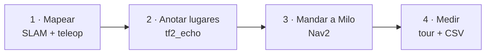
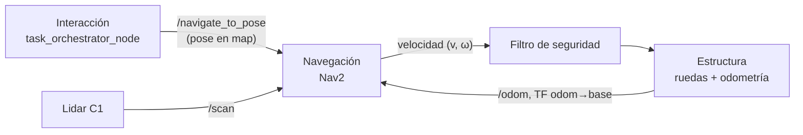
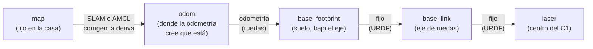
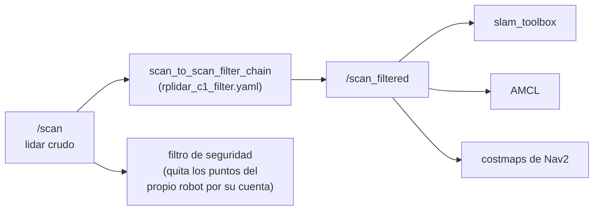
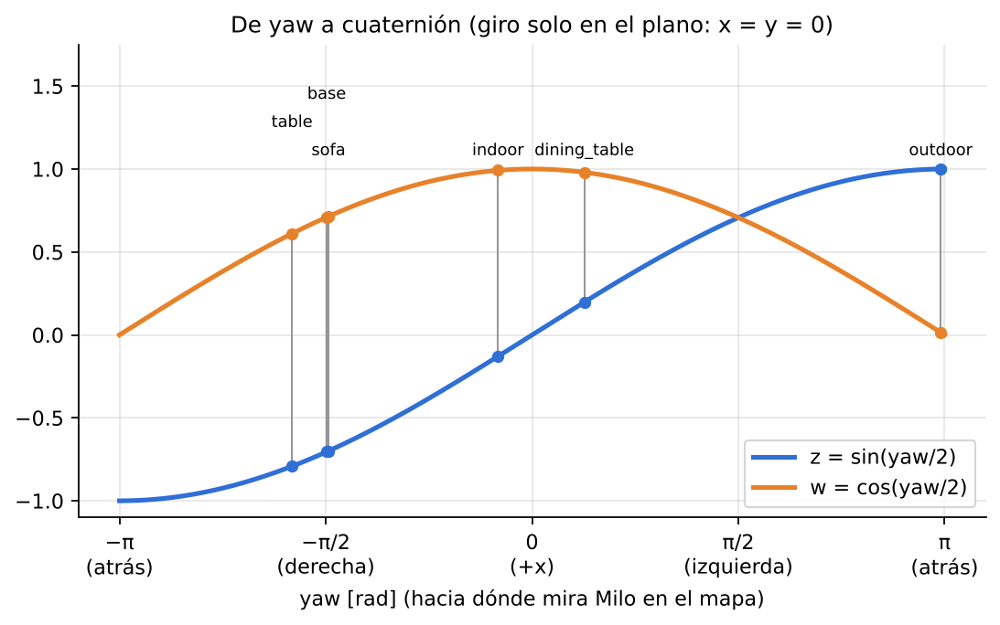
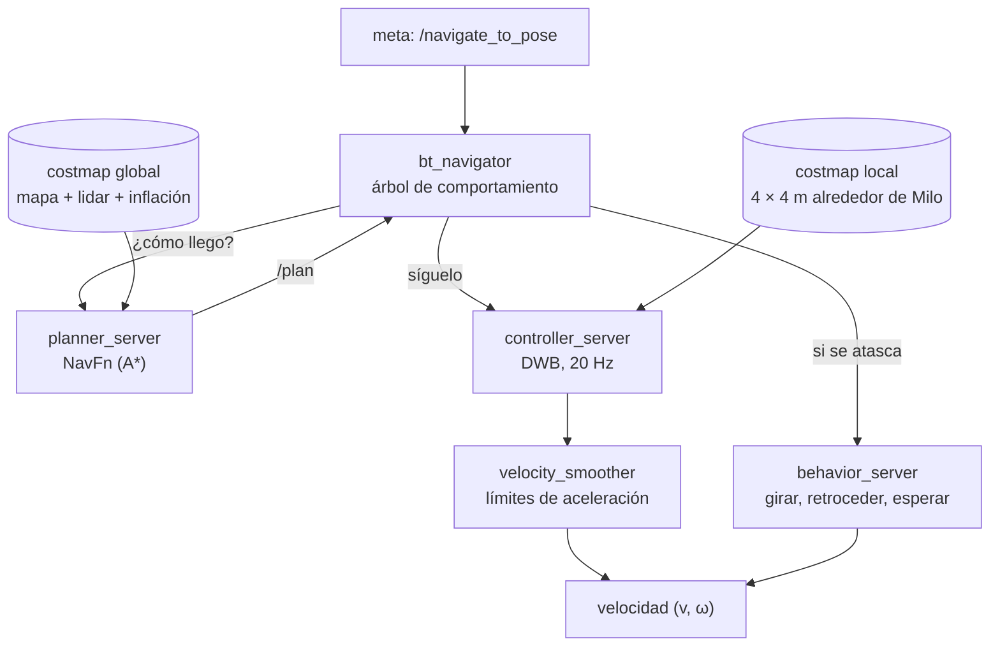
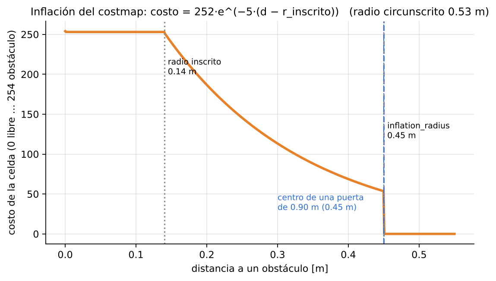
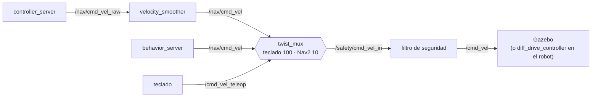

*milo_ws · ROS 2 Humble · Gazebo classic 11 · Nav2 · Docker*

# Milo: mapeo y navegación autónoma

Informe técnico del equipo de **Navegación** de AndesRobot. Explica cómo Milo arma un mapa de la
casa, cómo sabe dónde está, cómo se le enseñan lugares con nombre y cómo llega solo a ellos sin
chocar. Todo se probó en la casa RoboCup@Home simulada en Gazebo; los valores salen del código y
de esas pruebas.

**Fecha:** 11 de octubre de 2026 · **Alcance:** `andesrobot_slam`, `andesrobot_navigation`,
`andesrobot_safety`, la casa de `andesrobot_gazebo` y los scripts · **Rama:** `casa-nav`
(base: `9307547`, con el brazo de Ivan)

| Dato | Qué es |
| ---: | --- |
| **12.6 × 12.6 m** | la casa del rulebook en Gazebo: 4 piezas, 18 muebles, puertas de 1.40 m |
| **5 cm** | tamaño de cada celda del mapa (271 × 249 celdas para la casa entera) |
| **6 lugares** | anotados a mano en el mapa y alcanzados con Nav2 |
| **0.506 m** | radio que barre Milo al girar en el lugar: lo que manda en las puertas |

## Contenido

**Para empezar**

- [Antes de empezar: qué es y cómo leerlo](#intro)
- [Glosario](#glosario)

**I · El problema**

1. [Qué tiene que hacer Navegación en el reto](#reto)
2. [El escenario: la casa en Gazebo](#casa)

**II · Saber dónde está**

3. [Frames y TF](#tf)
4. [El lidar y su filtro](#lidar)
5. [Mapeo (SLAM)](#slam)
6. [Localización con AMCL](#amcl)

**III · Llegar a un lugar**

7. [Lugares con nombre](#lugares)
8. [Nav2 por dentro](#nav2)
9. [La huella de Milo y las puertas](#huella)
10. [Filtro de seguridad](#seguridad)
11. [Quién manda la velocidad](#velocidades)

**IV · Estado**

12. [Resultados](#resultados)
13. [Problemas y soluciones](#problemas)
14. [Pendientes](#pendientes)
15. [Cómo usarlo](#uso)

<a id="intro"></a>

## Antes de empezar: qué es y cómo leerlo

> **En palabras simples:** en la prueba, a Milo lo dejan en la puerta de una casa que no conoce
> y tiene que llegar solo a distintos lugares ("anda al sofá", "lleva esto a la cocina"). Para
> eso necesita tres cosas: un **mapa** de la casa, saber **dónde está** dentro de ese mapa, y
> poder **planear y seguir un camino** sin chocar. Este informe explica cada una.

### Qué se está haciendo

El ejercicio completo tiene cuatro pasos, en este orden:



1. **Mapear:** se pasea a Milo con el teclado mientras el SLAM arma el mapa (sección 5).
2. **Anotar lugares:** se lleva a Milo frente a cada cosa y se guarda su pose (sección 7).
3. **Mandarlo:** se le da un lugar y Nav2 planea el camino y lo maneja (secciones 8 a 11).
4. **Medir:** se le hace recorrer todos los lugares y se registra cómo le fue (sección 12).

### Por qué así

- **Simular primero:** Milo físico todavía se está armando. En Gazebo se prueba todo sin
  riesgo, y como se usan los **mismos tópicos** que el robot real, lo probado se reutiliza.
- **Herramientas estándar:** slam_toolbox, AMCL y Nav2 son lo que usa casi todo ROS 2. No se
  reinventa nada; el trabajo está en configurarlos bien para Milo.
- **Lugares anotados a mano:** en la competencia la casa se conoce el día del setup. Anotarlos
  uno mismo es justo lo que hay que hacer allá.

### Cómo leer este informe

- Cada sección empieza con un recuadro **«En palabras simples»**. Si solo se lee eso, se
  entiende el proyecto.
- Cada fórmula viene seguida de **«Se lee así»**: qué significa cada símbolo, con números de
  Milo.
- Los términos técnicos están en el [glosario](#glosario).
- El texto en letra de código (por ejemplo `base_footprint`) son nombres exactos en el
  proyecto; sirven para buscarlos.

### Notación

| Se escribe | Significa | Ejemplo |
| --- | --- | --- |
| $`(x, y)`$ | posición en el plano, en metros | $`(-3.15,\ -4.03)`$: frente al sofá |
| $`\psi`$ o *yaw* | hacia dónde mira el robot, en radianes, medido desde $`+x`$ hacia $`+y`$ | $`\psi = -1.55`$ ≈ −89°: mirando "hacia abajo" del mapa |
| $`(x, y, \psi)`$ | una **pose** en 2D | dónde está y hacia dónde mira |
| $`v`$, $`\omega`$ | velocidad lineal (m/s) y de giro (rad/s) del robot | $`v = 0.35`$, $`\omega = 0.9`$ |
| $`d`$ | una distancia, en metros | distancia a un obstáculo |
| $`\pi`$ rad | 180° | $`\pi/2`$ = 90° |

<a id="glosario"></a>

## Glosario

Ordenado de lo general a lo específico. La última columna dice dónde aparece en Milo.

| Término | Qué significa | En Milo |
| --- | --- | --- |
| **Nodo, tópico, acción** | programa de ROS; canal donde se publican datos; tarea larga con progreso | `/navigate_to_pose` es una acción |
| **Frame** | un sistema de coordenadas (dónde está el cero y hacia dónde apuntan los ejes) | `map`, `odom`, `base_footprint`, `laser` |
| **TF** | el árbol que dice cómo pasar de un frame a otro | `map → odom → base_footprint → laser` |
| **Odometría** | cuánto se movió el robot según sus ruedas; acumula error con el tiempo | `/odom`, del diff drive |
| **Lidar** | sensor que mide distancias girando un láser | RPLIDAR C1, 12 m, a 0.33 m del suelo |
| **SLAM** | armar el mapa y ubicarse en él al mismo tiempo | slam_toolbox |
| **Scan matching** | alinear un barrido del lidar con los anteriores para corregir la odometría | dentro de slam_toolbox |
| **Cierre de lazo** | reconocer un lugar ya visitado y corregir todo el mapa | `do_loop_closing: true` |
| **Mapa de ocupación** | imagen donde cada celda está libre, ocupada o desconocida | `casa.pgm` + `casa.yaml` |
| **AMCL** | localización con un mapa ya hecho, usando partículas | `nav2_amcl` |
| **Partícula** | una "suposición" de dónde está el robot | entre 500 y 2000 |
| **Pose** | posición + orientación | $`(x, y, \psi)`$ |
| **Cuaternión** | otra forma de escribir una orientación (4 números) | lo que pide Nav2 |
| **Costmap** | mapa de "qué tan caro es pasar por aquí" | global y local |
| **Inflación** | agrandar los obstáculos en el costmap para no pasar rozando | radio 0.45 m |
| **Planificador global** | busca un camino completo en el mapa | NavFn (A*) |
| **Controlador local** | sigue el camino, calculando $`v`$ y $`\omega`$ 20 veces por segundo | DWB |
| **Huella (footprint)** | el contorno del robot visto desde arriba | rectángulo de 0.56 × 0.50 m |
| **Filtro de seguridad** | el último que revisa la velocidad: frena antes de chocar | `andesrobot_safety` |
| **twist_mux** | elige qué velocidad pasa cuando hay varias fuentes | teclado > Nav2 |

---

# Parte I · El problema

<a id="reto"></a>

## 1. Qué tiene que hacer Navegación en el reto

> **En palabras simples:** Navegación recibe un destino ("anda a esta pose del mapa") y entrega
> velocidades a las ruedas. No decide **adónde** ir (eso lo decide Interacción) ni **cómo**
> girar cada rueda (eso lo hace Estructura).

En el Human Robot Interaction Challenge a Milo lo dejan en la puerta y tiene que llegar solo a su
zona base, recibir invitados, llevarlos al living y llevar un bolso adonde le digan. La
navegación tiene que ser **completamente autónoma**: no se permite teleop durante la prueba.

Según la arquitectura del equipo, las piezas se conectan así:



Lo único que Navegación le pide a los otros equipos es la odometría (Estructura) y el lidar.
Lo único que entrega es velocidad, en el frame del robot y en m/s y rad/s.

<a id="casa"></a>

## 2. El escenario: la casa en Gazebo

> **En palabras simples:** se copió la casa del rulebook de RoboCup@Home dentro del simulador,
> con sus cuatro piezas y sus muebles, para practicar ahí todo el ejercicio.

<a id="fig-casa"></a>


**Figura 1.** La casa en el frame `map` y los 6 lugares anotados (sección 7). En negro, lo que ve
el lidar a 0.33 m de altura; en gris claro, las cubiertas de mesas y sillas, que el lidar **no**
ve porque pasa por debajo (solo ve las patas).

La casa no se dibujó a mano: la genera el script `andesrobot_gazebo/tools/gen_casa_robocup.py`
a partir de una lista de muros, puertas y muebles con las medidas del plano. Así se puede
agrandar, cambiar una puerta o mover un mueble y regenerarla en un segundo.

| Parámetro | Valor | Por qué |
| --- | --- | --- |
| `ESCALA` | 1.4 → casa de 12.6 × 12.6 m | con el plano a escala 1 (9 × 9 m), Milo no podía girar entre los muebles |
| `DOOR` | 1.40 m | con 0.90 m el filtro de seguridad no lo dejaba girar dentro de la puerta (sección 9) |
| Muros | 1.2 m de alto, 15 cm de grosor | más altos que el lidar |
| Muebles | tamaño real (la cama sigue midiendo 2 m) | solo crece el espacio entre ellos |
| Mesas y sillas | cubierta + 4 patas | como en una casa real: el lidar solo ve las patas |
| Origen | centro de la casa = (0, 0) del mundo | Milo parte en (−7.2, −1.862), afuera de la puerta del living |

Al generarla, el script **verifica** que Milo quepa por todas las puertas, que pueda llegar
desde la partida a cada mueble del rulebook y que pueda girar frente a cada uno sin que lo
frene el filtro de seguridad. Si algo falla, lo avisa (`Verificación: OK` / `HAY PROBLEMAS`).

---

# Parte II · Saber dónde está

<a id="tf"></a>

## 3. Frames y TF

> **En palabras simples:** cada cosa tiene su propio "cero". El mapa tiene uno, el robot otro y
> el lidar otro. TF es la tabla que dice cómo pasar de uno a otro, y se actualiza todo el rato.



| Frame | Dónde está el cero | Quién lo publica |
| --- | --- | --- |
| `map` | un punto fijo de la casa | slam_toolbox (al mapear) o AMCL (al navegar) publican `map → odom` |
| `odom` | donde la odometría cree que partió el robot | el diff drive publica `odom → base_footprint` |
| `base_footprint` | en el suelo, bajo el eje de las ruedas | — |
| `base_link` | en el eje de las ruedas, a 0.083 m del suelo | `robot_state_publisher` (URDF) |
| `laser` | el centro óptico del lidar: 0.35 m adelante y 0.333 m sobre el suelo | URDF |

**Por qué hay dos frames "fijos" (`map` y `odom`).** La odometría es suave pero se va
desviando: si una rueda patina, el error queda para siempre. El SLAM (o AMCL) mira el lidar y
corrige ese error moviendo `map → odom`. Así el robot nunca "salta" en `odom` (bueno para el
control), y en `map` siempre está donde de verdad está (bueno para ir a un lugar).

> **Detalle de la simulación:** el plugin de Gazebo calcula la odometría con la pose **real**
> del robot en el mundo (`odometry_source = world`). Por eso en la sim `odom` y `map` quedan
> casi iguales al mundo de Gazebo, y las poses que se anotan sirven aunque se cierre y se vuelva
> a abrir la casa. En el robot real no es así: ahí la odometría sí se desvía.

<a id="lidar"></a>

## 4. El lidar y su filtro

> **En palabras simples:** el lidar gira y mide la distancia a lo que tiene alrededor. Pero
> también se ve a sí mismo (la columna de Milo), así que antes de usarlo se borran esos puntos.

| Dato | Valor |
| --- | --- |
| Sensor | Slamtec RPLIDAR C1 |
| Alcance | 0.05 – 12 m (se usan 0.15 – 12 m) |
| Frecuencia | 10 Hz |
| Altura del barrido | 0.333 m sobre el suelo |
| Filtro | `laser_filters`: borra una franja de 14° (±7° alrededor de los 180° del lidar) donde se ve la columna, y todo lo que esté fuera de 0.15–12 m |



**Consecuencia importante:** el lidar ve **una sola rebanada horizontal** a 0.33 m. Todo lo que
esté más arriba o más abajo no existe para él: las cubiertas de las mesas (≈ 0.75 m), un cable
en el suelo o una repisa colgada. En la [figura 1](#fig-casa) se ve: las mesas aparecen como
cuatro puntitos (las patas).

<a id="slam"></a>

## 5. Mapeo (SLAM)

> **En palabras simples:** mientras Milo se pasea, el SLAM va guardando "fotos" del lidar con
> la pose donde se tomó cada una. Las alinea entre sí para corregir los errores de las ruedas, y
> cuando Milo vuelve a un lugar donde ya estuvo, ajusta todo el mapa para que cierre bien.

Se usa **slam_toolbox** en modo *online async*: arma el mapa en vivo y, si llega un barrido
mientras procesa otro, se salta el nuevo en vez de atrasarse.

**Cómo funciona por dentro.** El mapa es un **grafo de poses**: cada nodo es una pose de Milo
con su barrido del lidar, y cada arista dice "entre estas dos poses hay tal distancia". Cada vez
que Milo avanza 0.25 m o gira 0.25 rad (~14°), se agrega un nodo:

1. **Scan matching:** el barrido nuevo se alinea con los últimos 10. Se prueban posiciones en
   una ventana de ±0.5 m (de a 1 cm) y ángulos de ±20°, y se queda con la que mejor calza.
2. **Cierre de lazo:** si hay nodos viejos a menos de 3 m, se intenta alinear con ellos. Si
   calzan 10 barridos seguidos, se agrega una arista nueva.
3. **Optimización:** se acomodan todas las poses para que cumplan las aristas lo mejor posible:

```math
\min_{\mathbf x_1,\ldots,\mathbf x_n} \sum_{(i,j)} \mathbf e_{ij}^\top\, \Omega_{ij}\, \mathbf e_{ij},
\qquad \mathbf e_{ij} = (\mathbf x_j \ominus \mathbf x_i) - \mathbf z_{ij}
```

**Se lee así:** $`\mathbf x_i`$ es la pose del nodo $`i`$; $`\mathbf z_{ij}`$ es lo que midió el
scan matching entre $`i`$ y $`j`$ ("el j está 0.25 m adelante"); $`\mathbf x_j \ominus \mathbf x_i`$
es lo que dicen las poses actuales; $`\mathbf e_{ij}`$ es la diferencia (el error), y
$`\Omega_{ij}`$ dice cuánto confiar en esa medición. El optimizador (Ceres, método de
Levenberg–Marquardt) mueve todas las poses a la vez hasta que la suma de errores sea mínima.
Cuando hay un cierre de lazo, este paso es el que "endereza" el mapa.

Al final, `map_saver_cli` convierte el grafo en una imagen:

| Archivo | Qué tiene |
| --- | --- |
| `casa.pgm` | la imagen: blanco = libre, negro = ocupado, gris = desconocido (celdas de 5 cm) |
| `casa.yaml` | resolución, dónde está el (0, 0) en la imagen y los umbrales libre/ocupado (0.25 / 0.65) |

<!-- FOTO: captura de RViz con el mapa armándose (img/slam_mapeando.png) -->
<!-- FOTO: el mapa final convertido a PNG (img/mapa_casa.png). Para convertirlo:
     python3 -c "from PIL import Image; Image.open('ros2_ws/src/andesrobot_slam/maps/casa.pgm').save('docs/navegacion/img/mapa_casa.png')" -->

<a id="amcl"></a>

## 6. Localización con AMCL

> **En palabras simples:** con el mapa ya hecho, no hace falta volver a mapear. AMCL lanza cientos
> de "suposiciones" de dónde puede estar Milo, compara lo que vería el lidar desde cada una con
> lo que ve de verdad, y se queda con las que calzan.

Cada partícula es una pose posible. En cada paso:

1. **Mover:** cada partícula se mueve igual que dijo la odometría, más un poco de ruido.
2. **Pesar:** a cada partícula se le da un peso según qué tan bien calza el lidar con el mapa
   desde esa pose:

```math
w^{[k]} \;\propto\; \prod_{i=1}^{N} \Big( z_{hit}\, \mathcal N\!\big(d_i^{[k]};\,0,\,\sigma_{hit}\big) + z_{rand}\,\tfrac{1}{r_{max}} \Big)
```

**Se lee así:** $`w^{[k]}`$ es el peso de la partícula $`k`$. Para cada uno de los $`N = 90`$
rayos del lidar, $`d_i^{[k]}`$ es la distancia entre donde ese rayo pegó (visto desde la
partícula) y el obstáculo más cercano del mapa. Si el rayo cae justo sobre un muro del mapa,
$`d_i = 0`$ y la campana $`\mathcal N`$ da mucho; si cae en el aire, da poco. $`\sigma_{hit} = 0.2`$ m
es el ancho de la campana, y el término $`z_{rand}/r_{max}`$ ($`r_{max}`$ = 12 m) evita que un solo
rayo raro (una persona pasando) mate a una partícula buena.

3. **Remuestrear:** se sacan partículas nuevas, con más copias de las de mayor peso. Las malas
   desaparecen.

| Parámetro | Valor | Qué hace |
| --- | --- | --- |
| `min_particles` / `max_particles` | 500 / 2000 | menos partículas cuando ya sabe dónde está |
| `max_beams` | 90 | rayos que usa de cada barrido |
| `update_min_d` / `update_min_a` | 0.15 m / 0.15 rad | solo actualiza si Milo se movió eso |
| `set_initial_pose` | sí, en la partida | no hay que dar *2D Pose Estimate* en RViz |

---

# Parte III · Llegar a un lugar

<a id="lugares"></a>

## 7. Lugares con nombre

> **En palabras simples:** el mapa sabe qué está libre y qué está ocupado, pero no sabe qué es "el
> sofá". Un lugar es una **pose** del mapa con un nombre: dónde pararse y hacia dónde mirar.

**Cómo se anotan.** Con la simulación abierta, se lleva a Milo con el teclado frente a cada cosa,
mirándola a unos 70–80 cm, y se pregunta dónde está:

```bash
ros2 run tf2_ros tf2_echo map base_footprint
```

```
- Translation: [-3.147, -4.026, -0.000]              ← x, y
- Rotation: in RPY (radian) [0.000, -0.000, -1.551]   ← el último es el yaw
```

Y se anota en `ros2_ws/src/andesrobot_slam/maps/casa_lugares.yaml`, una línea por lugar:

```yaml
sofa: {x: -3.15, y: -4.03, yaw: -1.55}
dining_table: {x: 1.572, y: -2.738, yaw: 0.398}
```

**Por qué Nav2 pide un cuaternión.** Una orientación en 3D no se puede guardar bien con tres
ángulos (hay posiciones donde se "traban"), así que ROS usa cuaterniones: cuatro números
$`(x, y, z, w)`$. Cuando el giro es solo en el plano, como el de Milo, queda:

```math
q = \big(0,\ 0,\ \sin\tfrac{\psi}{2},\ \cos\tfrac{\psi}{2}\big)
\qquad\Longleftrightarrow\qquad
\psi = \mathrm{atan2}\!\big(2(wz + xy),\ 1 - 2(y^2 + z^2)\big)
```

**Se lee así:** para mandar a Milo mirando con $`\psi = -1.55`$ rad (el sofá),
$`z = \sin(-0.775) = -0.700`$ y $`w = \cos(-0.775) = 0.714`$, que es justo lo que mostraba la línea
*Quaternion* del `tf2_echo`. La fórmula de la derecha es la vuelta: de cuaternión a yaw.
$`q`$ y $`-q`$ son el mismo giro, por eso el yaw de `outdoor` (−3.171, casi −π) puede salir con
$`(z, w) = (-0.9999, -0.0147)`$ o con $`(0.9999, 0.0147)`$.



**Figura 2.** De yaw a cuaternión, con los 6 lugares anotados encima.

**Los lugares anotados** (11-oct-2026):

| Lugar | x [m] | y [m] | yaw [rad] | z | w |
| --- | ---: | ---: | ---: | ---: | ---: |
| `sofa` | −3.150 | −4.030 | −1.550 | −0.6997 | 0.7144 |
| `dining_table` | 1.572 | −2.738 | 0.398 | 0.1977 | 0.9803 |
| `table` | −3.943 | −4.308 | −1.828 | −0.7920 | 0.6106 |
| `base` | −2.145 | −1.770 | −1.564 | −0.7047 | 0.7095 |
| `indoor` | −6.644 | −2.153 | −0.259 | −0.1291 | 0.9916 |
| `outdoor` | −5.998 | −3.982 | −3.171 | −0.9999 | −0.0147 |

**Mandar a Milo a mano**, por ejemplo a la mesa del comedor:

```bash
ros2 action send_goal /navigate_to_pose nav2_msgs/action/NavigateToPose \
  "{pose: {header: {frame_id: map}, pose: {position: {x: 1.572, y: -2.738}, orientation: {z: 0.1977, w: 0.9803}}}}" --feedback
```

o por nombre, sin hacer cuentas: `./sim.sh ir dining_table` (lee el `.yaml` y calcula $`z`$ y
$`w`$ solo).

<a id="nav2"></a>

## 8. Nav2 por dentro

> **En palabras simples:** Nav2 es un equipo de programas. Uno decide los pasos ("planea, sigue,
> si te atascas gira un poco"), otro dibuja el camino completo en el mapa, otro lo va siguiendo
> rueda a rueda, y otro suaviza las velocidades para que Milo no dé tirones.



### Costmaps e inflación

Un costmap es el mapa de ocupación con un "precio" en cada celda: 0 = libre, 254 = obstáculo.
Alrededor de cada obstáculo el precio baja de a poco (**inflación**), para que el planificador
prefiera pasar por el medio de los pasillos y no rozando:

```math
c(d) =
\begin{cases}
254 & d = 0 \quad\text{(obstáculo)}\\
253 & 0 < d \le r_{ins}\\
252\; e^{-k\,(d - r_{ins})} & r_{ins} < d \le R\\
0 & d > R
\end{cases}
```

**Se lee así:** $`d`$ es la distancia de la celda al obstáculo más cercano; $`r_{ins}`$ es el
radio inscrito de Milo (lo más cerca que puede estar un obstáculo del centro sin tocarlo:
0.14 m, la cola); $`k = 5`$ (`cost_scaling_factor`) dice qué tan rápido baja el precio, y
$`R = 0.45`$ m (`inflation_radius`) es dónde llega a cero. Con estos valores, el centro de una
puerta de 0.90 m (a 0.45 m de cada marco) queda casi gratis, y el planificador pasa por ahí.



**Figura 3.** Cómo baja el costo al alejarse de un obstáculo.

| Costmap | Tamaño | Capas | Para qué |
| --- | --- | --- | --- |
| global | todo el mapa | mapa guardado + lidar + inflación | planear el camino completo |
| local | 4 × 4 m, se mueve con Milo | lidar + inflación | esquivar lo que aparece (una silla movida, una persona) |

### Planificador global: NavFn

Busca el camino más barato en el costmap global con **A\***: explora celdas desde Milo hacia la
meta, siempre primero la que promete el camino total más corto (lo recorrido + una estimación de
lo que falta). Como el costo de cada celda incluye la inflación, el "más barato" no es el más
corto: es el que va por el medio.

### Controlador local: DWB

Veinte veces por segundo, DWB prueba muchas velocidades posibles (20 de $`v`$ × 30 de
$`\omega`$), simula 1.5 s hacia adelante con cada una y les pone nota:

```math
\text{nota}(v, \omega) = \sum_{c} \lambda_c \cdot \text{crítico}_c(v, \omega)
```

**Se lee así:** cada **crítico** mira una cosa: si la trayectoria choca (`BaseObstacle`, revisa
la **huella completa** de Milo), si se aleja del camino (`PathDist`, `PathAlign`), si avanza
hacia la meta (`GoalDist`, `GoalAlign`), si al final queda mirando para el lado correcto
(`RotateToGoal`) o si está oscilando (`Oscillation`). $`\lambda_c`$ es el peso de cada uno. Gana
la de menor nota y esa velocidad se manda.

| Parámetro | Valor | Por qué |
| --- | --- | --- |
| $`v_{max}`$ / $`\omega_{max}`$ | 0.35 m/s / 0.9 rad/s | un poco menos que el tope del filtro de seguridad (0.4 / 1.0) |
| aceleración | 0.8 m/s² / 1.5 rad/s² | la misma que el diff drive (sim y robot) |
| tolerancia de llegada | 0.12 m y 0.15 rad | para el brazo, conviene llegar cerca |
| `sim_time` | 1.5 s | cuánto mira hacia adelante |

<a id="huella"></a>

## 9. La huella de Milo y las puertas

> **En palabras simples:** el centro de giro de Milo (el eje de las ruedas) no está al medio del
> robot: la punta está 44 cm adelante y la cola solo 12 cm atrás. Al girar en el lugar, la punta
> barre un círculo grande, y eso es lo que decide si cabe en una puerta.

La huella es un rectángulo medido desde `base_footprint`: $`x \in [-0.12,\ 0.44]`$ m e
$`y \in [-0.25,\ 0.25]`$ m. El radio que barre al girar en el lugar es la distancia del eje a la
esquina más lejana:

```math
r_{giro} = \max_{\text{esquinas}} \sqrt{x^2 + y^2} = \sqrt{0.44^2 + 0.25^2} = 0.506\ \text{m}
```

Para poder **girar en el lugar dentro de una puerta**, los marcos tienen que quedar fuera de ese
círculo más la holgura del filtro de seguridad ($`h`$ = 0.15 m en modo teleop):

```math
\frac{a}{2} > r_{giro} + h \quad\Longrightarrow\quad a > 2\,(0.506 + 0.15) = 1.31\ \text{m}
```

**Se lee así:** $`a`$ es el ancho de la puerta. Con una puerta real de 0.90 m los marcos quedan
a 0.45 m del centro, dentro del círculo de 0.66 m: el filtro no deja girar y Milo "se queda
corto". Por eso la casa simulada tiene puertas de 1.40 m (marcos a 0.70 m).


**Figura 4.** Por qué Milo se trababa en las puertas de 0.90 m y por qué con 1.40 m no.

> ⚠️ **Ojo:** agrandar las puertas sirve para practicar, pero las puertas de la arena real miden
> ~0.90 m. El arreglo de fondo está en el filtro: en modo navegación (`safety_nav.yaml`) la
> holgura baja a 0.08 m y el giro solo se bloquea **en el lugar** ($`|v| < 0.02`$ m/s), no
> mientras avanza en curva. Ver [pendientes](#pendientes).

<a id="seguridad"></a>

## 10. Filtro de seguridad

> **En palabras simples:** es el último que revisa cada orden de velocidad antes de que llegue a
> las ruedas. Si hay algo muy cerca en la dirección en que Milo se mueve, frena; si está todavía
> más cerca, para. Funciona igual con el teclado que con Nav2.

Mira solo un **corredor** del ancho de Milo más 10 cm por lado, en la dirección en que se mueve
(adelante si avanza, atrás si retrocede). Así, con un muro adelante, igual puede retroceder para
salir.

```math
v_{\text{permitida}} = v \cdot s(d),\qquad
s(d) = \begin{cases}
0 & d \le d_{stop}\\[2pt]
\dfrac{d - d_{stop}}{d_{slow} - d_{stop}} & d_{stop} < d < d_{slow}\\[6pt]
1 & d \ge d_{slow}
\end{cases}
```

**Se lee así:** $`d`$ es la distancia libre dentro del corredor, desde el borde de Milo;
$`d_{stop} = 0.30`$ m y $`d_{slow} = 0.70`$ m. Con un obstáculo a 0.50 m (justo al medio),
$`s = 0.5`$ y Milo va a la mitad de la velocidad pedida.


**Figura 5.** Zonas del filtro y cuánto deja avanzar según la distancia.

| Parámetro | Teleop (`safety.yaml`) | Navegación (`safety_nav.yaml`) |
| --- | --- | --- |
| `stop_distance` / `slow_distance` | 0.30 / 0.70 m | igual |
| `max_linear` / `max_angular` | 0.4 m/s / 1.0 rad/s | igual |
| `rotation_clearance` | 0.15 m | 0.08 m |
| giro bloqueado si hay algo cerca | siempre | solo girando en el lugar |
| `cmd_timeout` | 0 (mantiene la última tecla) | 0.5 s (si Nav2 se calla, para) |

<a id="velocidades"></a>

## 11. Quién manda la velocidad

> **En palabras simples:** pueden mandar velocidad Nav2 y el teclado. Un "árbitro" (twist_mux)
> deja pasar una sola: si alguien toca el teclado, gana el teclado; si no, Nav2. Lo que sale pasa
> siempre por el filtro de seguridad.



Cada fuente tiene un *timeout* de 0.5 s: si deja de publicar, pierde la prioridad. Así basta
soltar las teclas para que Nav2 retome el control.

> Para practicar sobre el SLAM en vivo (`nav_sobre_slam.launch.py`) no hay mux: Nav2 publica
> directo en `/cmd_vel_teleop`, la misma entrada del teclado. Por eso ahí no hay que tocar el
> teleop mientras Nav2 maneja.

---

# Parte IV · Estado

<a id="resultados"></a>

## 12. Resultados

> **En palabras simples:** la casa se mapeó completa, se anotaron 6 lugares y Milo llegó solo a
> ellos con Nav2.

| Prueba | Resultado |
| --- | --- |
| Mapeo de la casa completa | ✅ mapa de 271 × 249 celdas de 5 cm (~13.5 × 12.5 m) |
| Lugares anotados con `tf2_echo` | ✅ 6 lugares ([tabla](#lugares), [figura 1](#fig-casa)) |
| Nav2 sobre el SLAM en vivo, meta por terminal | ✅ llegó a `dining_table` (`SUCCEEDED`) |
| Nav2 + AMCL con el mapa guardado (`./sim.sh nav casa`) | ⏳ por probar |
| Tour por todos los lugares con CSV | ⏳ por probar |

<!-- FOTO: Gazebo con Milo en la casa (img/gazebo_casa.png) -->
<!-- FOTO: RViz con el plan verde y Milo yendo a dining_table (img/rviz_nav.png) -->
<!-- VIDEO: Milo yendo solo a la mesa. En GitHub: editar este archivo en la web, arrastrar el
     .mp4 (hasta ~10 MB) aquí, y GitHub pone un reproductor. Si pesa más: GIF corto en img/
     o link a YouTube/Drive. -->

### Cómo se va a medir

`./sim.sh tour` recorre todos los lugares en orden aleatorio (semilla fija, para repetir el
experimento) y guarda por cada viaje: si llegó, el tiempo, los metros recorridos, el largo del
plan inicial, el error final y las recuperaciones de Nav2. Con eso se calcula la métrica estándar
de navegación hacia una meta:

```math
\text{SPL} = \frac{1}{N} \sum_{i=1}^{N} S_i \, \frac{\ell_i}{\max(p_i,\ \ell_i)}
```

**Se lee así:** $`N`$ viajes; $`S_i`$ = 1 si el viaje $`i`$ llegó y 0 si no; $`\ell_i`$ es el largo
del camino más corto (aquí, el plan inicial de Nav2) y $`p_i`$ lo que de verdad recorrió.
SPL = 1 es perfecto: llegó siempre y por el camino más corto. Si llega dando una vuelta el doble
de larga, ese viaje cuenta 0.5.

<a id="problemas"></a>

## 13. Problemas y soluciones

| Problema | Por qué pasaba | Solución |
| --- | --- | --- |
| Milo se quedaba corto en las puertas | marcos de una puerta de 0.90 m a 0.45 m, dentro del círculo de giro + holgura (0.66 m) | puertas de 1.40 m en la sim; modo navegación del filtro (sección 9) |
| No cabía entre los muebles | plano a escala real (9 × 9 m) muy justo para un radio de giro de 0.51 m | `ESCALA = 1.4` sin agrandar los muebles |
| Las poses salían "raras" (parecían coordenadas de Gazebo) | en la sim la odometría sale de la pose real del mundo | se aprovecha: `map` ≈ mundo, y AMCL parte en la pose de la partida |
| El mapa se pierde al cerrar | el mapa vive en la memoria del SLAM | `./sim.sh mapa casa` **antes** de cerrar |
| `cd ~/Descargas` falla | Ubuntu en inglés | `~/Downloads` |
| El archivo de lugares no se guardaba | el `*` en la barra de `nano` = sin guardar | Ctrl+O, Enter, Ctrl+X |

<a id="pendientes"></a>

## 14. Pendientes

- **Volver a puertas de 0.90 m** y probar con `safety_nav.yaml`: es lo que va a encontrar Milo en
  la arena.
- **Las mesas que el lidar no ve:** Nav2 podría planear pasando bajo una cubierta. Opciones:
  sumar la cámara de profundidad al costmap, o marcar zonas prohibidas (*keepout*) en el mapa.
- **Navegación con mapa guardado + AMCL** (`./sim.sh nav casa`) y el **tour** con CSV.
- **Integración con Interacción:** un *stub* del `task_orchestrator_node` que reciba "anda a la
  cocina" y llame a `/navigate_to_pose`, para probar el reto de punta a punta antes de tener los
  otros equipos.
- **Nombres de tópicos del equipo** (`/nav/...`): remapear según el contrato de la arquitectura.
- **Milo físico:** mapear la arena real, anotar sus lugares y probar `./robot.sh nav` con cuidado
  (sin probar todavía).

<a id="uso"></a>

## 15. Cómo usarlo

El paso a paso completo está en el [README principal](../../README.md#3--simulación-casa-robocuphome--navegación-autónoma).
En corto:

| Paso | Comando |
| --- | --- |
| Mapear | `./sim.sh casa` + `./sim.sh teleop` + `./sim.sh mapa casa` |
| Anotar lugares | `./sim.sh shell` → `ros2 run tf2_ros tf2_echo map base_footprint` |
| Nav2 sobre el SLAM | `ros2 launch /ros2_ws/src/andesrobot_navigation/launch/nav_sobre_slam.launch.py` |
| Navegación completa | `./sim.sh nav casa` + `./sim.sh ir <lugar>` |
| Experimento | `./sim.sh tour 3` |
| Regenerar la casa | `python3 ros2_ws/src/andesrobot_gazebo/tools/gen_casa_robocup.py` |
| Regenerar las figuras | `python3 ros2_ws/src/andesrobot_navigation/scripts/figuras_nav.py` |

**Archivos que más se tocan:**

| Archivo | Qué tiene |
| --- | --- |
| `andesrobot_slam/config/slam_toolbox_mapping.yaml` | parámetros del SLAM |
| `andesrobot_slam/maps/` | mapas guardados y `casa_lugares.yaml` |
| `andesrobot_navigation/config/nav2_params.yaml` | AMCL, costmaps, planificador, controlador |
| `andesrobot_safety/config/safety*.yaml` | distancias del filtro de seguridad |
| `andesrobot_gazebo/tools/gen_casa_robocup.py` | la casa |
