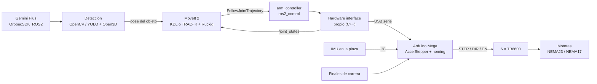
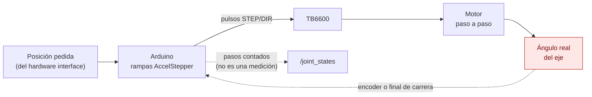
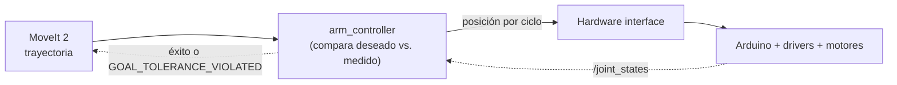
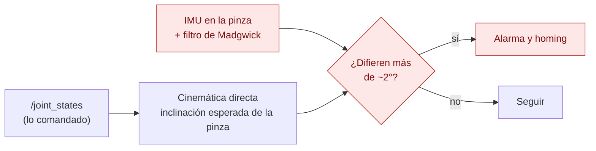
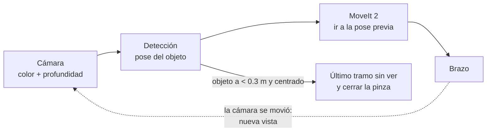
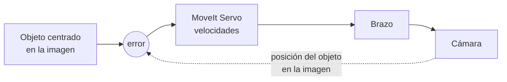
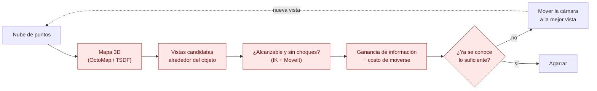

# Repaso de tecnologías para el brazo de Milo

Qué herramientas concretas (programas, bibliotecas, placas, sensores) se pueden usar para cada
tarea pendiente del brazo, cuáles ya usa el proyecto y cuál conviene elegir. Complementa al
[repaso de literatura](../literatura/README.md): aquel dice **qué método** usar; este, **con qué**
implementarlo. Se limita al brazo, el lift y la pinza.

> **En palabras simples:** para cada pieza del trabajo que falta (mover los motores reales,
> evitar choques, ver el objeto, simular) hay varias opciones en el mercado y en la comunidad de
> ROS. Este documento las compara pensando en Milo: que funcionen con ROS 2 Humble y Docker, con el
> hardware que ya hay (Arduino Mega, drivers TB6600, cámara Orbbec) y con un equipo de estudiantes.

**Cómo leerlo.** Cada tabla marca el estado de cada opción:

| Marca | Significa |
| --- | --- |
| ✅ **en uso** | ya está en `milo_ws` |
| ⭐ **recomendada** | la opción que se propone para Milo |
| ➕ **opcional** | útil más adelante o si cambia algo |
| ⚠️ **cuidado** | tiene una limitación importante para Milo |

Los términos técnicos están en el [glosario del informe](../informe/README.md#glosario). Los datos
que cambian con el tiempo (versiones, soporte) se revisaron el 17 de octubre de 2026; las fuentes
están al final.

## Contenido

1. [Resumen: el conjunto recomendado](#1-resumen-el-conjunto-recomendado)
2. [Planificación y control en ROS 2](#2-planificación-y-control-en-ros-2)
3. [Simulación](#3-simulación)
4. [Cámara y percepción](#4-cámara-y-percepción)
5. [Electrónica: microcontrolador, drivers y sensores](#5-electrónica-microcontrolador-drivers-y-sensores)
6. [Diseño eléctrico y mecánico](#6-diseño-eléctrico-y-mecánico)
7. [Computador del robot](#7-computador-del-robot)
8. [Herramientas de desarrollo y organización](#8-herramientas-de-desarrollo-y-organización)
9. [Cómo encaja todo](#9-cómo-encaja-todo)
10. [Diagramas de lazo cerrado](#10-diagramas-de-lazo-cerrado)
11. [¿Alcanza Milo a hacer NBV?](#11-alcanza-milo-a-hacer-nbv)
12. [Fuentes](#12-fuentes)

---

## 1. Resumen: el conjunto recomendado

| Capa | Hoy | Recomendado | Por qué |
| --- | --- | --- | --- |
| Planificación sin choques | IK propia, sin choques | **MoveIt 2** | revisa choques con las mallas y ya habla con el mismo controlador |
| Solver de IK | DLS propio | **KDL** al empezar → **TRAC-IK** | KDL viene con MoveIt; TRAC-IK resuelve más casos cerca de los límites |
| Trayectorias suaves | velocidad constante | **Ruckig** (dentro de MoveIt) | rampas de aceleración para que los motores paso a paso no pierdan pasos |
| Control | ros2_control en Gazebo | **ros2_control** + hardware interface propio | el mismo `arm_controller` sirve en simulación y en el robot |
| Microcontrolador | Arduino Mega (sin montar) | Mega para empezar; **ESP32 o Teensy 4.1** si falta velocidad o se quiere micro-ROS | el Mega genera pulsos para 6 motores solo por software |
| Drivers de motor | TB6600 | TB6600 al empezar; DM542/DM556 si hay ruido o pérdida de pasos | los digitales manejan mejor la resonancia de los NEMA23 |
| Saber dónde está cada eje | nada | **finales de carrera** para el homing; encoders después | sin ellos, el robot no sabe su posición al encender |
| IMU en la pinza | MPU-9250 (por montar) | MPU-9250 si ya está; **BNO085** o **ICM-20948** si se compra | el MPU-9250 está discontinuado; el BNO085 entrega la orientación ya calculada |
| Simulación | Gazebo Classic 11 | seguir; migrar a **Gazebo Harmonic** cuando se amplíe | Classic ya no recibe actualizaciones desde enero de 2025 |
| Cámara | Gemini Plus simulada | **verificar el driver** antes de conectarla | el driver actual de Orbbec no la lista; puede necesitar la versión antigua |
| Detección | nada | **OpenCV** (color, ArUco) → **YOLO** | de lo simple a lo general |
| Plano eléctrico | nada | **KiCad** (o Fritzing para un primer borrador) | gratis, estándar y versionable en git |

---

## 2. Planificación y control en ROS 2

> **En palabras simples:** el robot necesita un programa que, además de calcular la postura
> final, encuentre un camino sin chocar y lo convierta en una secuencia suave para los motores.

### MoveIt 2 y sus complementos

| Tecnología | Para qué | Estado |
| --- | --- | --- |
| **MoveIt 2** | planifica movimientos sin choques: lee el URDF, revisa las mallas y manda la trayectoria al controlador por `FollowJointTrajectory`, la misma acción que ya usa Milo | ⭐ recomendada; viene en binario para Humble (`ros-humble-moveit`) |
| **MoveIt Setup Assistant** | asistente gráfico que genera la configuración de MoveIt a partir del URDF: grupos, poses guardadas, pares de piezas que no hace falta revisar | ⭐ es el primer paso |
| **MoveIt Task Constructor** | arma tareas de varias etapas: acercarse, abrir la pinza, bajar, cerrar, levantar | ➕ para "tomar y dejar" objetos |
| **MoveIt Servo** | mueve el brazo en tiempo real a partir de velocidades (joystick o visión), revisando choques | ➕ para teleoperar o corregir con la cámara |
| **OMPL** | biblioteca de planificadores por muestreo (RRT, PRM…) que MoveIt usa por defecto | ✅ incluida en MoveIt |
| **STOMP / CHOMP** | planificadores por optimización, dan caminos más suaves | ➕ incluidos en MoveIt 2 |

**Cómo configurarlo para Milo:** un grupo `brazo` con `vertical_lift_joint` + `joint_1…6` (el
mismo de `arm_controller`) y un grupo `pinza` con `right_finger_joint`. El lift entra como un eje
más, igual que hace TIAGo con su torso.

### Solvers de cinemática inversa para MoveIt

| Solver | Qué es | Estado |
| --- | --- | --- |
| **KDL** | el solver por defecto de MoveIt (Newton con el jacobiano) | ⭐ para empezar; falla más cerca de los límites |
| **TRAC-IK** | corre en paralelo un KDL mejorado y una optimización; resuelve bastantes más casos | ⭐ después; ⚠️ en Humble no encontré paquete binario confirmado: se compila desde el código (rama de ROS 2) |
| `kinematics.py` propio | el DLS con pesos que ya tiene Milo | ✅ en uso; se mantiene para pruebas y para `arm-viz` |

### Trayectorias

| Tecnología | Para qué | Estado |
| --- | --- | --- |
| **Ruckig** | genera trayectorias con límites de velocidad, aceleración y tirón en microsegundos; integrada en MoveIt 2 como suavizado | ⭐ para los motores paso a paso |
| **TOTG** | parametrización en el tiempo con límites de velocidad y aceleración, la de MoveIt por defecto | ✅ viene con MoveIt |

### Control

| Tecnología | Para qué | Estado |
| --- | --- | --- |
| **ros2_control** + `joint_trajectory_controller` | ejecuta las trayectorias, con tolerancias | ✅ en uso en Gazebo |
| **Hardware interface propio** | plugin en C++ que traduce los comandos de ros2_control al protocolo serie del Arduino | ⭐ a escribir; el driver del hoverboard (`drivers/hoverboard_hardware_interface`) sirve de modelo |
| **micro-ROS** | ROS 2 dentro del microcontrolador | ⚠️ no funciona en el Mega (8 bits, 8 KB de RAM); sí en ESP32, Teensy y STM32 |

---

## 3. Simulación

> **En palabras simples:** el simulador es el "gemelo virtual" donde se prueba todo antes del
> robot real. El que usa Milo hoy dejó de recibir actualizaciones.

| Tecnología | Qué es | Estado |
| --- | --- | --- |
| **Gazebo Classic 11** | el simulador actual de Milo, con `gazebo_ros2_control` | ✅ en uso; ⚠️ fin de vida el 29 de enero de 2025: funciona, pero sin arreglos nuevos |
| **Gazebo Harmonic** (o Fortress) | el Gazebo moderno; Humble lo conecta con `gz_ros2_control` | ⭐ cuando se amplíe la simulación; Harmonic tiene soporte hasta septiembre de 2028 |
| **NVIDIA Isaac Sim** | simulador con render realista y modelos de ruido de cámaras | ➕ para entrenar detectores; necesita GPU NVIDIA RTX |

**Recomendación.** No migrar ahora: el brazo funciona en Classic y la migración toca el xacro de
simulación, los plugins de la cámara y el launch. Planificarla como una fase propia, idealmente
junto con el equipo de la base, porque afecta a todo el robot.

---

## 4. Cámara y percepción

> **En palabras simples:** el driver hace que la cámara real publique sus imágenes en ROS; las
> bibliotecas de visión las usan para encontrar el objeto y su posición en 3D.

### Driver y calibración

| Tecnología | Para qué | Estado |
| --- | --- | --- |
| **OrbbecSDK_ROS2** | driver oficial de las cámaras Orbbec; publica los mismos topics que la simulación de Milo | ⚠️ la rama actual (`v2-main`) no lista la **Gemini Plus** entre sus cámaras; la rama `main` (SDK v1) cubre modelos antiguos. Hay que probar con la cámara conectada antes de fijar la versión en `docker/milo.repos` |
| **image_pipeline** (`depth_image_proc`) | rectificar imágenes, pasar profundidad a nube de puntos | ➕ si el driver no entrega la nube |
| **easy_handeye2** | calibración cámara–pinza (Tsai–Lenz, Park–Martin) | ⭐ al montar la cámara |
| **ArUco** (en OpenCV) | marcadores impresos fáciles de detectar; sirven para calibrar y para medir exactitud | ⭐ |

### Detección y agarre

| Tecnología | Para qué | Estado |
| --- | --- | --- |
| **OpenCV** | visión clásica: color, formas, ArUco | ⭐ primer detector (los objetos de la mesa de prueba son de colores distintos) |
| **PCL / Open3D** | procesar nubes de puntos: quitar la mesa, separar objetos, medir su centro | ⭐ junto con OpenCV |
| **YOLO** (Ultralytics) | detector de objetos con redes neuronales, rápido y fácil de reentrenar | ⭐ segundo paso, para objetos reales |
| **Isaac ROS** | versiones aceleradas en GPU de detección, pose 6D (FoundationPose) y mapas 3D | ➕ solo si se usa una Jetson |
| **Contact-GraspNet / AnyGrasp** | proponen agarres a partir de la nube | ➕ cuando la detección simple funcione; ⚠️ AnyGrasp necesita licencia |

---

## 5. Electrónica: microcontrolador, drivers y sensores

> **En palabras simples:** el microcontrolador genera los pulsos que hacen girar los motores, los
> drivers dan la corriente, y los sensores le dicen al robot dónde está cada eje.

### Microcontrolador

| Placa | Ventajas | Limitaciones | Estado |
| --- | --- | --- | --- |
| **Arduino Mega 2560** | ya se tiene; 5 V como los TB6600; muchos pines | 8 bits y 16 MHz: con 6 motores los pulsos salen por software (AccelStepper) y limitan la velocidad; sin micro-ROS | ✅ disponible; ⭐ para la primera versión |
| **ESP32** | 32 bits, rápido, barato; micro-ROS; genera pulsos por hardware para 6 o más motores (FastAccelStepper) | 3.3 V: necesita adaptadores de nivel para los TB6600 | ⭐ si el Mega se queda corto |
| **Teensy 4.1** | muy rápido (600 MHz); micro-ROS; muchos timers | más caro; 3.3 V | ➕ |
| **STM32** (Nucleo) | industrial, buen soporte de micro-ROS | más difícil para empezar | ➕ |

### Generación de pulsos (firmware)

| Biblioteca | Qué hace | Estado |
| --- | --- | --- |
| **AccelStepper** | rampas de aceleración por motor, por software; funciona en el Mega con 6 motores | ⭐ para el Mega; ⚠️ la velocidad máxima total se reparte entre los 6 |
| **FastAccelStepper** | rampas generadas por los timers del microcontrolador, muy precisas | ⚠️ en el Mega solo 3 motores (pines 6, 7 y 8); ⭐ en ESP32 |
| **GRBL** (y variantes para más ejes) | firmware de máquinas CNC: recibe movimientos por serie | ➕ sirve para probar los motores con programas de CNC, pero no conversa con ros2_control |

### Drivers de motor

| Driver | Notas | Estado |
| --- | --- | --- |
| **TB6600** | hasta 4 A, 9–42 V, analógico | ✅ los que se tienen; justos para los NEMA23 de 4.0 A |
| **DM542 / DM556** | digitales, con compensación de resonancia; más suaves a media velocidad | ➕ si hay vibración o pérdida de pasos |
| **Motores paso a paso con lazo cerrado** (encoder + driver) | corrigen solos los pasos perdidos | ➕ para los ejes más cargados (joint_2 y joint_3) |

### Sensores de posición

| Sensor | Para qué | Estado |
| --- | --- | --- |
| **Finales de carrera** (mecánicos u ópticos) | homing: al encender, cada eje busca su tope y sabe dónde está | ⭐ imprescindibles con lazo abierto |
| **AS5600** (encoder magnético, I²C) | ángulo absoluto de cada eje | ➕; ⚠️ todos tienen la misma dirección I²C: hace falta un multiplexor TCA9548A |
| **AS5048A** (encoder magnético, SPI) | igual, con más resolución y sin problema de direcciones | ➕ |

### IMU

| Sensor | Notas | Estado |
| --- | --- | --- |
| **MPU-9250** | 9 ejes; el fusionado se hace en el PC (`imu_filter_madgwick`) | ✅ la que se tiene; ⚠️ discontinuada desde 2018 y a 3.3 V |
| **ICM-20948** | el reemplazo oficial del MPU-9250; registros distintos | ➕ si se compra otra |
| **BNO085** | calcula la orientación dentro del chip y la entrega como cuaternión | ➕ simplifica el firmware |

Para cualquiera: usar el modo de 6 ejes (sin magnetómetro) cerca de los motores, y agregarla al
URDF con el plugin `libgazebo_ros_imu_sensor`, igual que la IMU de la base.

### Alimentación y seguridad

- Fuente de 24 V y 15 A (la del EB300), con fusibles por driver.
- **Parada de emergencia** que corte la potencia de los motores (o al menos la señal ENABLE de
  todos los drivers), accesible desde fuera del alcance del brazo.
- Masa común entre el Mega y los drivers; cables de motor separados de los de señal y de la IMU.

---

## 6. Diseño eléctrico y mecánico

| Tecnología | Para qué | Estado |
| --- | --- | --- |
| **KiCad** | esquemático eléctrico profesional y gratuito; los archivos son texto y se versionan en git | ⭐ para el plano eléctrico |
| **Fritzing** | dibujos de cableado tipo protoboard, fáciles de entender | ➕ para un primer borrador o para la documentación |
| **draw.io / Mermaid** | diagramas de bloques (qué se conecta con qué) | ⭐ Mermaid ya se usa en el informe |
| **Fusion 360** | CAD del robot | ✅ en uso; ⭐ ahí se diseña el soporte de la IMU |
| **fusion2urdf** | exporta un ensamblaje de Fusion a URDF | ➕ si se rehacen piezas grandes |
| **FreeCAD** | CAD libre; ya se usó para convertir el modelo de la cámara | ✅ |

---

## 7. Computador del robot

| Opción | Notas | Estado |
| --- | --- | --- |
| **Portátil con Ubuntu 22.04** | lo que usa Milo hoy, con Docker | ✅ |
| **Jetson Orin Nano** | JetPack 6 trae Ubuntu 22.04, así que Humble funciona nativo; GPU para YOLO e Isaac ROS | ➕; ⚠️ la imagen Docker actual (`osrf/ros:humble-desktop`) es solo para PC (amd64): en la Jetson hay que partir de `ros:humble-ros-base`, que es multiplataforma |

---

## 8. Herramientas de desarrollo y organización

| Tecnología | Para qué | Estado |
| --- | --- | --- |
| **rosbag2** | grabar todos los topics de una prueba y reproducirla después | ⭐ para comparar simulación y robot real |
| **PlotJuggler** | graficar topics en vivo o desde un rosbag (posiciones pedidas vs. reales, IMU) | ⭐ para ajustar rampas |
| **Foxglove** | visualizador en el navegador, alternativa a RViz | ➕ |
| **GitHub Actions** (`ros-tooling/action-ros-ci`) | correr las pruebas de `pytest` en cada cambio subido | ⭐ hoy no hay integración continua |
| **GitHub Projects / Issues** | tablero con las fases del proyecto, tareas y responsables | ⭐ para la planificación |
| **GitHub Pages** | páginas web estáticas | ✅ en uso con `arm-viz` |

---

## 9. Cómo encaja todo

Del lado izquierdo, todo ya existe en ROS 2 y se configura; del lado derecho (hardware interface,
firmware, plano eléctrico) es lo que hay que construir. Las fases para hacerlo están en la
[sección 12 del repaso de literatura](../literatura/README.md#12-metodología-propuesta-por-fases).

---

## 10. Diagramas de lazo cerrado

> **En palabras simples:** un **lazo cerrado** es un sistema que mide lo que pasó, lo compara con
> lo que quería y corrige; como un termostato. Un **lazo abierto** manda la orden y supone que se
> cumplió, sin mirar. Milo tiene varios lazos uno dentro de otro: el de cada motor (miles de veces
> por segundo), el de la trayectoria (cientos), el de la cámara (algunas veces por segundo) y el
> de la tarea (una vez por intento). Si el lazo de adentro falla, los de afuera trabajan con
> datos falsos.

En los diagramas, las flechas punteadas son la **retroalimentación** (la medición que vuelve) y
los bloques en rojo lo que todavía no existe.

### Lazo 1: posición de cada motor

Con los TB6600 y sin sensores, este lazo está **abierto**: el Arduino cuenta los pulsos que manda
y supone que el motor los dio todos. Si el motor se traba o se salta pasos, nadie se entera.

| Versión | Qué cierra el lazo | Qué gana |
| --- | --- | --- |
| Hoy (planeado) | nada; solo homing con finales de carrera al encender | el robot sabe dónde empieza, no si después perdió pasos |
| Con encoders (AS5048A o motores con lazo cerrado) | el ángulo real del eje vuelve al microcontrolador, que corrige | `/joint_states` pasa a ser una medición real |

### Lazo 2: trayectoria (ros2_control)

`arm_controller` compara en cada ciclo la posición que debería tener cada articulación con la que
informa `/joint_states`, y aborta si al final quedó lejos (tolerancias de meta). **Este lazo solo
es real si el lazo 1 lo es**: con motores en lazo abierto, `/joint_states` repite lo comandado y
el controlador siempre "llega".

### Lazo 3: verificación con la IMU

Una forma barata de cerrar parcialmente el lazo 1 sin encoders: la cinemática directa predice
hacia dónde apunta la pinza; la IMU mide hacia dónde apunta de verdad (respecto de la gravedad).
Si no coinciden, algún motor perdió pasos y se repite el homing.

La IMU mide bien la inclinación (dos ángulos) pero no el giro alrededor de la vertical sin
magnetómetro; por eso detecta errores en joint_2, joint_3 y joint_5 mejor que en joint_1.

### Lazo 4: percepción "mirar y luego moverse"

El lazo de la tarea: medir el objeto, moverse, volver a medir antes del último tramo. Es lento
(una medición por paso), pero tolera las limitaciones de la cámara y es el primero que conviene
hacer.

### Lazo 5: servo visual (opcional)

El lazo de la cámara corre continuo: el error se mide en la imagen y se convierte en velocidades
del brazo con **MoveIt Servo**, de 10 a 30 veces por segundo. Es más preciso al final del
acercamiento, pero la profundidad deja de medir a 0.25 m y los motores paso a paso responden con
retraso; en Milo sirve para centrar el objeto, no para el contacto final.

### Lazo 6: Next-Best-View

El lazo de la sección 11: el robot decide **desde dónde mirar** para entender mejor la escena,
mira, actualiza su mapa 3D y vuelve a decidir, hasta que sabe lo suficiente para agarrar.

---

## 11. ¿Alcanza Milo a hacer NBV?

> **En palabras simples:** **NBV** (*Next-Best-View*, "la siguiente mejor vista") es que el
> robot elija por sí mismo desde dónde mirar: si un objeto está tapado o la cámara ve solo una
> cara, mueve la cámara a la posición que más información nueva le dé, en vez de seguir una lista
> fija de posiciones. Con la cámara en la pinza, mover la cámara es mover el brazo.

**Qué dice la literatura.** El problema lo planteó Connolly en 1985 [N1]. Los métodos actuales
guardan la escena en un mapa 3D de celdas (vacías, ocupadas o desconocidas) y puntúan cada vista
candidata por cuántas celdas desconocidas vería (la "ganancia de información"), menos el costo de
llegar ahí [N2, N3]. Para manipulación, Breyer et al. [N4] cierran el lazo con el agarre: después
de cada vista intentan proponer un agarre del objeto, y solo mueven la cámara otra vez si todavía
no hay uno bueno. Ese enfoque, "NBV dirigido al agarre", es el que mejor calza con Milo: no
necesita reconstruir toda la escena, solo lo suficiente del objeto, y su código es abierto.

### Requisitos y estado de Milo

| Requisito | Milo | Veredicto |
| --- | --- | --- |
| Cámara de profundidad en la pinza (*eye-in-hand*) | Gemini Plus sobre la pinza, simulada | ✅ es la configuración típica de NBV para manipulación |
| Rango útil de la cámara | 0.25–2.5 m; mejor entre 0.3 y 0.8 m | ✅ las vistas candidatas se ponen a 0.4–0.6 m del objeto |
| Mover la cámara alrededor del objeto | 7 ejes, 0.85 m de radio, lift de 1 m | ✅ por arriba, por delante y por los costados de un objeto sobre una mesa; ⚠️ no por detrás (la base no se mueve: es de otro equipo) |
| Llegar a cada vista sin chocar | la IK no revisa choques | ⚠️ **requiere MoveIt 2** (fase 5 del plan) |
| Saber con precisión dónde está la cámara | perfecto en Gazebo; en el robot, cinemática directa con motores en lazo abierto y piezas impresas | ⚠️ en el robot real **requiere homing, calibración cámara–pinza y medir el brazo** (fases 1 y 6); un error de 1 cm hace que las vistas no calcen al unirlas |
| Mapa 3D | nada propio; MoveIt ya puede construir un OctoMap con la nube para evitar choques | ✅ se reutiliza (OctoMap [N5]) o se usa un TSDF (Open3D, como [N4]) |
| Calcular la ganancia de cada vista | nada | ⚠️ hay que programarlo: proyectar rayos desde cada vista candidata contra el mapa |
| Cómputo | portátil | ✅ con 10–30 vistas candidatas por paso alcanza; una Jetson también |
| Tiempo por vista | motores a ~0.5 rad/s | ⚠️ cada cambio de vista toma varios segundos: NBV conviene si resuelve el agarre en 2–4 vistas |

### Veredicto

**Sí alcanza, en dos etapas.**

1. **En simulación, justo después de configurar MoveIt 2.** En Gazebo la pose de la cámara es
   exacta y la mesa de prueba tiene objetos que se tapan entre sí: es un buen banco de pruebas, y
   sirve como trabajo de investigación por sí mismo. Se puede empezar con la versión más simple:
   vistas candidatas en un casquete de esfera frente al objeto, ganancia = celdas desconocidas
   visibles del objeto.
2. **En el robot real, después de la calibración.** Requiere que el lazo 1 sea confiable
   (homing, y si es posible encoders o la verificación con la IMU del lazo 3) y la calibración
   cámara–pinza. Antes de eso, las vistas no calzan entre sí y el mapa sale borroso.

**Lo que no conviene intentar todavía:** reconstrucción completa de la escena o NBV moviendo la
base; ambos piden más vistas, más precisión y mover un robot que no es del equipo.

### Cómo se implementaría

Un nodo nuevo, `nbv_planner`, en `andesrobot_arm`:

1. Suscribirse a `/gripper_camera/depth/points` y acumular un mapa 3D alrededor del objeto
   (OctoMap o TSDF con Open3D).
2. Generar vistas candidatas sobre una esfera de 0.4–0.6 m de radio centrada en el objeto,
   apuntando hacia él, solo en la mitad delantera.
3. Pasar cada vista de pose de la cámara a pose del TCP con la transformación fija del URDF
   (`gripper_tcp` → `gripper_camera_depth_optical_frame`) y descartar las que no tengan IK o
   choquen (MoveIt).
4. Puntuar: celdas desconocidas del objeto que vería esa vista, menos un costo proporcional a
   cuánto hay que mover las articulaciones.
5. Publicar la mejor en `/arm_target_pose` (o pedírsela a MoveIt), esperar a que llegue y repetir.
6. Parar cuando el detector de agarres proponga uno con buena calidad, o cuando ninguna vista
   agregue información.

El repositorio de [N4] (`ethz-asl/active_grasp`) implementa este lazo con ROS y sirve de
referencia directa.

### Referencias de esta sección

- [N1] C. I. Connolly, "The determination of next best views", *ICRA*, 1985.
- [N2] S. Isler, R. Sabzevari, J. Delmerico, D. Scaramuzza, "An information gain formulation for active volumetric 3D reconstruction", *ICRA*, 2016. [Software](https://www.ifi.uzh.ch/en/rpg/news/Software-Release-Information-Gain-Based-Active-Reconstruction-Framework.html)
- [N3] J. Delmerico, S. Isler, R. Sabzevari, D. Scaramuzza, "A comparison of volumetric information gain metrics for active 3D object reconstruction", *Autonomous Robots*, 2018.
- [N4] M. Breyer, L. Ott, R. Siegwart, J. J. Chung, "Closed-loop next-best-view planning for target-driven grasping", *IROS*, 2022. [arXiv:2207.10543](https://arxiv.org/abs/2207.10543)
- [N5] A. Hornung, K. M. Wurm, M. Bennewitz, C. Stachniss, W. Burgard, "OctoMap: An efficient probabilistic 3D mapping framework based on octrees", *Autonomous Robots*, 2013.

---

## 12. Fuentes

Revisadas el 17 de octubre de 2026.

- Gazebo Classic: [anuncio de fin de vida](https://discourse.openrobotics.org/t/gazebo-classic-end-of-life-and-migration-survey/48541), [Classic 11 llegó al fin de vida](https://discourse.openrobotics.org/t/gazebo-classic-11-has-reached-end-of-life/48458), [gazebo_ros2_control](https://index.ros.org/r/gazebo_ros2_control/), [gz_ros2_control para Humble](https://docs.ros.org/en/humble/p/gz_ros2_control/__PACKAGE.html).
- MoveIt 2: [lanzamiento para Humble](https://moveit.ros.org/moveit/ros/humble/2022/06/02/MoveIt-Humble-Release.html), [tutorial de TRAC-IK](https://moveit.picknik.ai/humble/doc/examples/trac_ik/trac_ik_tutorial.html).
- TRAC-IK para ROS 2: [anuncio del port](https://discourse.ros.org/t/ros-2-port-of-trac-ik-an-alternative-ik-solver/21630), [paquete en ROS](https://index.ros.org/p/trac_ik/).
- Orbbec: [paquete orbbec_camera](https://index.ros.org/p/orbbec_camera/), [versión v1](https://index.ros.org/r/orbbec_camera_v1), [cámaras Orbbec en ROS (Husarion)](https://husarion.com/tutorials/ros-equipment/orbbec-cameras/).
- micro-ROS: [hardware soportado](https://micro.ros.org/docs/overview/hardware/), [foro: sin soporte para 8 bits](https://discourse.ros.org/t/micro-ros-on-arduino/17009/3).
- FastAccelStepper: [wiki del proyecto](https://github.com/gin66/FastAccelStepper/wiki), [readme del componente](https://components.espressif.com/components/gin66/fastaccelstepper/versions/2.0.0/readme).
- IMU: [compatibilidad ICM-20948 / MPU-9250 (TDK)](https://adm.invensense.tdk.com/icm-20948-and-mpu-9250-compatibility), [fin de vida del MPU-9250 (PX4)](https://discuss.px4.io/t/mpu-9250-end-of-life-migrate-to-icm-20948/9262).
- MoveIt 2 y OctoMap: [PointCloudOctomapUpdater (Humble)](https://moveit.picknik.ai/humble/api/html/classoccupancy__map__monitor_1_1PointCloudOctomapUpdater.html).
- NBV: [Breyer et al. 2022](https://arxiv.org/abs/2207.10543), [registro de Isler et al. 2016 (EPFL)](https://infoscience.epfl.ch/record/218622?ln=en), [Delmerico et al. 2018 (UZH)](https://www.merlin.uzh.ch/publication/show/15103).
- Robots de referencia: [TIAGo en ROS](https://robots.ros.org/tiago/), [diseño de Stretch](https://arxiv.org/abs/2109.10892).
