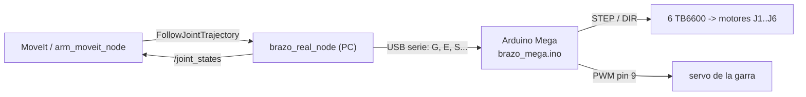
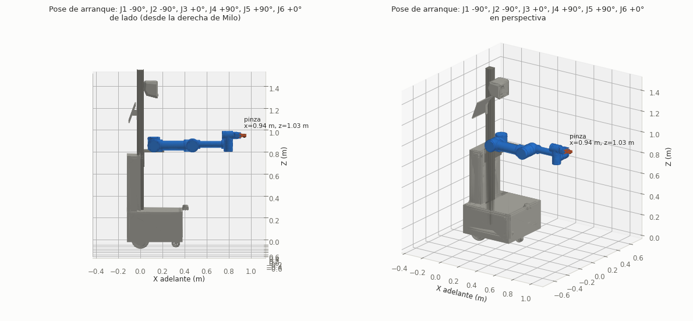

# Firmware del Arduino Mega del brazo

En palabras simples: el PC de Milo calcula los movimientos del brazo (MoveIt) y el Arduino Mega es
el que mueve de verdad los motores: le manda pulsos a los 6 drivers TB6600 de los motores paso a
paso y la señal al servo de la garra. El PC y el Arduino hablan por el cable USB, que para los dos
es un puerto serie. El Arduino solo cuenta **pasos**; los radianes los convierte el PC.



| Archivo | Qué es |
|---|---|
| `brazo_mega/brazo_mega.ino` | el programa del Arduino (v3: la v2 más el cableado de positivo común del brazo armado): protocolo de comandos, movimiento de las 6 articulaciones a la vez con rampa de aceleración, perro guardián, servo |
| `brazo_mega/brazo_mega.hex` | el mismo programa ya compilado, para cargarlo sin el IDE ni `arduino-cli` (en la Jetson); regenerarlo si se cambia el `.ino` (ver `cargar_firmware.sh`) |
| `cargar_firmware.sh` | carga el `.hex` con `avrdude` al Mega del brazo (y se niega si el puerto es el de la hoverboard); del equipo |
| `probar_arduino.py` | prueba desde el PC sin ROS: comunicación, una articulación por vez (en grados o pasos) y el servo |
| `prueba_exigente.py` | 12 pruebas duras (23 comprobaciones) **solo con el Arduino, sin el brazo** (mueven las 6 articulaciones miles de pasos): protocolo, latencia, exactitud de pasos y tiempos, carga, perro guardián, seguimiento de 30 s tipo ROS, ráfagas, X/Z/servo |
| `fig_conexiones.py` | dibuja los diagramas de conexión de `img/` (solo matplotlib): `python3 firmware/fig_conexiones.py` |
| `respaldos/` | (fuera de git) el `.hex` de lo que traía grabado el Arduino antes (la prueba de J1 del 23-nov) |

Del lado de ROS (en `ros2_ws/src/andesrobot_arm/`): `brazo_real_node.py` (el puente),
`brazo_real.py` (conversiones y protocolo, con pruebas), `config/brazo_real.yaml` (pasos, micropasos,
reducción, sentido, cero, servo), `launch/brazo_real.launch.py` (todo junto con MoveIt; `./robot.sh
brazo`), `seta.py` (la seta de emergencia), `sliders_node.py` (una ventana con un slider por articulación) y `arduino_falso.py` (un Arduino de mentira para probar sin hardware). Detalle en
`andesrobot_arm/docs/BRAZO.md`, sección «Brazo real (Arduino Mega)». El driver del **control de
Xbox** con el que el equipo movió el brazo armado está en `ros2_ws/src/drivers/brazo_driver/`
([más abajo](#control-de-xbox-el-driver-del-equipo)).

## La placa y los pines

- **Arduino Mega 2560 clon**, con chip USB **CH340** (`1a86:7523`): aparece como `/dev/ttyUSB0`
  (un Mega original aparece como `/dev/ttyACM0`). Con la regla de `docker/udev/99-milo.rules`
  instalada queda también como `/dev/arduino_brazo`. El Mega de la **hoverboard también es un
  CH340**: se distinguen por el nombre que reporta el chip, `USB2.0-Serial` el del brazo y `USB
  Serial` el de la hoverboard (por eso la regla lo pide; sin regla, usar
  `/dev/serial/by-id/usb-1a86_USB2.0-Serial-if00-port0`, que es lo que usa el equipo).
- **En Ubuntu,** el programa `brltty` se apodera de los CH340 y el puerto desaparece un segundo
  después de conectarlo. Si no se usa una pantalla braille: `sudo apt remove brltty` y volver a
  conectar el Arduino (ver `docker/udev/README.md`).
- **Pines** (de la imagen del cableado del 23-nov-2026; son los mismos del firmware con el que el
  equipo movió el brazo armado, en nov-2026):

  | Articulación | PUL / STEP | DIR |
  |---|---|---|
  | J1 | 45 | 44 |
  | J2 | 47 | 46 |
  | J3 | 49 | 48 |
  | J4 | 51 | 50 |
  | J5 | 53 | 52 |
  | J6 | 43 | 42 |
  | servo de la garra | 9 (señal) | — |

  ENA de los TB6600 sin conectar (siempre habilitados: si se deshabilitan, J2 y J3 caen por el
  peso). El pin 53 es también SS del SPI, sin conflicto mientras no se use SPI.
- **El servo de la garra no se alimenta desde el Arduino:** va a una fuente de 5-6 V aparte, con la
  GND unida a la del Arduino; del pin 9 solo sale la señal.
- **Pines libres** para lo que venga (la seta, finales de carrera): 2-8, 10-12 y 22-41. El 2 y el 3
  además pueden avisar al instante por interrupción (INT4/INT5); 0-1 son el USB y 13 el LED.

### Diagramas de conexión

Todo el sistema: el Arduino, los 6 drivers con sus motores, el servo y las dos fuentes. Cada
articulación tiene un color; la línea continua es STEP (al borne PUL− del driver) y la punteada es
DIR (al borne DIR−); PUL+ y DIR+ de los 6 van juntos al 5V del Arduino (en rojo).


Un driver en detalle (J1; los otros iguales con sus pines) y el servo:


Es un **esquema**, no un plano: al conectar, guiarse por el número impreso junto a cada pin de la
placa. Las señales van en **positivo común**, como las cableó el equipo: PUL+ y DIR+ al 5V del
Arduino, PUL− y DIR− a los pines. El optoacoplador de entrada del TB6600 se enciende cuando el pin
está en LOW, así que el firmware v3 manda las señales al revés que la v2: STEP en reposo en HIGH y
cada pulso un LOW (`POSITIVO_COMUN = true` en `brazo_mega.ino`). Con la v2 en este cableado cada
articulación giraría al revés y, al encender, cada pin en LOW sería un paso falso. Si algún día se
cablea en cátodo común (PUL− y DIR− a GND, PUL+ y DIR+ a los pines), poner `POSITIVO_COMUN = false`
y volver a cargar el programa. Si se cambia un pin en
`brazo_mega.ino`, cambiarlo también en `PINES` de `fig_conexiones.py` y volver a dibujar.

## Protocolo (v2 y v3, el mismo)

Una línea de texto por comando, terminada en `\n`, a 115200 baudios; el Arduino contesta otra
línea. Se puede usar a mano desde el Monitor Serie del Arduino IDE (con "Nueva línea").

| Comando | Respuesta | Qué hace |
|---|---|---|
| `P` | `PONG brazo_mega v3` | ¿estás ahí? |
| `E` | `E p1 p2 p3 p4 p5 p6 mov servo` | posición de cada articulación [pasos], `mov` 1 si algo se mueve, ángulo del servo (−1 suelto) |
| `G ms p1 .. p6` | `OK G` | ir a esas posiciones, todas llegando en `ms` milisegundos (lo usa ROS ~20 veces por segundo) |
| `M j pasos` | `OK M j destino` | mover solo la articulación `j` (1..6) esa cantidad de pasos, lento: para probar |
| `V n` | `OK V n` | velocidad de `M` [pasos/s] (200 al encender) |
| `A n` | `OK A n` | aceleración de la rampa [pasos/s²] (4000 al encender; 100 o más) |
| `X` | `OK X` | parar todo, en seco (parada de emergencia) |
| `Z` | `OK Z` | la posición actual pasa a ser 0 (solo quieto) |
| `S grados` | `OK S grados` | mover el servo de la garra |
| `D` | `OK D` | soltar el servo |

Seguridad: al encender no mueve nada y cuenta 0 en todas las articulaciones (no hay finales de
carrera: se enciende con el brazo en su pose cero, o se usa `Z` ahí). Con `G`, si el PC deja de
hablar medio segundo el brazo se detiene en seco (perro guardián). Velocidad máxima 2000 pasos/s
(~11.7 °/s con 1/8 de micropaso y 38.4:1).

**Rampa de aceleración (v2).** Un motor paso a paso no puede pasar de quieto a 2000 pasos/s de un
golpe: "pierde pasos" (el Arduino cree que llegó y el brazo quedó en otra parte). La velocidad de
cada articulación cambia como mucho `A` pasos/s por segundo (4000: de 0 a 2000 en 0.5 s), y se
recalcula cada 2 ms:

- `M` (probar a mano): trapecio. Acelera, sigue a `V` y frena a tiempo para llegar justo (con
  velocidad v necesita v²/(2·A) pasos para parar; frena con un 10 % de margen).
- `G` (ROS, uno cada 50 ms): la velocidad sigue a la que pide el PC con la misma rampa, sin
  frenar "para llegar justo" a cada G (su destino está solo 50 ms adelante y nunca pasaría de
  ~400 pasos/s); las trayectorias de MoveIt ya terminan con velocidad 0. Si el plazo de un G vence
  sin que llegue otro, es el destino final y ahí sí frena para llegar justo.
- Cambio de sentido: primero frena y después da la vuelta. Llegando al destino a 400 pasos/s o
  menos, para en seco (con un umbral más bajo oscilaba alrededor del destino sin terminar).

`X` y el perro guardián paran en seco: son paradas de emergencia. Con los motores reales hay que
ver qué aceleración aguantan sin perder pasos (empezar con `A 2000` o menos).

Cuántos pasos es un grado: `pasos_motor × micropasos × reduccion / 360` = 200 × 8 × 38.4 / 360 =
**170.7 pasos/°** con los valores de `brazo_real.yaml` (200 pasos y 1/8 son **supuestos**: revisar
la placa de los motores y los interruptores de cada TB6600).

## Cargar el programa

**Con `firmware/cargar_firmware.sh`** (del equipo; sirve en la Jetson, sin el IDE: solo necesita
`avrdude`, y lo instala si falta): carga `brazo_mega/brazo_mega.hex` en el Mega del brazo, se niega
si el puerto es el de la hoverboard, y al final pregunta `P` para comprobar. Cerrar antes el driver
de Xbox o `brazo_real_node`.

```bash
firmware/cargar_firmware.sh                 # al Mega del brazo, por su nombre en /dev/serial/by-id
firmware/cargar_firmware.sh /dev/ttyUSB0    # a otro puerto
```

El `.hex` hay que regenerarlo cuando se cambia el `.ino` (con `arduino-cli`, abajo:
`arduino-cli compile --fqbn arduino:avr:mega --output-dir /tmp/brazo_mega firmware/brazo_mega` y
copiar `/tmp/brazo_mega/brazo_mega.ino.hex` encima de `firmware/brazo_mega/brazo_mega.hex`).

**Con el Arduino IDE**: abrir `firmware/brazo_mega/brazo_mega.ino`, elegir Herramientas → Placa →
"Arduino Mega or Mega 2560", Procesador "ATmega2560", el puerto `/dev/ttyUSB0`, y Subir.

**Con `arduino-cli`** (en el PC de desarrollo está la 1.5.1 en `~/.local/bin`, bajada de los releases
de GitHub con su suma de verificación):

```bash
arduino-cli core install arduino:avr                       # una vez
arduino-cli lib install Servo                              # una vez
arduino-cli compile --fqbn arduino:avr:mega firmware/brazo_mega
arduino-cli upload  --fqbn arduino:avr:mega -p /dev/ttyUSB0 firmware/brazo_mega
```

Para volver a grabar lo que traía antes (la prueba de J1), con el `avrdude` que instala
`arduino-cli`:

```bash
~/.arduino15/packages/arduino/tools/avrdude/8.0.0-arduino1/bin/avrdude -C ~/.arduino15/packages/arduino/tools/avrdude/8.0.0-arduino1/etc/avrdude.conf -p atmega2560 -c wiring -P /dev/ttyUSB0 -b 115200 -D -U flash:w:firmware/respaldos/mega_prueba_j1_2026-11-23.hex:i
```

## Paso a paso: del Arduino suelto al brazo moviéndose con MoveIt

Cada paso dice qué hacer, **qué tiene que pasar** y qué hacer si no pasa. Los pasos 1 a 4 se hacen
con el Arduino solo (sin drivers ni motores, no hay riesgo). Desde el 5 hay 24 V y motores: siempre
con alguien al lado listo para cortar la fuente de 24 V **y sosteniendo el brazo**, porque sin
corriente J2 y J3 caen por su peso.

Todos los comandos se corren en el PC, desde `~/milo_ws`, salvo el paso 10 (que usa Docker).

### 1. Preparar el PC (una sola vez)

1. Quitar `brltty`, que en Ubuntu se apodera de los chips CH340 (el puerto aparece y desaparece):

   ```bash
   sudo apt remove brltty
   ```

2. Instalar la regla udev, que le da al Arduino el nombre fijo `/dev/arduino_brazo` y permiso para
   todos los usuarios:

   ```bash
   sudo cp docker/udev/99-milo.rules /etc/udev/rules.d/
   ```

   ```bash
   sudo udevadm control --reload-rules && sudo udevadm trigger
   ```

3. Solo para cargar programas: `arduino-cli` (ver «Cargar el programa» más abajo).

### 2. Conectar el Arduino al PC

Solo el cable USB (todavía sin fuente de 24 V).

```bash
ls -l /dev/arduino_brazo
```

**Tiene que pasar:** el LED ON del Arduino se enciende y `/dev/arduino_brazo -> ttyUSB0` (u otro
número). **Si no aparece:** `ls -l /dev/ttyUSB*`; si tampoco, otro cable USB (algunos solo cargan,
no llevan datos) y revisar el paso 1.

### 3. Cargar el programa (solo si no lo tiene)

El Arduino del brazo tiene `brazo_mega` v3 (la cargó el equipo para la prueba con el control de
Xbox, nov-2026). Para saberlo basta el paso 4: si contesta `PONG brazo_mega v3`, saltarse este
paso; si contesta `v2`, cargar la v3 (con el cableado de positivo común la v2 gira al revés). Si no, o si se cambió el `.ino`: ver «Cargar el
programa» más abajo. **Al cargar el programa el Arduino se reinicia y cuenta 0 donde esté el brazo.**

### 4. Probar la comunicación (no mueve nada)

```bash
python3 firmware/probar_arduino.py
```

**Tiene que pasar:**

```
Puerto: /dev/arduino_brazo
  -> P              <- PONG brazo_mega v3   (se reinició: cuenta desde 0)
  -> E              <- E 0 0 0 0 0 0 0 -1
  -> Q              <- ERR comando desconocido: Q
Todo OK
```

`E` da las 6 posiciones en pasos, `mov` (1 si algo se mueve) y el servo (−1 = suelto). La primera
vez después de enchufarlo dice «se reinició»; las siguientes, «no se reinició: sigue su cuenta».
**Si dice otra cosa que `PONG brazo_mega`:** el Arduino tiene otro programa (paso 3). **Si no
contesta:** otro programa está usando el puerto (cerrar el Monitor Serie del Arduino IDE o
`./robot.sh brazo`).

### 5. Cablear (con TODO apagado)

Desenchufar el USB y la fuente de 24 V. Después, siguiendo los [diagramas](#diagramas-de-conexión):

1. **En cada TB6600, los interruptores:** SW1-SW3 en **1/8** (fila «8» o «1600» de la tabla impresa en
   el driver) y SW4-SW6 en la corriente nominal de su motor (dice la placa del motor; si no se
   sabe, empezar por la más baja que mueva el brazo). Los 6 drivers con el mismo micropaso, o
   cambiar `micropasos` en `brazo_real.yaml` para el que sea distinto.
2. **Señales (positivo común):** PUL− y DIR− de cada driver a sus pines (tabla de arriba); PUL+
   y DIR+ de los 6 juntos al pin 5V del Arduino; ENA+ y ENA− sin conectar.
3. **Motores:** A+ A− a una bobina y B+ B− a la otra (los dos cables de una bobina tienen
   continuidad con el multímetro).
4. **Fuente de 24 V:** a VCC y GND de cada driver (rojo a VCC).
5. **Servo:** señal al pin 9; + y − a su fuente de 5-6 V; la − de esa fuente también a una GND del
   Arduino.
6. **Revisar antes de encender:** ningún cable de 24 V cerca de un pin del Arduino, todas las GND
   unidas, cada motor en su driver.

Si se puede, la primera vez probar cada motor **sin acoplar al brazo** (o con el brazo apoyado):
así un sentido o un pin equivocado no golpea nada.

### 6. Encender

Primero el USB (Arduino), después los 24 V.

**Tiene que pasar:** nada se mueve; los motores se ponen «duros» (con 24 V, los drivers sostienen
la posición aunque el Arduino no mande pulsos), con un clic al energizar y quizás un zumbido suave;
el servo queda suelto; el LED «L» del Arduino apagado (se enciende solo mientras algo se mueve).
Repetir el paso 4: tiene que seguir dando «Todo OK».

**Si un motor se calienta tanto que no se puede tocar:** la corriente (SW4-SW6) está muy alta. **Si
el Arduino se reinicia al encender los 24 V:** falta una GND en común o hay un cable de 24 V mal
puesto: apagar y revisar.

### 7. Probar cada articulación, una por vez

Empezar por las que no cargan peso (J1, J4, J5, J6) y dejar J2 y J3 al final, sosteniendo el
brazo. Pocos grados, lento:

```bash
python3 firmware/probar_arduino.py --articulacion 1 --grados 2 --vel 100 --volver
```

**Tiene que pasar:** la articulación gira 2°, se detiene y vuelve, con arranque y frenado suaves
(2° = 341 pasos: a 100 pasos/s son unos 3.5 s por tramo). El script imprime los pasos que contó el
Arduino; «Todo OK» solo dice que el Arduino contó bien, **lo que vale es lo que se ve en el brazo**.

Para cada articulación, mirar y anotar:

| Qué mirar | Si no | Dónde se corrige |
|---|---|---|
| ¿Se movió la articulación pedida? | pines STEP/DIR cruzados (o el cable de otro driver) | el cableado |
| ¿Giró hacia donde gira en RViz con un ángulo positivo? (en RViz: `./sim.sh brazo` y el marcador, o el URDF) | al revés | `invertir: true` en esa articulación de `ros2_ws/src/andesrobot_arm/config/brazo_real.yaml` |
| ¿Giró los grados pedidos? (con 10° se ve mejor) | el doble, la mitad... | `micropasos` (interruptores del driver) o `pasos_motor` (motor de 0.9°: 400) |
| ¿Volvió exacto al mismo lugar? | pierde pasos | bajar `--vel` y `--acel 2000`, subir la corriente del driver |
| ¿Vibra o zumba sin girar? | pierde todos los pasos: corriente baja, bobina mal cableada o mucha carga | la corriente o el cableado A/B |

Después de que gire bien despacio, subir de a poco: `--grados 10`, `--vel 400`, `--vel 1000`... y
la aceleración con `--acel` (4000 al encender el Arduino; `--acel` queda puesta hasta que el
Arduino se reinicie). La velocidad máxima del firmware es 2000 pasos/s (~11.7 °/s).

### 8. El servo de la garra

Primero **sin los dedos trabados contra nada**, con un ángulo intermedio, y después de a poco
hacia cada lado:

```bash
python3 firmware/probar_arduino.py --servo 90
```

```bash
python3 firmware/probar_arduino.py --servo 80 70 60 50 --pausa 2
```

**Tiene que pasar:** en el primer ángulo el servo salta de golpe ahí (no tiene rampa) y después se
queda firme. Anotar el ángulo con la garra **abierta del todo** y **cerrada del todo**, y
ponerlos en `garra:` de `brazo_real.yaml` (hoy 40 y 110 son supuestos). Si con algún ángulo la garra
llega a su tope y el servo zumba, ese ángulo ya es demasiado: volver. `--suelta` lo deja sin fuerza.

### 9. Dejar el brazo en su pose cero

ROS supone que, cuando el Arduino cuenta 0 pasos, el brazo está en la pose `cero` de
`brazo_real.yaml`. Desde el 26-nov-2026 esa pose **no** es la de todo en 0 del URDF (brazo hacia
arriba), sino la **pose de arranque**: el brazo **estirado hacia adelante**, horizontal, con la
pinza en lo más lejos que alcanza al frente y apuntando hacia adelante. Es una pose fácil de dejar
y repetir a mano, sin encoders ni IMU. En ángulos del URDF: **J1 −90°, J2 −90°, J3 0, J4 +90°,
J5 +90°, J6 0** (`articulaciones: joint_N: {cero: ...}` del yaml, en radianes); con el lift fijo a
0,88 m deja la pinza a 0,94 m delante de Milo, 9 cm a su derecha y a 1,03 m del suelo. Hay cuatro
combinaciones que dejan así la pinza (J1/J2 ±90°, muñeca arriba o abajo); el brazo real está en
esta (la otra con la muñeca arriba, J1 +90°/J2 +90°/J4 −90°/J5 −90°, es su espejo). Así se ve (la figura se
regenera con `scripts/fig_pose_arranque.py` si se cambia algún `cero`):



Llevar el brazo a esa pose (moviendo cada articulación con el paso 7 o con el control de Xbox; a
mano con los 24 V apagados, no: J2 y J3 caen por el peso) y decirle al Arduino que cuente 0 ahí:

```bash
python3 firmware/probar_arduino.py --cero
```

(o **Y** en el control de Xbox, que hace lo mismo). Desde aquí no hay que desenchufar el USB ni
volver a cargar el programa: el Arduino perdería la cuenta y habría que repetir este paso.

**Tiene que pasar:** al arrancar `brazo_real_node`, RViz muestra el brazo estirado hacia adelante,
igual que el real, y los sliders marcan J1 −90°, J2 −90°, J3 0°, J4 90°, J5 90°, J6 0°. Si al
mover una articulación RViz y el brazo giran al revés, esa lleva `invertir: true`. **Ojo con
«Todo a cero»** de los sliders: lleva a la pose cero del URDF, o sea levanta el brazo hacia
arriba de golpe.

(Historia, 26-nov: primero se probó J2 +90°/J5 −90° y después una pose de reposo medida a ojo
contra fotos; ninguna se usó: el equipo eligió esta, estirada al frente.)

### 10. Con ROS y MoveIt

Primero **sin MoveIt**, con una ventana de sliders (uno por articulación, en grados, y la garra en
mm). Es lo mismo que el paso 7 pero ya pasando por ROS, y sirve para comprobar que RViz y el brazo
real se mueven igual:

```bash
./robot.sh brazo moveit:=false sliders:=true
```

**Tiene que pasar:** al **soltar** un slider, esa articulación va lento (0.1 rad/s ≈ 6°/s) al
ángulo del slider, y la etiqueta «medido» y RViz la siguen. «PARAR» la detiene donde esté. Los
sliders no revisan choques (MoveIt sí): pocos grados cada vez, sobre todo J2 y J3. Si una
articulación gira al revés que en RViz, falta `invertir: true` (paso 7).

Después, con MoveIt:

```bash
./robot.sh brazo
```

(`rviz:=false` si no hay pantalla; `ARDUINO=/dev/ttyUSB0 ./robot.sh brazo` sin la regla udev.)

**Tiene que pasar:** en RViz el brazo aparece en la pose cero, igual que el real. Mover el marcador
y planificar: el brazo real sigue la trayectoria lento (MoveIt al 15 %), y la garra abre y cierra
con el servo. Si se cierra el programa (Ctrl+C) o se desconecta el USB a mitad de un movimiento, el
brazo se detiene solo a los 0.5 s (perro guardián).

**Ojo:** no hay encoders. RViz muestra los pasos que **contó** el Arduino, no dónde está el brazo:
si un motor pierde pasos, RViz y el brazo quedan distintos sin ningún aviso. Mirar el brazo, no
solo la pantalla.

#### Altura del brazo sin el elevador

Mientras el elevador (lift) no esté montado, el carro del brazo queda fijo en la columna y MoveIt
planifica solo con las 6 articulaciones (grupo `brazo_sin_lift`). Hay que decirle a qué altura
quedó, con `lift:=` en metros. Con `lift:=0` el URDF pone la base del brazo (la cara de abajo de
`link_1`, donde gira J1) a **0,927 m** del suelo, así que:

  lift = (altura medida del suelo a la base del brazo) − 0,927

Medido el 25-nov-2026: 32 cm del suelo al techo de la base + 56 cm hasta la base del brazo =
0,88 m → `lift:=-0.047`, que es el valor por defecto. Si se remide: `./robot.sh brazo lift:=-0.05`.
Comprobar: `ros2 run tf2_ros tf2_echo base_footprint link_1_1` debe dar z ≈ la altura medida. Un
centímetro de error aquí es un centímetro de error en la altura de la pinza.

#### Repartido entre la Jetson y el PC (por ethernet)

El Arduino y la seta están en la Jetson (Orin Nano), pero MoveIt y RViz andan mejor en el PC. El
launch se puede partir en dos (`parte:=`), y las dos mitades se encuentran solas por la red:

| Dónde | Comando | Qué corre |
| --- | --- | --- |
| Jetson (nativo) | `ros2 launch andesrobot_arm brazo_real.launch.py parte:=driver seta_linea:=144` | solo `brazo_real_node` (Arduino + seta); no necesita MoveIt |
| PC (Docker) | `./robot.sh brazo-pc` (o `./robot.sh brazo-pc moveit:=false sliders:=true`) | `robot_state_publisher`, MoveIt, RViz, marcador y sliders |

Para que se vean:
1. Un cable de red entre los dos. En el PC, la conexión cableada en modo «Compartida con otros
   computadores» (NetworkManager le da IP a la Jetson por DHCP). **Ojo:** la Jetson tiene un
   hotspot WiFi en 10.42.0.1, que es justo la red que NetworkManager usa por defecto al compartir;
   con las dos en 10.42.0.x el ping no pasa. Por eso el PC usa 10.43.0.1 (una vez:
   `nmcli con modify "Perfil 1" ipv4.addresses 10.43.0.1/24`, con el nombre de tu conexión
   cableada) y la Jetson queda en 10.43.0.146. Si la Jetson no cambia de IP, desconectar y
   conectar el cable. Probar `ping` en los dos sentidos.
2. El mismo `ROS_DOMAIN_ID` en los dos. La Jetson usa **7** (en su `~/.bashrc`, con FastDDS);
   el contenedor usa el de la terminal, así que en el PC: `ROS_DOMAIN_ID=7 ./robot.sh brazo-pc`
   (el contenedor tiene que arrancar con esa variable; si ya estaba corriendo con otra,
   `./robot.sh stop` primero). `ROS_LOCALHOST_ONLY` sin poner o en 0.
3. Probar: en la Jetson `ros2 topic pub /hola std_msgs/msg/String "{data: hola}"` y en el PC
   (`./robot.sh shell`) `ros2 topic echo /hola`.
4. En la Jetson, `andesrobot_arm` compilado nativo, fuera de `ros2_ws` (como el driver del
   equipo, ver abajo), y la misma versión del código que en el PC: el URDF lo publica el PC, pero
   `brazo_real.yaml` (pasos, `invertir`, `cero`) lo lee la Jetson.

Primero el driver en la Jetson y después el PC.

**Instalarlo en la Jetson (una vez; hecho el 25-nov-2026).** Nuestro paquete va en una carpeta
propia, `~/andes_ws`, para no tocar los workspaces del equipo (`~/ros2_ws`, con su `brazo_driver`,
y `~/milo_ws`, que en la Jetson es una copia suya, no este repo). Desde el PC, en `~/milo_ws`:

```bash
ssh milo@10.43.0.146 'mkdir -p ~/andes_ws/src'
```

```bash
rsync -a --delete --exclude __pycache__ ros2_ws/src/andesrobot_arm milo@10.43.0.146:andes_ws/src/
```

```bash
ssh milo@10.43.0.146 'cd ~/andes_ws && source /opt/ros/humble/setup.bash && colcon build --symlink-install --packages-select andesrobot_arm'
```

Repetir el `rsync` (y el `colcon build` si hay archivos nuevos) cada vez que cambie el código o
`config/brazo_real.yaml`. La Jetson traía ROS 2 Humble desktop y `pyserial`, pero no
`control_msgs`, que `brazo_real_node` necesita: se instaló con
`sudo apt install ros-humble-control-msgs`. MoveIt no hace falta en la Jetson.

**Arrancar el driver en la Jetson** (por SSH o en su pantalla por VNC, `10.43.0.146:5900`):

```bash
source /opt/ros/humble/setup.bash && source ~/andes_ws/install/setup.bash && export ROS_DOMAIN_ID=7 && ros2 launch andesrobot_arm brazo_real.launch.py parte:=driver seta_linea:=144 puerto:=/dev/ttyUSB0
```

(`/dev/ttyUSB0` es el CH340 `USB2.0-Serial` del brazo; la Jetson no tiene nuestra regla udev, así
que `/dev/arduino_brazo` no existe ahí. También sirve
`puerto:=/dev/serial/by-id/usb-1a86_USB2.0-Serial-if00-port0`, que no cambia al reconectar.)

**El control de Xbox y los sliders van por turnos, no a la vez:** el puerto del Arduino lo usa un
solo programa. El control sirve para calibrar:
1. Con el driver de Xbox del equipo, llevar el brazo a la **pose de arranque** (paso 9: la de todo
   estirada hacia adelante, paso 9) y apretar Y (home: esa pose pasa a ser 0 pasos).
2. Cerrar el driver de Xbox (comprobar con `fuser /dev/ttyUSB0`, que no debe mostrar nada).
3. Arrancar nuestro driver (arriba) y después, en el PC, `ROS_DOMAIN_ID=7 ./robot.sh brazo-pc
   moveit:=false sliders:=true`.
4. Para volver al Xbox: cerrar nuestro driver (Ctrl+C) y abrir el suyo.

Al pasar del driver del equipo al nuestro **el Arduino se reinicia** (su driver abre el puerto con
HUPCL, que al cerrar baja DTR) y empieza a contar 0 donde esté el brazo; nuestro nodo lo avisa.
Por eso el paso 1 importa: si el brazo quedó en la pose cero, da lo mismo. Ojo: el driver del
equipo corre en el dominio ROS 0 (no tiene `ROS_DOMAIN_ID` en su entorno); el nuestro, en el 7.

**Probado el 25-nov-2026, el brazo real con las dos partes:**
- Antes, en un solo computador (las dos partes como procesos separados, con el Arduino falso):
  MoveIt planificó y el driver ejecutó (pinza a 2 mm de la meta).
- Con el brazo armado: driver en la Jetson (firmware v3, seta leída suelta), sliders y RViz en el
  PC por el cable. `/joint_states` llegó al PC a 20 Hz. Se movieron con los sliders **las 6
  articulaciones**, una por una: 23 movimientos, todos «Objetivo alcanzado» según la cuenta de
  pasos (no hay encoders: no mide dónde quedó el brazo de verdad), ninguno rechazado, sin
  eventos de la seta.
- Sin anotar todavía: el sentido de cada articulación comparado con RViz (`invertir`), si un
  grado del slider es un grado real (micropasos de los TB6600, hoy supuestos en 1/8), la garra
  desde los sliders y MoveIt con el brazo real.

### 11. Apagar

Llevar el brazo a una pose de reposo (apoyado, o con J2 y J3 sin carga), **sostenerlo**, cortar
los 24 V y después desenchufar el USB.

### Para parar en una emergencia

- **La seta de emergencia** (si está conectada y la lee el programa que mueve el brazo: ver
  [abajo](#seta-de-emergencia)): parada en seco y el brazo queda bloqueado hasta soltarla.
- **Cortar la fuente de 24 V.** Los motores quedan sin fuerza: J2 y J3 caen, hay que sostener el
  brazo.
- Con ROS: Ctrl+C en `./robot.sh brazo` y el brazo frena en 0.5 s (perro guardián).
- A mano, desde el Monitor Serie (115200, «Nueva línea»): `X` lo para en seco.

### Lo que NO hay que hacer con el brazo conectado

- Correr `firmware/prueba_exigente.py`: mueve las 6 articulaciones miles de pasos, a toda velocidad
  y en los dos sentidos.
- Cargar un programa con el brazo fuera de su pose cero (el Arduino se reinicia y cuenta 0 ahí).
- Conectar o desconectar motores con los 24 V encendidos (se queman los drivers).

Sin hardware, todo lo de ROS se puede probar con el Arduino falso (en el contenedor):
`ros2 run andesrobot_arm arduino_falso` y `ros2 launch andesrobot_arm brazo_real.launch.py
puerto:=/tmp/arduino_falso`.

## El Arduino no se reinicia al reconectar

Linux, al cerrar un puerto serie, baja la señal DTR, y el Mega (como casi todos los Arduino) se
reinicia la próxima vez que se abre: vuelve a contar 0 pasos **donde esté el brazo**. Medido el
23-nov: J1 en 162 pasos → 0 al reabrir. Con el brazo montado, reiniciar el nodo o correr
`probar_arduino.py` le haría creer a MoveIt que el brazo está en cero. Por eso `brazo_real.Enlace`
abre el puerto sin `HUPCL` (no baja DTR al cerrar): el Arduino se reinicia solo la primera vez
después de enchufarlo, y `Enlace.conectar` dice si se reinició (el nodo lo avisa en el log). Con
esto, matar el nodo a mitad de una trayectoria deja al Arduino frenado por el perro guardián y
con su cuenta intacta.

## Control de Xbox (el driver del equipo)

Con este driver el equipo movió el brazo armado por primera vez (nov-2026, en Chile), desde la
Jetson. Corre **nativo** (ROS 2 Humble instalado en la Jetson, sin Docker) y no usa MoveIt: mueve
una articulación a la vez, a la velocidad que diga el joystick. Está en
`ros2_ws/src/drivers/brazo_driver/` (paquete `brazo_driver`, nodo `arm_driver_node`), con sus
parámetros en `config/brazo_driver.yaml`.

```bash
ros2_ws/src/drivers/brazo_driver/scripts/instalar.sh   # una vez: dependencias, compila, ícono
brazo_milo                                             # o doble clic en «Brazo MILO» del escritorio
```

Compila en `~/.cache/brazo_milo`, **fuera** de `ros2_ws`: en el PC de desarrollo `ros2_ws/install/`
es del contenedor y una compilación nativa ahí lo rompe.

| Control | Qué hace |
|---|---|
| **RT** (mantener) | hombre muerto: sin RT apretado no se mueve nada (ni la garra); al soltarlo frena |
| **Joystick izquierdo ↑↓** | mueve la articulación seleccionada (más empujado = más rápido, hasta 2000 pasos/s) |
| **A** | siguiente articulación (J1 → … → J6 → J1) |
| **Y** | con el brazo quieto: la pose actual pasa a ser el cero (`Z`) |
| **B** | parada en seco |
| **Joystick derecho ↑↓** | abre / cierra la garra (servo, pin 9). Por velocidad: más empujado = más rápido (hasta `servo_vel` 90°/s); al soltarlo se queda en ese ángulo. También pide RT y se bloquea con la seta |

La garra es del equipo (segunda entrega, `brazo_milo_servo.zip`, 25-nov-2026). El servo arranca
suelto y el primer movimiento parte de `servo_inicial` (90°); va entre `servo_min` y `servo_max`
de `config/brazo_driver.yaml`, hoy 0..180, **provisionales**: medir dónde la garra queda abierta y
cerrada del todo (sin que el servo zumbe contra el tope), anotarlo ahí y en `garra:` de
`brazo_real.yaml`. La ventana muestra el ángulo con una barra.

Lo que se cambió al traerlo (25-nov-2026): abrir el puerto **sin HUPCL** como `brazo_real_node`
(ver la sección siguiente: así cerrar el driver y abrirlo de nuevo, o pasar del driver a
`brazo_real_node`, no reinicia el Arduino ni pierde la cuenta), el aviso en la ventana cuando el
Arduino sí se reinició, y compilar en `~/.cache/brazo_milo` (`scripts/`). Una primera versión de la
garra con LB/RB que se había agregado aquí se reemplazó por la del equipo. La garra se probó con
el Arduino falso (1 s a fondo arriba desde 90° llega a 180°, 3 s a medias abajo a 45°, tope en
0°), no con el brazo.

**Pasar del control de Xbox a MoveIt:** cerrar el driver (el puerto es de un programa a la vez) y
abrir `brazo_real_node`. El Arduino sigue con su cuenta, pero `brazo_real_node` supone que 0 pasos
es la pose `cero` de `brazo_real.yaml` (la pose de arranque del paso 9): el **Y**
tiene que haberse pulsado con el brazo justo en esa pose. (Los grados que muestra la ventana del
control son desde el home, no los del URDF: ahí J2 y J5 marcan 0.)

## Seta de emergencia

**Hoy (como en la prueba del equipo):** la seta es la misma de la base, un botón normalmente
cerrado (NC) entre el **pin 1 (3,3 V)** y el **pin 7 (GPIO09, gpiochip0 línea 144)** del header de
40 pines de la **Jetson**. La leen, con `gpioget` cada 50 ms, el driver de Xbox y `brazo_real_node`
(este último con `seta_linea:=144`; por defecto está desactivada porque en el PC y en Docker no
existe ese pin). Al presionarla mandan `X` (parada en seco) y no mueven nada hasta que se suelte;
`brazo_real_node` corta la trayectoria en curso, rechaza las nuevas y publica `/arm/seta`. Si el
pin no se puede leer durante 1 s (cable suelto, sin `gpiod`, sin permisos), se toma como
presionada. Probado con un `gpioget` falso y el Arduino falso.

**Su límite:** la para el **programa** que le habla al Arduino. El puerto lo usa uno a la vez y los
dos programas de arriba la leen, pero `probar_arduino.py`, `prueba_exigente.py` o el Monitor Serie
no, y si el programa se cuelga sin cerrar el puerto, el perro guardián solo actúa sobre los `G`.

**Más adelante, en el Arduino:** conectarla también a un pin del Arduino hace que pare pase lo que
pase en el PC. Propuesta: **pin 2** (libre, con interrupción) a un contacto NC de la seta cuyo otro
lado va a **GND** del Arduino, con `INPUT_PULLUP` en el firmware: suelta, el pin lee LOW; presionada
o con el cable cortado, HIGH, y el firmware para en seco y rechaza `G` y `M` hasta soltarla. El
contacto **no** puede ser el mismo que lee la Jetson (son circuitos distintos: 3,3 V de la Jetson
contra la GND del Arduino); hace falta una seta con **dos bloques de contacto NC** (casi todas
aceptan agregar uno) o una segunda seta. No está programado todavía.

## Estado (23-nov-2026)

Probado **solo con el Arduino, sin drivers ni motores** (firmware v2, con rampa):

- `prueba_exigente.py`: **23 de 23**. Latencia de una pregunta 4.3 ms (máx 5.2 ms en 300). `M` de
  4000 pasos: 2.60-2.64 s (ideal con rampa 2.53). Un solo `G` de 2 s a 6 metas: llegan exactas
  y se pasan como mucho 254 pasos al frenar (frenado 500). Las 6 a 2000 pasos/s a la vez: 1995
  pasos/s medidos en cada una; 3.84 s para 6000 pasos con E a 50 Hz (ideal 3.53). Rampa medida:
  4200 pasos/s² (pedida 4000), pico 2001 pasos/s. Cambio de sentido a 2000 pasos/s: sigue 501
  pasos frenando (ideal 500) y vuelve exacto. Perro guardián: frena y se queda quieto. Seguimiento
  tipo ROS de 30 s (G + E a 20 Hz, 598 ciclos): 0 errores, 0 respuestas perdidas, error máximo
  12-69 pasos (0.07-0.4°) en las articulaciones que no se pasan de velocidad. Ráfaga de 30 G: 30
  de 30. Comando `A`: con 2000 pasos/s² tarda lo esperado.
- Errores encontrados con estas pruebas y corregidos: una línea demasiado larga daba dos
  respuestas; los pasos (y después los ticks de la rampa) se programaban desde cuándo se
  revisaban y no desde cuándo tocaban (8-14 % más lento); con la rampa, oscilaba alrededor del
  destino sin terminar; y con las 6 articulaciones a la vez no alcanzaba el procesador (un
  movimiento de 3.5 s tardaba 5.1): pines escritos directo en los registros del puerto y la raíz
  cuadrada y la división de la rampa solo cuando hacen falta.
- Ojo: si se le pregunta E sin pausa (~220 veces por segundo) contestar le quita ~10 % de
  velocidad. ROS pregunta 20 veces por segundo: a ese ritmo va a la velocidad pedida.
- Con ROS (`brazo_real.launch.py` en el contenedor de `./robot.sh`, Arduino real, firmware v2):
  MoveIt planifica `brazo_sin_lift` y la cuenta de pasos deja la pinza a 0.8 mm de la pose pedida;
  trayectoria directa, rechazo del lift, garra y aviso de velocidad, OK. Con v1: matar el nodo a
  mitad de una trayectoria deja al Arduino frenado (perro guardián) y con su cuenta.
- Sin probar aquí: los motores reales (qué aceleración aguantan, el sentido de cada uno, los
  micropasos reales), el servo y su rango.
- **Nov-2026, el equipo en Chile:** con el brazo armado, firmware v3 (positivo común) y el control
  de Xbox desde la Jetson, el brazo se movió teleoperado, articulación por articulación, con la
  seta de la base. La garra no se probó (su driver no la manejaba). Lo integrado aquí el 25-nov
  en su driver (garra, puerto sin HUPCL) solo se probó con el Arduino falso.
- **25-nov-2026, primera vez por ROS:** `brazo_real_node` en la Jetson + sliders en el PC por
  ethernet movieron las 6 articulaciones del brazo armado (ver «Repartido entre la Jetson y el
  PC», paso 10). Falta anotar sentidos y escala.
