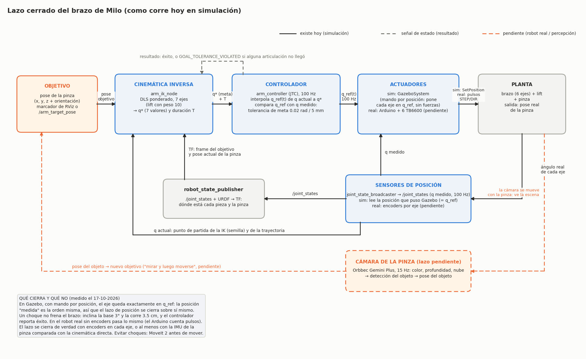
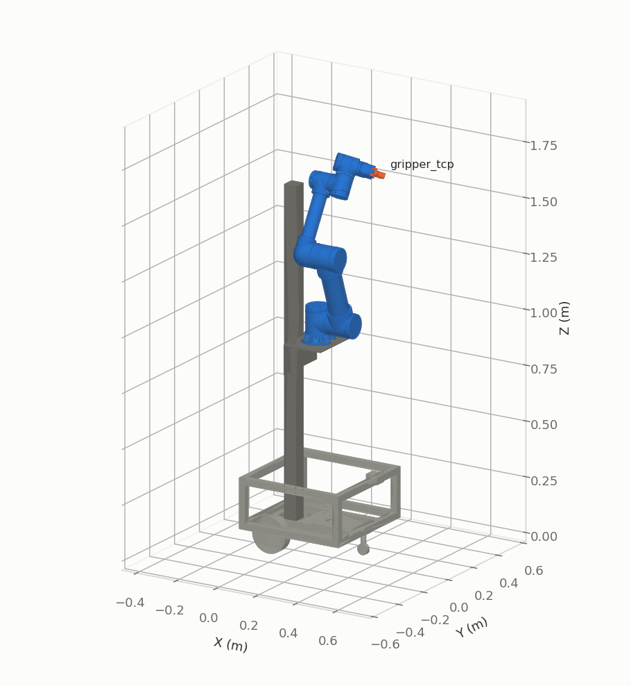
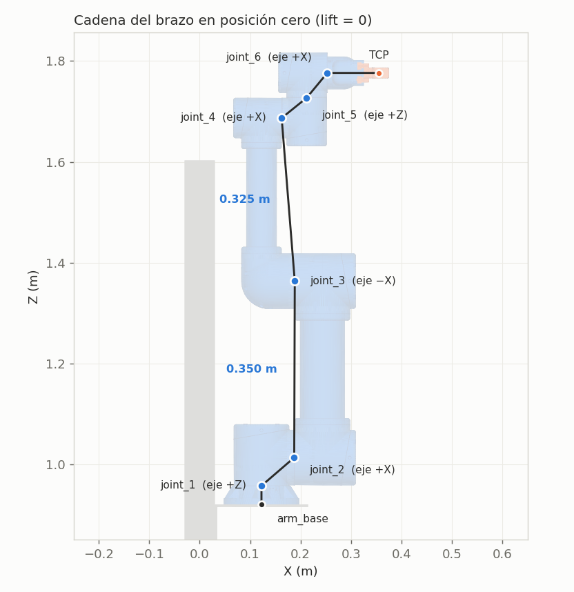
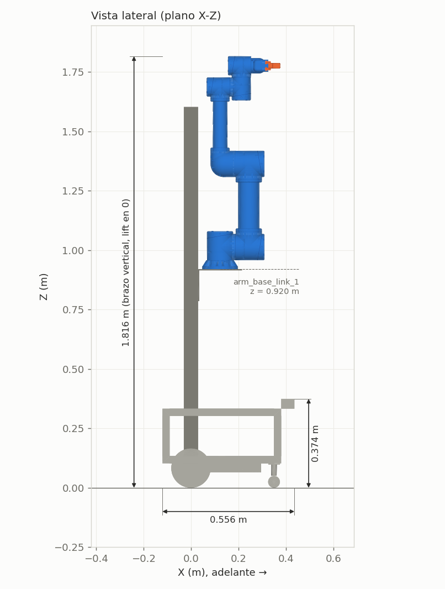
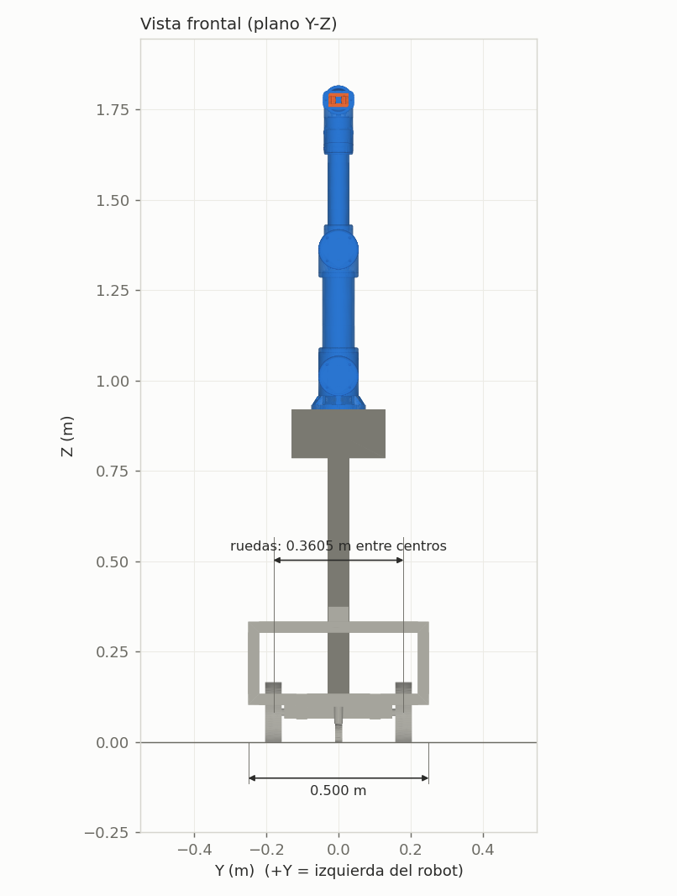
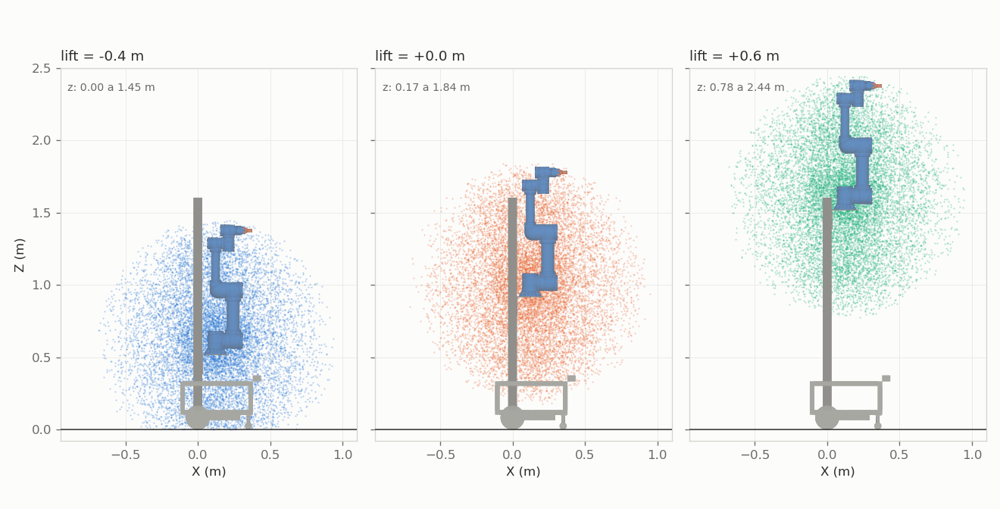

# Brazo de Milo (`andesrobot_arm`)

Cinemática directa e inversa del brazo + lift, control en Gazebo, planificación sin choques con
MoveIt 2 y marcador interactivo en RViz. Solo el brazo: la base se supone quieta (el diff drive y
el SLAM son de los otros paquetes). El robot real todavía no tiene driver para el brazo: esto
funciona **solo en simulación**.

## Usarlo

```bash
cd ~/milo_ws
./sim.sh brazo          # Gazebo + Milo con el brazo controlado + IK + marcador + RViz
```

En RViz: herramienta **Interact** (tecla `i`), arrastra la esfera naranja y suelta. MoveIt busca un
camino sin choques y el brazo va a esa pose. Si no se mueve, no hay camino: la pose está fuera de
alcance o choca con la mesa, la columna o lo que ve la cámara (el log dice `MoveIt no movió el
brazo` y por qué): clic derecho en la esfera → **Volver a la pinza**.

Mandar una pose a mano (en otra terminal, `./sim.sh shell`):

```bash
ros2 topic pub --once /arm_target_pose geometry_msgs/msg/PoseStamped \
  "{header: {frame_id: base_footprint}, pose: {position: {x: 0.5048, y: -0.2163, z: 1.862},
    orientation: {x: -0.1252, y: 0.5501, z: -0.7869, w: 0.2502}}}"
```

Abrir / cerrar la pinza (`right_finger_joint`: −0.007 cerrada … 0.016 abierta):

```bash
ros2 action send_goal /gripper_controller/follow_joint_trajectory control_msgs/action/FollowJointTrajectory \
  "{trajectory: {joint_names: [right_finger_joint], points: [{positions: [0.016], time_from_start: {sec: 1}}]}}"
```

Sin Docker (ROS Humble instalado en el PC): `ros2 launch andesrobot_arm arm_sim.launch.py`
(`gui:=false` sin ventana de Gazebo, `rviz:=false` sin RViz, `camara:=false` sin la cámara de la
pinza, `mesa:=false` sin la mesa de prueba, `moveit:=false` con la cinemática inversa propia en vez
de MoveIt, `octomap:=false` sin el mapa de la cámara en la escena).

Tests (sin ROS corriendo): `source install/setup.bash && cd src/andesrobot_arm && python3 -m pytest -q test`

Prueba de humo en Gazebo, sin ventanas (~2 min, con el contenedor levantado y sin otra simulación
andando): `bash /ros2_ws/src/andesrobot_arm/scripts/prueba_gazebo.sh`. Comprueba controladores,
`/joint_states`, los 4 canales de la cámara, una pose alcanzable y la pinza, y apaga todo al final.

## MoveIt 2: planificar sin choques

Desde el 18 de octubre de 2026, `./sim.sh brazo` lanza **MoveIt 2** (`move_group`) con la
configuración del paquete `andesrobot_moveit_config`, y `arm_moveit_node` reemplaza a `arm_ik_node`.
Cada pose que llega a `/arm_target_pose` se convierte en una petición a la acción `/move_action`:

1. `move_group` arma la **escena de planificación**: el robot (URDF + SRDF), la mesa de prueba
   (la publica `arm_moveit_node` como dos cajas en `/planning_scene`) y, con `octomap:=true`, lo
   que ve la cámara de la pinza como OctoMap (celdas de 2 cm; `config/sensors_3d.yaml`).
2. Resuelve la IK con KDL para el grupo `brazo` (lift + joint_1…6, de `base_footprint` a
   `gripper_tcp`) y busca con OMPL (RRT-Connect) un camino completo que no choque en ningún tramo.
3. Le pone tiempo con rampas de aceleración (TOTG, límites en `config/joint_limits.yaml`, al 50 %
   por defecto) y lo ejecuta en el mismo `arm_controller`, vigilando que llegue a tiempo.

Si no hay camino, `arm_moveit_node` lo dice en el log con el código de MoveIt explicado («no
encontró un camino: la meta está fuera de alcance, choca con algo… o no tiene solución de IK») y
el brazo no se mueve. Es la diferencia de fondo con `arm_ik_node`: una pose dentro de la mesa
ahora se **rechaza** en vez de ejecutarse.

Parámetros de `arm_moveit_node` (`--ros-args -p nombre:=valor`):

| Parámetro | Default | Uso |
|---|---|---|
| `planning_time` / `planning_attempts` | 5.0 s / 5 | tiempo e intentos de OMPL |
| `velocity_scaling` / `acceleration_scaling` | 0.5 / 0.5 | fracción de los límites de `joint_limits.yaml` |
| `tolerancia_pos` / `tolerancia_rot` | 2 mm / 0.02 rad | esfera y ángulo por eje que se aceptan como «llegó» |
| `position_only` | false | ignorar la orientación |
| `mesa` / `mesa_frame` | true / `base_footprint` | publicar la mesa de prueba como obstáculo; `mesa:=false` del launch la apaga |

Archivos de `andesrobot_moveit_config/config/`: `andesrobot.srdf` (grupos `brazo` y `pinza`,
posturas `cero`, `frente`, `abierta`, `cerrada`, y los pares de piezas sin revisión de choques),
`kinematics.yaml` (KDL), `joint_limits.yaml`, `moveit_controllers.yaml` (los mismos controladores de
`arm_controllers.yaml`), `ompl_planning.yaml` y `sensors_3d.yaml` (OctoMap). En RViz, los paneles
*Escena de MoveIt* (obstáculos y OctoMap en verde) y *Trayectoria planificada* muestran lo que
planifica (`rviz/arm_moveit.rviz`).

Si cambia la geometría del robot (una pieza nueva, la cámara en otro lugar), regenerar los pares
de piezas que no chocan del SRDF (dentro de `./sim.sh shell`):

```bash
X=$(ros2 pkg prefix andesrobot_description)/share/andesrobot_description/urdf/andesrobot.urdf.xacro
ros2 run moveit_setup_assistant collisions_updater --urdf $X \
  --xacro-args "lock_arm:=false arm_control:=true gripper_camera:=true arm_controllers_file:=/tmp/c.yaml" \
  --srdf /ros2_ws/src/andesrobot_moveit_config/config/andesrobot.srdf \
  --output /tmp/andesrobot_generado.srdf --default --always --trials 30000
# y copiar las líneas <disable_collisions .../> de /tmp/andesrobot_generado.srdf al final del SRDF
```

Limitaciones de esta integración: la escena de MoveIt solo conoce los frames del robot, por eso
la mesa y el OctoMap van en `base_footprint` (vale mientras la base no se mueva); los objetos de la
mesa que ve la cámara entran como obstáculos, así que una pose que los toque se rechaza (para
agarrar uno hay que quitarlo de la escena o apagar el OctoMap); y la IK es KDL, que cerca de los
límites de las articulaciones falla más que TRAC-IK (no hay binario para Humble).

## Puerta de prueba (desafío: abrir una puerta empujando)

`ros2 launch andesrobot_arm arm_sim.launch.py puerta:=true` pone una puerta frente a Milo en vez de
la mesa (`worlds/puerta_prueba.sdf`): hoja de 0.90 × 2.00 m en el plano x = 0.80 m que se abre
**empujando** (alejándose de Milo, hasta 80°), bisagra a la izquierda de Milo (y = +0.45) y manija
de **palanca** a la derecha (y = −0.38), a 1.0 m de altura. Hoja y manija tienen resorte: la puerta
se cierra sola y despacio, y la manija vuelve a quedar horizontal (bajarla del todo cuesta
~1.5 N·m). No tiene pestillo todavía: se puede empujar sin bajar la manija. Los ángulos reales de
la bisagra y la manija salen en `/puerta/joint_states` (para medir los experimentos). La manija
es metálica y brillante a propósito, como las reales que hacen fallar la profundidad.

Para mirarla con la cámara de la pinza (a ~0.5 m, apuntando hacia la puerta):

```bash
ros2 topic pub --once /arm_target_pose geometry_msgs/msg/PoseStamped \
  "{header: {frame_id: base_footprint}, pose: {position: {x: 0.28, y: -0.30, z: 1.10},
    orientation: {x: 0.0, y: 0.0, z: 1.0, w: 0.0}}}"
```

### Detectar la manija (YOLO)

La imagen trae Ultralytics (YOLOv8/11, YOLOE) con PyTorch y CUDA; los pesos se bajan solos a
`ros2_ws/modelos/` (no va a git). Prueba del 19-10-2026 sobre la cámara simulada: YOLOE (texto
«door handle») y YOLOv8s entrenado en Open Images (que trae la clase `Door handle`) **ubican y
recortan bien la manija, pero no la reconocen** (clase equivocada, confianza < 0.06): la puerta
simulada, de colores planos, es muy distinta de las fotos con que se entrenaron. Hay que afinar
un modelo propio.

Para eso, `scripts/generar_dataset_manija.py` genera imágenes **ya etiquetadas**: con la
simulación de la puerta corriendo, mueve la pinza (MoveIt) a vistas al azar alrededor de la
manija (0.35–0.8 m, ±40° a los lados, −15° a +45° en altura), toma la foto a color y proyecta la
geometría conocida de la manija (TF + `/puerta/joint_states`) para escribir la caja, el polígono
(máscara) y 3 keypoints (`eje` de la roseta, punto de `agarre` a 7 cm, `punta` de la palanca) en
formato YOLO, en `ros2_ws/datasets/manija_sim/` (no va a git):

Si todas las fotos muestran la misma puerta café con la misma luz, el modelo aprende *esa*
puerta y no reconoce otra. Por eso, con `--variar K`, cada K fotos el generador borra la puerta de
Gazebo y pone una **variante al azar** («domain randomization»): colores y texturas de hoja,
marco y muros (madera, ladrillo, pintura); manija plateada, dorada, negra, blanca...; largo de la
palanca (10–14 cm), grosor y roseta; una luz extra de color e intensidad al azar; y la hoja
entreabierta o la manija bajada (se corre el punto de reposo de sus resortes). Las etiquetas
usan las medidas de cada variante; `meta.csv` anota cuál tiene cada foto.

Para entrenar se generan dos carpetas con distinta semilla (así la validación son puertas que el
modelo nunca vio) y luego `scripts/entrenar_manija.py` afina el modelo (pesos y gráficos en
`ros2_ws/modelos/entrenamientos/`, no van a git):

```bash
ros2 launch andesrobot_arm arm_sim.launch.py puerta:=true octomap:=false        # terminal 1
cd /ros2_ws/src/andesrobot_arm/scripts                                           # terminal 2
python3 generar_dataset_manija.py --n 300 --variar 5 --semilla 1 --salida /ros2_ws/datasets/manija_sim/train
python3 generar_dataset_manija.py --n 60 --variar 5 --semilla 2 --salida /ros2_ws/datasets/manija_sim/val
# (apagar la simulación para dejar la GPU libre)
python3 entrenar_manija.py --tarea pose     # caja + keypoints; o --tarea seg (máscara)
```

«Afinar» (fine-tuning) es partir de un modelo ya entrenado con miles de fotos (COCO) y enseñarle
solo la clase nueva: necesita cientos de imágenes y minutos, no millones y días.

Medido: unos 9 s por foto (≈ 1 hora las 360); una vista que MoveIt no alcanza se salta.

## Cámara de la pinza (Orbbec Gemini Plus)

`./sim.sh brazo` monta la cámara sobre la pinza (`andesrobot_description/urdf/andesrobot.gripper_camera.xacro`,
malla `meshes/orbbec_gemini_plus.stl`) y pone una mesa con tres objetos frente a Milo
(`worlds/mesa_prueba.sdf`). Canales, con los mismos nombres que el driver real `OrbbecSDK_ROS2`
lanzado con `camera_name:=gripper_camera`:

| Topic | Qué es | Simulación |
|---|---|---|
| `/gripper_camera/color/image_raw` | imagen a color | 640×480 `rgb8`, FOV 71° |
| `/gripper_camera/depth/image_raw` | profundidad | 640×400 `32FC1` en metros, 0.25–2.5 m, FOV 67.9° |
| `/gripper_camera/depth/points` | nube de puntos con color | en `gripper_camera_depth_optical_frame` |
| `/gripper_camera/ir/image_raw` | infrarrojo | 640×400 `mono8` |

Cada uno trae su `camera_info`; todos a 15 Hz (`gripper_camera_rate` en el xacro; la real llega a
30). RViz los muestra en los paneles *Camara color / profundidad / infrarrojo* y la nube en 3D.
Guardar una imagen de cada canal (en otra terminal, `./sim.sh shell`):

```bash
ros2 run andesrobot_arm capturar_camara     # -> ~/milo_ws/ros2_ws/capturas/<fecha>/
```

Deja `color.png`, `ir.png`, `profundidad_mm.png` (16 bits en mm, como la real), `profundidad_vista.png`,
`nube.ply` y `resumen.txt`. Para que la cámara mire la mesa, mandar la pinza arriba de ella
apuntando 45° hacia abajo:

```bash
ros2 topic pub --once /arm_target_pose geometry_msgs/msg/PoseStamped \
  "{header: {frame_id: base_footprint}, pose: {position: {x: 0.5, y: 0.0, z: 1.4},
    orientation: {x: 0.3827, y: 0.0, z: 0.9239, w: 0.0}}}"
```

Montaje: soporte con bisagra sobre la cara superior de `link_6_1`, cámara mirando hacia donde apunta
la pinza e inclinada 20° hacia abajo (`gripper_camera_tilt`). Frames: `gripper_camera_link` (cuerpo),
`gripper_camera_{color,depth,ir}_frame` (cada lente) y sus `_optical_frame` (Z adelante, los de los
mensajes). La profundidad empieza a 0.25 m: la cámara **no ve el objeto en el agarre final** (los
dedos quedan a ~9 cm); se mide desde una pose previa y después se cierra sin ver.

Diferencias con la cámara real: la profundidad real llega en mm (`16UC1`) con ruido y huecos, y el IR
real muestra el patrón de puntos del proyector; en Gazebo la profundidad es perfecta y el IR es una
imagen gris. Gazebo publica además `/gripper_camera/depth/color_sim/*`, que no existe en la real.

## Qué corre



Lazo de control, de la orden al movimiento y de vuelta: la IK parte de `/joint_states`, el
controlador compara la posición pedida con la medida a 100 Hz, y la cámara (pendiente) cerrará el
lazo de percepción. En Gazebo la posición medida es la orden misma (mando por posición): ver
«Limitaciones». Se genera con `scripts/fig_lazo_cerrado.py` (solo matplotlib). Cómo quedaría el mismo lazo con
MoveIt 2 (planificación con revisión de choques): figura C del informe, `scripts/fig_lazo_moveit.py`.

| Pieza | Qué hace |
|---|---|
| `arm_sim.launch.py` | xacro con `lock_arm:=false arm_control:=true gripper_camera:=true` → Gazebo, spawn de Milo y la mesa, controladores, MoveIt (`moveit:=true`), nodos, RViz |
| `move_group` | MoveIt 2: escena de planificación (robot + mesa + OctoMap), IK (KDL), planificador (OMPL) y ejecución vigilada; configuración en `andesrobot_moveit_config` |
| `arm_moveit_node` | escucha `/arm_target_pose` y se lo pide a MoveIt (acción `/move_action`); publica la mesa en la escena |
| `arm_controller` | `JointTrajectoryController`: `vertical_lift_joint` + `joint_1..6` en una sola trayectoria, con tolerancias de meta (aborta si una articulación no llega; ver «Limitaciones») |
| `gripper_controller` | `JointTrajectoryController`: `right_finger_joint` (el izquierdo lo copia Gazebo, `mimic`) |
| `arm_ik_node` | (con `moveit:=false`) escucha `/arm_target_pose`, resuelve la IK propia y manda la trayectoria, sin revisión de choques |
| `arm_marker_node` | marcador en RViz sobre `gripper_tcp`; al soltar publica en `/arm_target_pose` (frame `base_footprint`) |
| `capturar_camara` | guarda una imagen de cada canal de la cámara de la pinza (`ros2 run andesrobot_arm capturar_camara`) |

Parámetros de `arm_ik_node`:

| Parámetro | Default | Uso |
|---|---|---|
| `use_lift` | true | false = IK de 6 articulaciones en `arm_base_link_1`, el lift no se mueve |
| `lift_weight` | 10.0 | peso del lift en la IK: mayor = lo mueve menos |
| `position_only` | false | ignorar la orientación del objetivo |
| `max_joint_velocity` / `max_lift_velocity` | 0.5 rad/s / 0.1 m/s | para calcular la duración |
| `min_duration` | 1.0 s | duración mínima de cada movimiento |

## Geometría (del URDF, marco `base_footprint`)

| | |
|---|---|
|  |  |
|  |  |

Robot completo (brazo vertical, lift en 0): 0.556 m de largo (x = −0.12 … 0.436), 0.500 m de ancho,
1.816 m de alto. Base hasta el lidar: 0.374 m. Ruedas: 0.3605 m entre centros.

- Brazo: hombro → codo 0.350 m, codo → muñeca 0.325 m; joint_4 → joint_5 → joint_6: 0.064 + 0.064 m.
- `gripper_tcp`: 0.102 m hacia −X de `link_6_1`, centro de las caras internas de los dedos
  (x = −0.083 … −0.121, punta en −0.1224). Apertura de la pinza: 0.017 + 2·q (3 … 49 mm).
- `arm_base_link_1` con lift en 0: (0.1225, 0, 0.920). Hombro (joint_2): z = 0.613 … 1.613 m según el lift.
- Con joint_1 = 0, los ejes de joint_2, 3, 4 y 6 son paralelos a X: el brazo se dobla hacia los
  costados. Para trabajar al frente, joint_1 gira.
- La muñeca **no es esférica** (joint_4 y joint_6 paralelos, a ~9 cm): no hay IK cerrada.

Alcance del TCP (muestreo aleatorio de 60 000 configuraciones, sin choques ni límites reales):

| Lift | Alturas del TCP | Alcance horizontal máx. (desde `base_footprint`) |
|---|---|---|
| −0.4 m | suelo … 1.45 m | 0.95 m |
| 0.0 m | 0.17 … 1.84 m | 0.96 m |
| +0.6 m | 0.78 … 2.44 m | 0.95 m |

Al frente (x máx.): 0.52 m a ras del suelo, 0.77 m a 0.30 m de altura, 0.89 m a 0.75 m, 0.93 m a 1.0 m.



Las figuras y `figuras/medidas.json` salen de `scripts/figuras.py`, que lee el URDF y las mallas:
si cambia el xacro, regenerarlas (dentro del contenedor, `./sim.sh shell`):

```bash
source /ros2_ws/install/setup.bash && cd /ros2_ws/src/andesrobot_arm
python3 scripts/figuras.py docs/figuras
```

## Métodos y ecuaciones

**Cinemática directa** (`kinematics.py`): producto de transformaciones leídas del URDF,
`T(q) = Π T_origin,i · M_i(q_i)`, con `R_origin = Rz(yaw)·Ry(pitch)·Rx(roll)`,
`M_rot = Rodrigues(eje, q)` y `M_pris = traslación q·eje`.

**Jacobiano geométrico**: rotativa `J_i = [z_i × (p_tcp − p_i); z_i]`, prismática `J_i = [z_i; 0]`.

**Cinemática inversa** (DLS ponderado, `ArmKinematics.ik`):

- Error: `e = [p_d − p ; log(R_d·Rᵀ)]` (el segundo es el vector de rotación eje·ángulo).
- Paso: `Δq = W⁻¹Jᵀ(J W⁻¹Jᵀ + λ²I)⁻¹ e`, recortado a ‖Δq‖ ≤ 0.5; λ = 0.01.
  `W` = peso por articulación (el lift lleva 10: con 7 articulaciones hay infinitas soluciones
  y así prefiere mover el brazo).
- Límites: se recorta a los del URDF; si el rango es una vuelta completa (los ±π provisorios),
  el ángulo da la vuelta en vez de recortarse.
- Converge con ‖e_p‖ < 0.1 mm y ‖e_R‖ < 1 mrad. Primer intento desde la posición actual; si
  falla, hasta 20 reinicios al azar dentro de los límites.

**Duración de la trayectoria**: `T = max(min_duration, max_i |Δq_i| / v_i)`.

## Limitaciones

- **Límites provisorios** (±π, 20 N·m, 1 rad/s): la IK puede devolver posturas que el brazo real no hace.
  Cambiar `arm_lower`/`arm_upper`/`arm_effort`/`arm_velocity` en `andesrobot.urdf.xacro`.
- **Giros largos cerca de ±π**: una articulación no puede pasar de ±π, así que si el objetivo queda
  "al otro lado" da casi una vuelta completa. Ejemplo medido: `joint_1` de 3.05 a −3.03 rad recorre
  6.08 rad en 12.2 s en vez de 0.2 rad. Se arregla con los topes reales.
- **Sin revisión de choques (solo con `moveit:=false`)**: la IK propia no sabe dónde están el
  chasis, la columna ni la mesa, y el brazo va directo a la solución. Con MoveIt (el default) los
  choques se evitan antes de mover. `arm_controller` tiene **tolerancias de meta**
  (`config/arm_controllers.yaml`: 0.02 rad por articulación, 5 mm el lift, 1 s de margen): si una
  articulación no llega, aborta y `arm_ik_node` avisa *"el brazo no llegó… ¿chocó con algo?"*. Pero
  en Gazebo eso **casi nunca pasa**: con el mando por posición las articulaciones son infinitamente
  rígidas y un choque no frena el brazo, sino que mueve al robot entero. Medido el 17 de octubre de
  2026: la pinza mandada 2 cm dentro del tablero de la mesa (desde arriba y desde el costado) «llega»
  al milímetro, y la base queda inclinada 3° y corrida 3.5 cm hacia atrás. El abort del 9 de octubre
  (la mesa frenó la pinza a 6 mm) fue un caso afortunado. Las tolerancias quedan como red de
  seguridad para el robot real con encoders; la protección de verdad es planificar con revisión de
  choques (MoveIt 2, ver `docs/tecnologias/` en la raíz del repo). La pinza no tiene tolerancia a
  propósito: al agarrar, los dedos quedan frenados.
- **Muñeca distinta al EB300**: el DH oficial del fabricante tiene d₄ = 122, d₅ = 99 y d₆ = 57 mm; el
  URDF (del CAD del equipo), 89.6, 89.5 y 41 mm. El brazo y el antebrazo sí coinciden. Hay que medir
  el brazo real antes de confiar en la posición de la pinza al centímetro.
- **Masas aproximadas**: los motores están (links `motor_joint_N`), pero los reductores EBA valen 0 y
  las piezas impresas se calcularon como ABS macizo.
- **Cámara ideal**: Gazebo da una profundidad perfecta (sin ruido, sombras ni huecos) y un IR sin el
  patrón del proyector. Ver «Cómo hacer realista la profundidad» en el informe (sección 14).
- **Mando por posición**: Gazebo pone las articulaciones en el ángulo pedido como si fueran
  infinitamente rígidas; para agarrar objetos de verdad (y para que un choque frene el brazo en vez
  de inclinar la base) habría que pasar a esfuerzo con PID.
- `simple_collision:=true` deja al brazo sin colisión propia (y una caja fija donde estaría el brazo
  bloqueado): por eso `arm_sim.launch.py` usa las mallas por defecto.
- `gazebo_ros2_control` (Humble) no puede leer un URDF con comentarios XML: `arm_sim.launch.py` los
  borra antes de publicar `/robot_description`. No reemplazar por `rsp.launch.py` sin eso.
