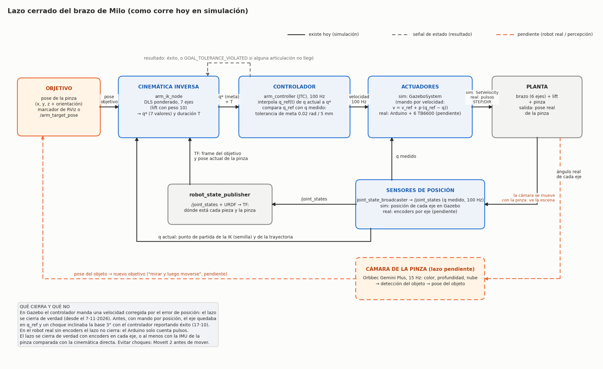
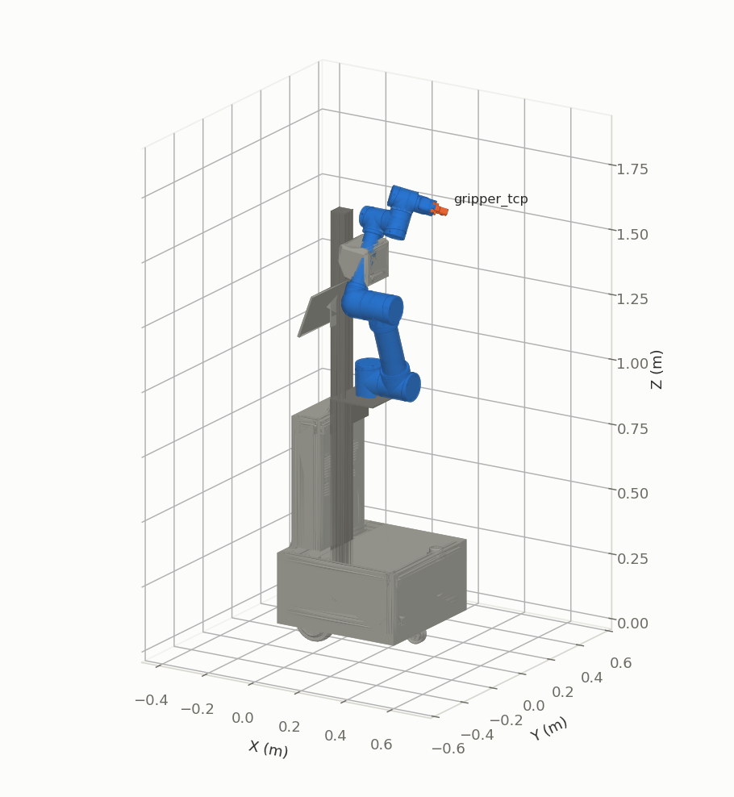
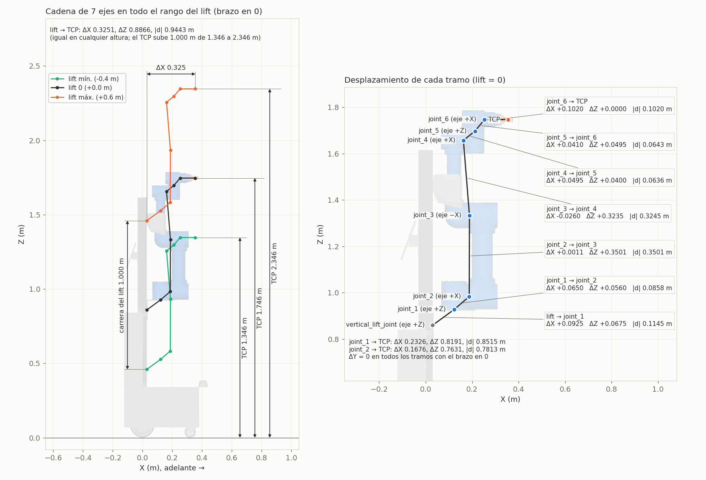
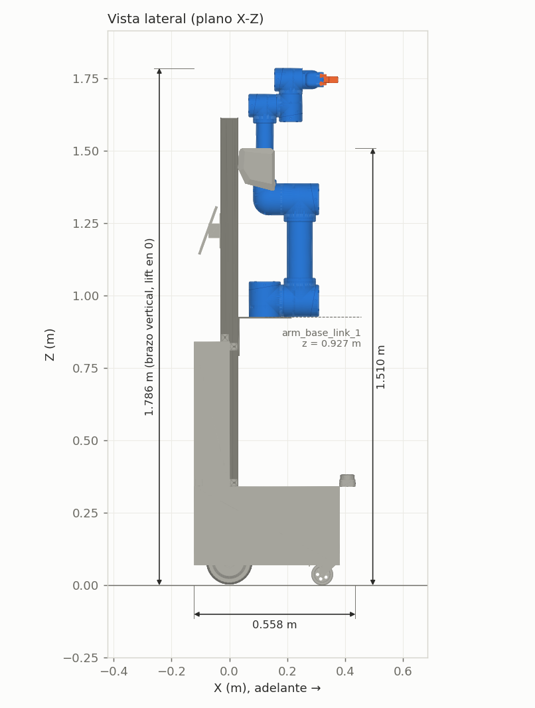
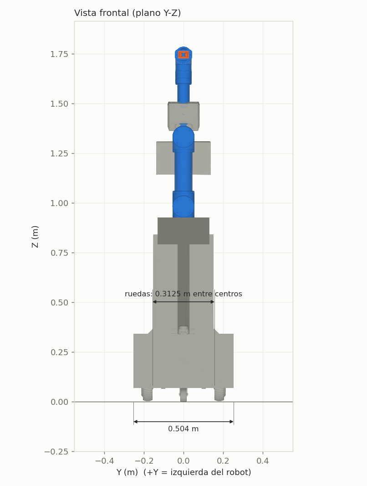
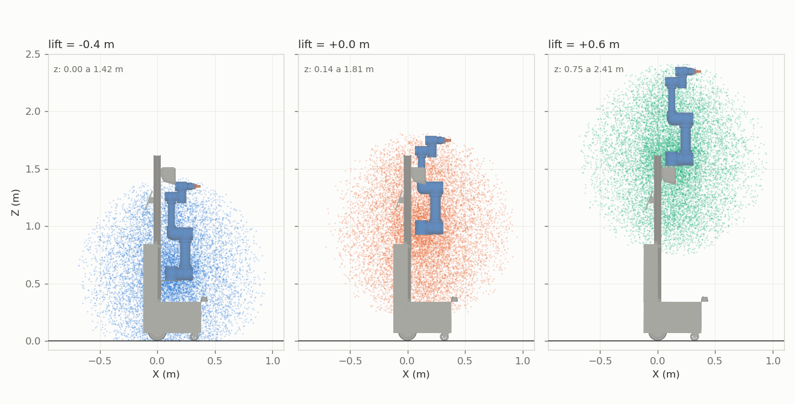

# Brazo de Milo (`andesrobot_arm`)

Cinemática directa e inversa del brazo + lift, control en Gazebo, planificación sin choques con
MoveIt 2 y marcador interactivo en RViz. Solo el brazo: la base se supone quieta (el diff drive y
el SLAM son de los otros paquetes). El robot real todavía no tiene driver para el brazo: esto
funciona **solo en simulación**.

## Usarlo

```bash
cd ~/milo_ws
./sim.sh brazo          # Gazebo + Milo con el brazo controlado + MoveIt + cámara + mesa + RViz
```

En RViz: herramienta **Interact** (tecla `i`), arrastra la esfera naranja y suelta. MoveIt busca un
camino sin choques y el brazo va a esa pose. Si no se mueve, no hay camino: la pose está fuera de
alcance o choca con la mesa, la columna o lo que ve la cámara (el log dice `MoveIt no movió el
brazo` y por qué): clic derecho en la esfera → **Volver a la pinza**.

Mandar una pose a mano (en otra terminal, `./sim.sh shell`):

```bash
ros2 topic pub --once /arm_target_pose geometry_msgs/msg/PoseStamped \
  "{header: {frame_id: base_footprint}, pose: {position: {x: 0.5048, y: -0.2163, z: 1.862},
    orientation: {x: -0.1252, y: 0.5501, z: -0.7869, w: 0.2502}}}"
```

Abrir / cerrar la pinza (`right_finger_joint`: −0.007 cerrada … 0.016 abierta; `left_finger_joint` siempre
el valor opuesto: los dos dedos se mandan juntos, en espejo, y una meta con un solo dedo se rechaza):

```bash
ros2 action send_goal /gripper_controller/follow_joint_trajectory control_msgs/action/FollowJointTrajectory \
  "{trajectory: {joint_names: [right_finger_joint, left_finger_joint], points: [{positions: [0.016, -0.016], time_from_start: {sec: 1}}]}}"
```

Sin Docker (ROS Humble instalado en el PC): `ros2 launch andesrobot_arm arm_sim.launch.py`
(`gui:=false` sin ventana de Gazebo, `rviz:=false` sin RViz, `camara:=false` sin la cámara de la
pinza, `mesa:=false` sin la mesa de prueba, `puerta:=true` la puerta de prueba en vez de la mesa,
`moveit:=false` con la cinemática inversa propia en vez de MoveIt, `octomap:=false` sin el mapa de
la cámara en la escena). `./sim.sh brazo` no pasa argumentos: para cambiarlos, `./sim.sh shell` y
el `ros2 launch` directo.

Tests (sin ROS corriendo, dentro de `./sim.sh shell`):
`source /ros2_ws/install/setup.bash && cd /ros2_ws/src/andesrobot_arm && python3 -m pytest -q test`

Prueba de humo en Gazebo, sin ventanas (~2 min, con el contenedor levantado y sin otra simulación
andando): `bash /ros2_ws/src/andesrobot_arm/scripts/prueba_gazebo.sh`. Comprueba controladores,
`/joint_states`, los 4 canales de la cámara, una pose alcanzable, y con MoveIt que la mesa está en
la escena, que una pose dentro de la mesa se rechaza y que el OctoMap se llena; después la pinza, y
apaga todo al final. `MOVEIT=false bash .../prueba_gazebo.sh` la corre con `arm_ik_node`.

**Pinza por fuerza.** Los dedos se mandan por esfuerzo, no por posición: `gripper_controller` usa
un PID (`gains` en `config/arm_controllers.yaml`) y Gazebo recorta la fuerza al tope
`gripper_force` (20 N) del URDF, así que al cerrar sobre un objeto el dedo se frena contra él y
sigue empujando, como el servo real trabado. Cada dedo tiene su PID (el izquierdo ya no es
*mimic* en la simulación: así se iba corriendo con los movimientos del brazo). Por qué 20 N, el
amortiguamiento y los parámetros de contacto: comentarios de `andesrobot.urdf.xacro` y
`andesrobot.arm_control.xacro`. Prueba (con la simulación corriendo; mejor sin mesa ni cámara:
`ros2 launch andesrobot_arm arm_sim.launch.py gui:=false rviz:=false mesa:=false camara:=false`):
`python3 /ros2_ws/src/andesrobot_arm/scripts/prueba_pinza.py` pone cajas fijas de 10 a 45 mm entre
los dedos y comprueba que la apertura queda a menos de 1 mm del ancho sin temblar (7-nov: < 0.1 mm
de error, < 0.25 mm de temblor).

**Levantar un objeto suelto** (fase 2 de P15). `scripts/prueba_levantar.py` pone una caja suelta
de 30 mm sobre un pedestal entre los dedos, cierra, sube el lift 5 cm y mide durante 10 s cuánto se
corre la caja respecto del TCP (su pose la publica el plugin `gazebo_ros_p3d` del SDF de la caja).
Dos cosas hicieron falta:
- **Brazo por velocidad.** Con mando por posición, `gazebo_ros2_control` pone cada articulación en
  la posición pedida de un salto en cada paso, sin velocidad, y el roce de los dedos no arrastra la
  caja: subió 0 mm de 50. Ahora `arm_controller` manda velocidad
  ($`v = v_\mathrm{ref} + p\,(q_\mathrm{ref} - q)`$, `ff_velocity_scale` 1, $`p`$ = 20 s⁻¹ y 60 s⁻¹
  el lift) y la caja sube con la pinza. En reposo el brazo queda a ~1e-5 rad del objetivo y el lift
  a 0.3 mm. Prueba de humo completa en verde con MoveIt y con `arm_ik_node`.
- **Apretar, no cerrar del todo.** Si los dos dedos empujan con el tope, nada los centra y la caja
  se va de lado (3.8 mm en 10 s con 1 kg). Mandando cada dedo 2 mm más adentro del ancho
  (`--apriete`), cada uno empuja $`p \cdot 2`$ mm = 20 N y si la caja se corre, un dedo empuja más
  que el otro y la devuelve. En la pinza real lo hace el piñón que mueve los dos dedos.
Resultado (7-nov, contacto de los dedos kp 1e6, kd 300): de 0.1 a 0.5 kg la caja sube con la pinza
y se corre 0.05–0.4 mm en 10 s (8 de 8); con 1 kg resbala 2–3 mm al arrancar la subida (no pasa).
`python3 /ros2_ws/src/andesrobot_arm/scripts/prueba_levantar.py --masa 0.1 0.5` (misma simulación
que `prueba_pinza.py`, con la pinza en la pose inicial).

## MoveIt 2: planificar sin choques

Desde el 18 de octubre de 2026, `./sim.sh brazo` lanza **MoveIt 2** (`move_group`) con la
configuración del paquete `andesrobot_moveit_config`, y `arm_moveit_node` reemplaza a `arm_ik_node`.
Cada pose que llega a `/arm_target_pose` se convierte en una petición a la acción `/move_action`:

1. `move_group` arma la **escena de planificación**: el robot (URDF + SRDF), la mesa de prueba
   (la publica `arm_moveit_node` como dos cajas en `/planning_scene`) y, con `octomap:=true`, lo
   que ve la cámara de la pinza como OctoMap (celdas de 2 cm; `config/sensors_3d.yaml`).
2. Resuelve la IK con KDL para el grupo `brazo` (lift + joint_1…6, de `base_footprint` a
   `gripper_tcp`) y busca con OMPL (RRT-Connect) un camino completo que no choque en ningún tramo.
3. Le pone tiempo con rampas de aceleración (TOTG, límites en `config/joint_limits.yaml`, al 50 %
   por defecto) y lo ejecuta en el mismo `arm_controller`, vigilando que llegue a tiempo.

Si no hay camino, `arm_moveit_node` lo dice en el log con el código de MoveIt explicado («no
encontró un camino: la meta está fuera de alcance, choca con algo… o no tiene solución de IK») y
el brazo no se mueve. Es la diferencia de fondo con `arm_ik_node`: una pose dentro de la mesa
ahora se **rechaza** en vez de ejecutarse.

Parámetros de `arm_moveit_node` (`--ros-args -p nombre:=valor`):

| Parámetro | Default | Uso |
|---|---|---|
| `planning_time` / `planning_attempts` | 5.0 s / 5 | tiempo e intentos de OMPL |
| `velocity_scaling` / `acceleration_scaling` | 0.5 / 0.5 | fracción de los límites de `joint_limits.yaml` |
| `tolerancia_pos` / `tolerancia_rot` | 2 mm / 0.02 rad | esfera y ángulo por eje que se aceptan como «llegó» |
| `position_only` | false | ignorar la orientación |
| `joint_6_max` | 1.5708 rad | la meta pide además \|joint_6\| ≤ este valor, para que la cámara (detrás de la muñeca) no quede de cabeza; 0 = sin esta restricción |
| `mesa` / `mesa_frame` | true / `base_footprint` | publicar la mesa de prueba como obstáculo; `mesa:=false` del launch la apaga |

Archivos de `andesrobot_moveit_config/config/`: `andesrobot.srdf` (grupos `brazo` y `pinza`,
posturas `cero`, `frente`, `abierta`, `cerrada`, y los pares de piezas sin revisión de choques),
`kinematics.yaml` (KDL), `joint_limits.yaml`, `moveit_controllers.yaml` (los mismos controladores de
`arm_controllers.yaml`), `ompl_planning.yaml` y `sensors_3d.yaml` (OctoMap). En RViz, los paneles
*Escena de MoveIt* (obstáculos y OctoMap en verde) y *Trayectoria planificada* muestran lo que
planifica (`rviz/arm_moveit.rviz`).

Si cambia la geometría del robot (una pieza nueva, la cámara en otro lugar), regenerar los pares
de piezas que no chocan del SRDF (dentro de `./sim.sh shell`):

```bash
X=$(ros2 pkg prefix andesrobot_description)/share/andesrobot_description/urdf/andesrobot.urdf.xacro
ros2 run moveit_setup_assistant collisions_updater --urdf $X \
  --xacro-args "lock_arm:=false arm_control:=true gripper_camera:=true arm_controllers_file:=/tmp/c.yaml" \
  --srdf /ros2_ws/src/andesrobot_moveit_config/config/andesrobot.srdf \
  --output /tmp/andesrobot_generado.srdf --default --always --trials 30000
# y copiar las líneas <disable_collisions .../> de /tmp/andesrobot_generado.srdf al final del SRDF
```

Limitaciones de esta integración: la escena de MoveIt solo conoce los frames del robot, por eso
la mesa y el OctoMap van en `base_footprint` (vale mientras la base no se mueva); los objetos de la
mesa que ve la cámara entran como obstáculos, así que una pose que los toque se rechaza (para
agarrar uno hay que quitarlo de la escena o apagar el OctoMap); y la IK es KDL, que cerca de los
límites de las articulaciones falla más que otros solvers. TRAC-IK no tiene paquete para ROS 2
Humble (no está en el índice oficial de rosdistro); el reemplazo que sí hay es pick_ik.

**Dos opciones para probar** (con los valores por defecto todo queda como siempre; **ninguna de
las dos se ha probado todavía en la simulación**):

| Argumento | Qué cambia | Cómo se ve si funciona |
| --- | --- | --- |
| `ik:=pick_ik` | el solver de cinemática inversa pasa de KDL a pick_ik (`config/kinematics_pick_ik.yaml`; el paquete `ros-humble-pick-ik` está en el Dockerfile, hay que reconstruir la imagen) | `prueba_gazebo.sh` sigue pasando y resuelve igual o más poses que con KDL, sin tardar mucho más |
| `suavizado:=ruckig` | agrega el adaptador `AddRuckigTrajectorySmoothing` después de TOTG: la trayectoria acota también el tirón (jerk) | los movimientos arrancan y frenan sin golpes; el brazo sigue llegando a la pose |

Dentro del contenedor (`./sim.sh shell`; `./sim.sh brazo` no pasa argumentos):
`ros2 launch andesrobot_arm arm_sim.launch.py ik:=pick_ik suavizado:=ruckig`.
Si `move_group` se queja de un parámetro de pick_ik, comparar `kinematics_pick_ik.yaml` con el README
de la versión instalada. La lógica que no depende de ROS está en `andesrobot_arm/moveit_opciones.py`
(con pruebas); un módulo o archivo `.yaml` nuevo necesita `./sim.sh build`.

## Puerta de prueba (desafío: abrir una puerta empujando)

`ros2 launch andesrobot_arm arm_sim.launch.py puerta:=true` pone una puerta frente a Milo en vez de
la mesa (`worlds/puerta_prueba.sdf`): hoja de 0.90 × 2.00 m en el plano x = 0.80 m que se abre
**empujando** (alejándose de Milo, hasta 80°), bisagra a la izquierda de Milo (y = +0.45) y manija
de **palanca** a la derecha (y = −0.38), a 1.0 m de altura. Hoja y manija tienen resorte: la puerta
se cierra sola y despacio, y la manija vuelve a quedar horizontal (bajarla del todo cuesta
~1.5 N·m). No tiene pestillo todavía: se puede empujar sin bajar la manija. Los ángulos reales de
la bisagra y la manija salen en `/puerta/joint_states` (para medir los experimentos). La manija
es metálica y brillante a propósito, como las reales que hacen fallar la profundidad.

Para mirarla con la cámara de la pinza (a ~0.5 m, apuntando hacia la puerta):

```bash
ros2 topic pub --once /arm_target_pose geometry_msgs/msg/PoseStamped \
  "{header: {frame_id: base_footprint}, pose: {position: {x: 0.28, y: -0.30, z: 1.10},
    orientation: {x: 0.0, y: 0.0, z: 1.0, w: 0.0}}}"
```

### Detectar la manija (YOLO)

La imagen trae Ultralytics (YOLOv8/11, YOLOE) con PyTorch y CUDA; los pesos se bajan solos a
`ros2_ws/modelos/` (no va a git). Prueba del 19-10-2026 sobre la cámara simulada: YOLOE (texto
«door handle») y YOLOv8s entrenado en Open Images (que trae la clase `Door handle`) **ubican y
recortan bien la manija, pero no la reconocen** (clase equivocada, confianza < 0.06): la puerta
simulada, de colores planos, es muy distinta de las fotos con que se entrenaron. Hay que afinar
un modelo propio.

Para eso, `scripts/generar_dataset_manija.py` genera imágenes **ya etiquetadas**: con la
simulación de la puerta corriendo, mueve la pinza (MoveIt) a vistas al azar alrededor de la
manija (0.35–0.8 m, ±40° a los lados, −15° a +45° en altura), toma la foto a color y proyecta la
geometría conocida de la manija (TF + `/puerta/joint_states`) para escribir la caja, el polígono
(máscara) y 3 keypoints (`eje` de la roseta, punto de `agarre` a 7 cm, `punta` de la palanca) en
formato YOLO, en `ros2_ws/datasets/manija_sim/` (no va a git).

Si todas las fotos muestran la misma puerta café con la misma luz, el modelo aprende *esa*
puerta y no reconoce otra. Por eso, con `--variar K`, cada K fotos el generador borra la puerta de
Gazebo y pone una **variante al azar** («domain randomization»): colores y texturas de hoja,
marco y muros (madera, ladrillo, pintura); manija plateada, dorada, negra, blanca...; largo de la
palanca (10–14 cm), grosor y roseta; una luz extra de color e intensidad al azar; y la hoja
entreabierta o la manija bajada (se corre el punto de reposo de sus resortes). Las etiquetas
usan las medidas de cada variante; `meta.csv` anota cuál tiene cada foto.

Para entrenar se generan dos carpetas con distinta semilla (así la validación son puertas que el
modelo nunca vio) y luego `scripts/entrenar_manija.py` afina el modelo (pesos y gráficos en
`ros2_ws/modelos/entrenamientos/`, no van a git):

```bash
ros2 launch andesrobot_arm arm_sim.launch.py puerta:=true octomap:=false        # terminal 1
cd /ros2_ws/src/andesrobot_arm/scripts                                           # terminal 2
python3 generar_dataset_manija.py --n 300 --variar 5 --semilla 1 --salida /ros2_ws/datasets/manija_sim/train
python3 generar_dataset_manija.py --n 60 --variar 5 --semilla 2 --salida /ros2_ws/datasets/manija_sim/val
# (apagar la simulación para dejar la GPU libre)
python3 entrenar_manija.py --tarea pose     # caja + keypoints; o --tarea seg (máscara)
```

«Afinar» (fine-tuning) es partir de un modelo ya entrenado con miles de fotos (COCO) y enseñarle
solo la clase nueva: necesita cientos de imágenes y minutos, no millones y días.

Medido: de 9 a 11 s por foto; una vista que MoveIt no alcanza se salta.

Probar el modelo con lo que ve la cámara (con la puerta en la simulación y la pinza apuntando a
la manija; en otra terminal, `./sim.sh shell`):

```bash
ros2 run andesrobot_arm capturar_camara --ros-args -p carpeta:=/ros2_ws/capturas/prueba && \
yolo pose predict model=/ros2_ws/modelos/entrenamientos/manija_pose/weights/best.pt \
  source=/ros2_ws/capturas/prueba/color.png project=/ros2_ws/capturas name=yolo exist_ok=True
# -> ~/milo_ws/ros2_ws/capturas/yolo/color.jpg con la caja y los 3 keypoints
```

Si `capturar_camara` dice «No llegó nada por /gripper_camera/...», no hay simulación corriendo.
Para detectar **en vivo** y obtener la manija en 3D está `manija_node` (**sin probar todavía en la
simulación**; la geometría que usa, `andesrobot_arm/manija.py`, sí tiene pruebas con una puerta
sintética):

```bash
ros2 run andesrobot_arm manija_node --ros-args -p use_sim_time:=true      # dentro del contenedor
# opciones: -p confianza:=0.5  -p distancia_previa:=0.30  -p enviar_previa:=true
#           -p acercar:=true  -p distancia_final:=0.05  -p tiempo_max:=30.0
```

Cada 0.5 s corre el modelo sobre la imagen a color y pasa los keypoints `eje`, `agarre` y `punta` a
puntos 3D: cada píxel a color es un rayo que se sigue hasta tocar la superficie de la imagen de
profundidad (cámaras con otra resolución y otro campo de visión). Si la profundidad falla sobre la
manija brillante, se usa el plano de la puerta ajustado con los píxeles de alrededor, corrido 5 cm
hacia el robot (lo que sobresale la manija). Lo mismo si el rayo pasó al lado de la palanca (es
delgada) y midió la hoja de detrás: un keypoint que cae sobre el plano de la puerta se cambia por
el cruce de su rayo con el plano de la manija (`corregir_saliente`). Una detección sin sentido (palanca que no mide 8–18 cm,
fuera del plano de la puerta) se descarta con un aviso. Publica en `base_footprint`:

| Topic | Qué es |
| --- | --- |
| `/manija/agarre` | el punto donde se empuja la palanca |
| `/manija/pose_previa` | dónde poner la pinza, a 0.30 m de la manija y mirando a la puerta (desde ahí la profundidad mide) |
| `/manija/marcadores` | eje, agarre, punta y la normal de la puerta, para verlos en RViz |
| `/manija/distancia` | distancia en línea recta del efector final (`gripper_tcp`) al punto de agarre [m] |
| `/manija/agarre_tcp` | el punto de agarre visto desde `gripper_tcp` (x negativo = lo que falta avanzar) |

En cada detección escribe en el log cuánto le falta a la pinza (`manija.distancia_desde_tcp`):
*«manija a 0.300 m del TCP: avanzar 0.300 m, lateral −0.000 m, vertical +0.000 m»*. «Avanzar» es a
lo largo de la dirección en que apunta la pinza (su −X local); lateral y vertical, a lo largo de
sus ejes Y y Z. Con lateral y vertical cerca de 0 basta avanzar en línea recta.

**Llevar la pinza a la manija** (`acercar:=true`, clase `Acercamiento` de `manija.py`). La
profundidad no mide a menos de 0.25 m, así que el acercamiento va en dos tramos:

1. Con 3 detecciones seguidas que no se separan más de 2 cm (una suelta puede estar mal), manda
   a `/arm_target_pose` la pose previa: 30 cm antes del punto de agarre, mirando a la puerta.
2. Cuando el TCP llega (a menos de 1 cm), vuelve a detectar la manija desde ahí (más cerca y de
   frente, mejor estimación) y manda el último tramo: `distancia_final` (5 cm) antes del punto de
   agarre, a ciegas. Al llegar escribe a qué distancia quedó la pinza.

Si el brazo no llega en `tiempo_max` s (MoveIt no encontró camino), vuelve a detectar y lo
intenta de nuevo. Conviene lanzar la puerta con `octomap:=false`: con el OctoMap, la puerta y la
manija que ve la cámara son obstáculos y MoveIt rechaza una pose a 5 cm de ellas. Todavía no toca
ni baja la palanca: el arco (`arco_palanca`) ya está calculado en `manija.py`; falta ejecutarlo.

```bash
ros2 launch andesrobot_arm arm_sim.launch.py puerta:=true octomap:=false     # terminal 1
ros2 run andesrobot_arm manija_node --ros-args -p use_sim_time:=true -p acercar:=true
```

Para que la cámara vea la manija antes de lanzar el nodo, mandar primero la pinza a una pose de
partida frente a ella (x 0.387, y −0.319, z 1.086 en `base_footprint`, pinza horizontal girada
180° en Z: la cámara queda a 55 cm de la manija). El comando, de dónde sale la pose y las
alternativas a 45 y 65 cm están en [`docs/prueba_desde_cero.md`](../../../../docs/prueba_desde_cero.md#9-pinza-frente-a-la-manija-y-acercamiento),
el orden de pruebas desde un PC vacío.

`scripts/probar_manija_sin_gazebo.py` prueba el nodo de punta a punta **sin Gazebo ni YOLO** (un
brazo ideal que sigue `/arm_target_pose` por TF, una puerta plana en la profundidad y los keypoints
verdaderos con 1 px de ruido): medido el 5-nov-2026, la pinza queda a 0.050 m del punto de agarre
y la manija estimada a 0.3 mm de la verdadera. Esa prueba encontró que el rayo de un keypoint puede
pasar al lado de la palanca y llevar la pinza 5 cm de más (hasta tocar la manija): por eso
`corregir_saliente`. No reemplaza la prueba en Gazebo (MoveIt, la imagen y el modelo reales). Un
nodo o script nuevo necesita `./sim.sh build`.

**Probado en Gazebo (7-nov-2026)**, con la cámara detrás de la muñeca y desde la pose de partida:
detecta la manija estable, va a la pose previa, la detecta de nuevo a 0.300 m y termina con
«Listo: … 0.050 m». Medida con TF, la pinza quedó a 0.063 m del punto de agarre verdadero
(x 0.745): el punto detectado estaba 1.3 cm más cerca. Los marcadores en RViz no se revisaron
(prueba sin ventanas). El modelo se entrenó con fotos de la cámara anterior (sobre la pinza, sin
el cuerpo de la pinza en la imagen) y aun así la detecta.

**Primer resultado (19-10-2026)**, `yolov8s-pose` con 267 fotos de entrenamiento y 60 de
validación (puertas que no vio), 100 épocas en 6 minutos (RTX 3070): encuentra la manija en las
60 (mAP50 0.995), los keypoints caen a ~2–3 px del punto verdadero (peor: 9.5 px en una imagen
de 640×480) y tarda 12 ms por imagen. Ojo: eso mide *simulación contra simulación*; con una
puerta real todavía no está probado (siguiente paso: fotos de una puerta real).

**La base resbala.** En la simulación, cada movimiento del brazo
hace retroceder la base ~1 mm, **aunque no toque nada** (medido moviendo el brazo en el aire: 1.4
cm en 12 movimientos). En una corrida de 300 fotos la base terminó 0.41 m atrás y girada 24°, y
MoveIt fallaba 1 de cada 3 vistas porque la puerta quedaba lejos. Las etiquetas siguen bien (se
calculan con la TF del momento), pero se pierde tiempo. Por eso el generador baja la aceleración
del brazo (`--aceleracion 0.2`), no intenta vistas que dejen el TCP a menos de 12 cm de la hoja
(`--margen`), avisa cuando la base se movió 5 cm y **para a los 15 cm** (`--deriva_max`): se
relanza la simulación y se sigue con `--inicio N` (lo dice el mensaje). Esto también importa para
empujar la puerta de verdad: la fuerza del brazo puede mover la base.

## Objetos sobre la mesa (modelo de objetos del reglamento)

Igual que con la manija, pero con objetos: un modelo YOLO **de detección** entrenado con el
dataset del reglamento (`dataset_reglamento2`, YOLO11n, 27 clases: bag, book, bottle, bowl, box,
card, cereal_box, cleaning_supply, clothing, colgate_box, cup, drink, electronic_device, food,
fork, fruit, key, knife, pitcher, plate, pringles, redbull_can, rubik_cube, spoon, tool, tray,
writing_tool) encuentra el objeto y `objeto_node` lleva la pinza frente a él. Los pesos van en
`ros2_ws/modelos/objetos/best.pt` (no van a git: se copian a mano).

**Escenario** (`objetos:=...`, basado en `sim_cup_bowl`): la misma mesa de siempre (así MoveIt
ya la conoce como obstáculo) con objetos escaneados de objetos reales. El catálogo
`config/objetos.yaml` tiene 26, de 23 clases (sin modelo: colgate_box, key, redbull_can y drink),
de Google Scanned Objects (Gazebo Fuel) y del set YCB, todos CC-BY 4.0. `objetos:=true` pone la
taza y el bowl originales; `objetos:=taza,platano,pringles` los que se pidan (ids o clases, hasta
10: una fila de 5 en x = 0.80, al alcance del brazo, y otra en x = 0.95). Los modelos se bajan
una vez a `ros2_ws/modelos/gazebo/` (no va a git, ~370 MB); el launch suma esa carpeta a
`GAZEBO_MODEL_PATH` y pone los objetos recién cuando los controladores del brazo están andando:

```bash
python3 /ros2_ws/src/andesrobot_arm/scripts/descargar_objetos.py               # una vez (internet)
python3 /ros2_ws/src/andesrobot_arm/scripts/descargar_objetos.py --lista       # ids y clases
ros2 launch andesrobot_arm arm_sim.launch.py objetos:=true octomap:=false      # terminal 1
# Pinza frente a la mesa, cámara a 50 cm del centro de la mesa mirando 40° hacia abajo:
ros2 topic pub --once /arm_target_pose geometry_msgs/msg/PoseStamped "{header: {frame_id: base_footprint}, pose: {position: {x: 0.531, y: -0.009, z: 0.941}, orientation: {x: -0.1736, y: 0.0, z: -0.9848, w: 0.0}}}"
ros2 run andesrobot_arm objeto_node --ros-args -p use_sim_time:=true -p clase:=cup -p acercar:=true
# opciones: -p clase:=''  (la detección más segura, de cualquier clase)  -p confianza:=0.4
#           -p distancia_previa:=0.30  -p distancia_final:=0.10  -p inclinacion:=20.0
```

Cómo pasa de la caja a un punto 3D (`andesrobot_arm/objetos.py`, 8 pruebas en
`test/test_objetos.py`): el modelo solo da un rectángulo, así que se toman 25 píxeles de su parte
central, cada uno es un rayo que se sigue hasta la profundidad (la misma `punto_en_rayo` de la
manija) y el punto del objeto es la **mediana** (no se mueve si unos pocos rayos tocan la mesa).
Es un punto de la cara que mira a la cámara, no el centro del objeto. La pinza llega desde el lado
de Milo, inclinada `inclinacion` grados hacia abajo, en los mismos dos tramos que la manija
(`manija.Acercamiento`): 30 cm, detectar de nuevo y `distancia_final`. Publica `/objeto/punto`,
`/objeto/pose_previa`, `/objeto/marcadores`, `/objeto/distancia` y `/objeto/punto_tcp`.

**Probado en Gazebo (6-nov-2026), clase `cup`:** desde la pose de arriba, detecta la taza (0.75),
va a la pose previa (quedó a 0.300 m), la detecta de nuevo (0.66, el punto se movió 1 cm) y
termina con la pinza a 0.103 m del punto detectado (pedido 0.10 m), justo frente a la taza. Esa
prueba se hizo antes de corregir el orden de los colores (ver abajo). **Repetida el 7-nov-2026**,
con los colores corregidos y la cámara detrás de la muñeca: detecta la taza blanca (0.83) en
(0.79, −0.26, 0.79), llega a la pose previa (0.301 m) y termina a 0.100 m. Desde atrás la pinza
ocupa el tercio de abajo de la imagen y el modelo a veces la llama `card` (0.22); `objeto_node` no
se confunde porque busca la clase pedida.

Qué hace `descargar_objetos.py` con cada modelo, y por qué (cada cosa salió de una prueba):
- **Material:** sin arreglo los objetos se veían negros (sin color ambiente `Ka`, o `Ka` en 0) o
  grises sin textura (la textura en otra carpeta, o la malla sin `usemtl`, como el tarro de
  Pringles). Copia la textura junto a la malla, pone `Ka` blanco y agrega el `usemtl`.
- **Masa e inercia:** los de Google traen 1 kg por defecto; se pone la del catálogo, con la inercia
  de una caja del tamaño de la malla.
- **Colisión = caja que encierra la malla:** con la malla como colisión y la masa real, la taza se
  caía de lado sola. Se ve igual (lo visual sigue siendo la malla); para agarrar de verdad habría
  que revisarlo.
- **Medidas** en `milo.json`: el launch las usa para dejar la base del objeto sobre la mesa (los de
  YCB no tienen el origen en la base).
- Descartados al probarlos: la botella de agua de Fuel (formato `.glb`, que Gazebo clásico no lee:
  va la de mostaza de YCB) y la lata de Coca-Cola de Fuel (su malla deja la lata 28 cm bajo su
  origen y salía disparada de la mesa: `drink` quedó sin modelo).

**Colores invertidos (corregido el 7-nov):** `image_to_array` da la imagen en RGB y Ultralytics
supone que un arreglo viene en BGR, como OpenCV: `objeto_node`, `manija_node` y
`evaluar_objetos.py` le pasaban al modelo los colores cambiados (rojo ↔ azul; la mesa café se
veía azul). Ahora dan vuelta los canales. No pasaba al probar con fotos guardadas (`yolo predict
... color.png`), porque Ultralytics lee bien los archivos. `manija_node` no se volvió a probar
en Gazebo después del arreglo.

**¿Qué clases reconoce el modelo en la simulación?** `scripts/evaluar_objetos.py` pone cada objeto
solo en (0.80, 0), mira desde tres vistas (de frente a 30° y 40°, y desde arriba), corre el modelo
con confianza mínima 0.1 y escribe un CSV en `ros2_ws/resultados/objetos/` y las fotos en
`ros2_ws/capturas/evaluacion_<fecha>/` (~40 s por objeto):

```bash
ros2 launch andesrobot_arm arm_sim.launch.py objetos:=true octomap:=false      # terminal 1
python3 /ros2_ws/src/andesrobot_arm/scripts/evaluar_objetos.py                  # todos (~17 min)
python3 /ros2_ws/src/andesrobot_arm/scripts/evaluar_objetos.py taza platano     # algunos
```

Resultado del 7-nov-2026 (con los colores ya corregidos): **4 de 26** reconocidos en al menos una
vista. Confianza de la clase correcta (frente 30° / frente 40° / arriba; «–» = no la encontró):

| Reconocidos | Confianza | Lo que ve en los demás |
|---|---|---|
| taza (ACE, cup) | 0.86 / 0.74 / 0.82 | mochila → clothing (0.40–0.81); sopa → drink (0.74) |
| taza blanca (cup) | 0.24 / 0.43 / 0.73 | bowl blanco → cup desde arriba (0.58) |
| tenedor (fork) | 0.20 / 0.65 / – | la mesa vista desde arriba → card (0.4–0.9) en casi todas las fotos |
| juego de cartas (card) | 0.13 / – / – | los otros 19 (bowl turquesa, botella, plátano, Rubik, Pringles…): nada, o card |

Las fotos se ven bien (objetos parados, con su textura y su tamaño real), así que el límite es del
modelo con imágenes de simulación: está entrenado con fotos reales (`dataset_reglamento2`) y a 50
cm muchos objetos se ven chicos. Detectar la mesa como `card` es un falso positivo que
`objeto_node` evita solo porque busca una clase pedida. Para usarlo en la simulación habría que
sumar fotos de estos objetos simulados al entrenamiento, como se hizo con la manija (P14 en
`docs/PENDIENTES.md`).

## Cámara de la pinza (Orbbec Gemini Plus)

`./sim.sh brazo` monta la cámara detrás de la muñeca (`andesrobot_description/urdf/andesrobot.gripper_camera.xacro`,
malla `meshes/orbbec_gemini_plus.stl`) y pone una mesa con tres objetos frente a Milo
(`worlds/mesa_prueba.sdf`). Canales, con los mismos nombres que el driver real `OrbbecSDK_ROS2`
lanzado con `camera_name:=gripper_camera`:

| Topic | Qué es | Simulación |
|---|---|---|
| `/gripper_camera/color/image_raw` | imagen a color | 640×480 `rgb8`, FOV 71° |
| `/gripper_camera/depth/image_raw` | profundidad | 640×400 `32FC1` en metros, 0.25–2.5 m, FOV 67.9° |
| `/gripper_camera/depth/points` | nube de puntos con color | en `gripper_camera_depth_optical_frame` |
| `/gripper_camera/ir/image_raw` | infrarrojo | 640×400 `mono8` |

Cada uno trae su `camera_info`; todos a 15 Hz (`gripper_camera_rate` en el xacro; la real llega a
30). RViz los muestra en los paneles *Camara color / profundidad / infrarrojo* y la nube en 3D.
Guardar una imagen de cada canal (en otra terminal, `./sim.sh shell`):

```bash
ros2 run andesrobot_arm capturar_camara     # -> ~/milo_ws/ros2_ws/capturas/<fecha>/
```

Deja `color.png`, `ir.png`, `profundidad_mm.png` (16 bits en mm, como la real), `profundidad_vista.png`,
`nube.ply` y `resumen.txt`. Para que la cámara mire la mesa, mandar la pinza arriba de ella
apuntando 45° hacia abajo:

```bash
ros2 topic pub --once /arm_target_pose geometry_msgs/msg/PoseStamped \
  "{header: {frame_id: base_footprint}, pose: {position: {x: 0.5, y: 0.0, z: 1.4},
    orientation: {x: 0.3827, y: 0.0, z: 0.9239, w: 0.0}}}"
```

Montaje (desde el 7-nov-2026; antes iba sobre la cara superior de `link_6_1`): un soporte en L
atornillado a la **tapa trasera del eje 6** (la carcasa del motor de joint_6, parte de
`link_5_1`, x = +0.056 m) sube por encima de la carcasa; arriba va la bisagra y la cámara mira
hacia donde apunta la pinza, inclinada 20° hacia abajo (`gripper_camera_tilt`). Queda 16 cm
detrás del TCP y 10 cm por encima. La L (aluminio de 3 mm, 0.04 kg) es un diseño estimado: no
está fabricada ni pesada. Frames: `gripper_camera_mount` (bisagra), `gripper_camera_link` (cuerpo),
`gripper_camera_{color,depth,ir}_frame` (cada lente) y sus `_optical_frame` (Z adelante, los de los
mensajes).

Lo que cambia por ir detrás de la muñeca:
- **La pinza tapa el tercio de abajo de la imagen.** Con la L más baja (placa a 5 mm de la
  carcasa) tapaba la mitad y el objeto quedaba detrás de ella; por eso la bisagra está 3 cm más
  arriba. Los dedos se ven apenas (las puntas), el resto de la pinza es una mancha blanca abajo.
- **La cámara no gira con joint_6.** Para la misma pose del TCP, MoveIt puede elegir joint_6 ≈ 0
  o ≈ ±π (media vuelta, con el resto del brazo acomodado); con ±π la pinza queda igual pero la
  imagen sale **de cabeza** (medido: joint_6 = 2.99 rad). `arm_moveit_node` pide por eso
  \|joint_6\| ≤ 90° en cada meta (`joint_6_max`): la cámara queda con su «arriba» hacia el +Z del
  TCP, como antes. Con `moveit:=false` (`arm_ik_node`) eso no está y la imagen puede salir girada.
- **Ve más cerca.** Un objeto a 0.10 m delante de los dedos queda a 0.27 m de la cámara, dentro
  de la profundidad (desde 0.25 m). La manija a 5 cm (0.22 m) todavía no: ese tramo sigue a ciegas.

Diferencias con la cámara real: la profundidad real llega en mm (`16UC1`) con ruido y huecos, y el IR
real muestra el patrón de puntos del proyector; en Gazebo la profundidad es perfecta y el IR es una
imagen gris. Gazebo publica además `/gripper_camera/depth/color_sim/*`, que no existe en la real.

### Cámara real

Se conecta por USB y se usa sin simulador. Una vez en cada PC, instalar el permiso USB
(`docker/udev/README.md`). Después:

```bash
./robot.sh camara                  # profundidad con su propia lente, 640×400
./robot.sh camara alineada:=true   # profundidad y nube en el punto de vista de la lente de color, 640×480
./robot.sh camara rviz:=true       # además abre RViz con los tres canales
```

Para ver las imágenes conviene usar esa opción de RViz, porque sus paneles vienen en **Best Effort**.
Con un `rviz2` abierto aparte, en su modo por defecto (*Reliable*), las imágenes bajaron de 30 a menos
de 2 Hz al cabo de unos minutos, también para los demás nodos; al cerrarlo volvieron a 30 Hz. Con
`rviz/camara_real.rviz` se mantuvieron en ~30 Hz durante los 6 minutos medidos. Si abres otro RViz,
cambia en cada panel *Topic → Reliability Policy* a *Best Effort*.

Lanza `launch/camara_real.launch.py`: el driver `orbbec_camera` (`docker/camara.repos`, con el parche
de `docker/parches/`) con los mismos topics y frames que la simulación. `capturar_camara` funciona
igual, en otra terminal con `./robot.sh shell`. Medido el 30-10-2026, con la cámara a ~2 m de una
superficie oscura:

| Topic | Real |
|---|---|
| `/gripper_camera/color/image_raw` | 640×480 `rgb8`, 30 Hz |
| `/gripper_camera/depth/image_raw` | 640×400 `16UC1` en mm, 30 Hz; solo 20–30 % de píxeles con dato en esa escena |
| `/gripper_camera/depth/points` | 30 Hz, sin color (en Gazebo sí trae color) |
| `/gripper_camera/ir/image_raw` | 640×400 `mono16`, 30 Hz (en Gazebo, `mono8`) |

Intrínsecos de fábrica: profundidad fx = fy = 477.6, cx = 321.0, cy = 201.2 (640×400); color
fx = fy = 455.1, cx = 327.0, cy = 243.9 (640×480). La cámara no tiene IMU y se conecta por USB 2.0.
Falta medir la calidad a la distancia de trabajo del brazo (0.2–1 m), y no hay calibración mano-ojo:
el montaje del URDF es el del diseño, no uno medido.

## Qué corre



Lazo de control con la IK propia (`moveit:=false`), de la orden al movimiento y de vuelta: la IK
parte de `/joint_states`, el controlador compara la posición pedida con la medida a 100 Hz, y la
cámara (pendiente: el detector y `manija_node` ya existen, sin probar, pero todavía no cierran el
lazo) cerrará el lazo de percepción. En Gazebo el controlador manda velocidad corregida por el error
de posición (desde el 7-nov; antes, con mando por posición, la medida era la orden misma): ver
«Limitaciones». Se genera con `scripts/fig_lazo_cerrado.py` (solo matplotlib). El mismo lazo con
MoveIt 2, que es lo que corre por defecto: figura C del informe, `scripts/fig_lazo_moveit.py`.

| Pieza | Qué hace |
|---|---|
| `arm_sim.launch.py` | xacro con `lock_arm:=false arm_control:=true gripper_camera:=true` → Gazebo, spawn de Milo y la mesa (o la puerta), controladores, MoveIt (`moveit:=true`), nodos, RViz |
| `move_group` | MoveIt 2: escena de planificación (robot + mesa + OctoMap), IK (KDL), planificador (OMPL) y ejecución vigilada; configuración en `andesrobot_moveit_config` |
| `arm_moveit_node` | escucha `/arm_target_pose` y se lo pide a MoveIt (acción `/move_action`); publica la mesa en la escena |
| `arm_controller` | `JointTrajectoryController`: `vertical_lift_joint` + `joint_1..6` en una sola trayectoria, con tolerancias de meta (aborta si una articulación no llega; ver «Limitaciones») |
| `gripper_controller` | `JointTrajectoryController`: `right_finger_joint` (el izquierdo lo copia Gazebo, `mimic`) |
| `arm_ik_node` | (con `moveit:=false`) escucha `/arm_target_pose`, resuelve la IK propia y manda la trayectoria, sin revisión de choques |
| `arm_marker_node` | marcador en RViz sobre `gripper_tcp`; al soltar publica en `/arm_target_pose` (frame `base_footprint`) |
| `capturar_camara` | guarda una imagen de cada canal de la cámara de la pinza (`ros2 run andesrobot_arm capturar_camara`) |
| `scripts/prueba_gazebo.sh` | prueba de humo sin ventanas (ver «Usarlo») |
| `objeto_node` | detecta un objeto del reglamento (`clase`, por ejemplo `cup`) con `modelos/objetos/best.pt` y lleva la pinza frente a él (ver «Objetos sobre la mesa») |
| `scripts/descargar_objetos.py` | baja los objetos del catálogo `config/objetos.yaml` (Gazebo Fuel y YCB) y los deja listos para Gazebo |
| `scripts/evaluar_objetos.py` | pone cada objeto solo en la mesa, lo mira desde 3 vistas y anota si el modelo lo reconoce (CSV) |
| `scripts/generar_dataset_manija.py` | fotos de la manija ya etiquetadas, con variantes al azar de la puerta |
| `scripts/entrenar_manija.py` | afina YOLO (pose, máscara o caja) con esas fotos |
| `scripts/figuras.py`, `fig_*.py` | figuras de la geometría y de los lazos de control (ver «Geometría») |

Parámetros de `arm_ik_node`:

| Parámetro | Default | Uso |
|---|---|---|
| `use_lift` | true | false = IK de 6 articulaciones en `arm_base_link_1`, el lift no se mueve |
| `lift_weight` | 10.0 | peso del lift en la IK: mayor = lo mueve menos |
| `position_only` | false | ignorar la orientación del objetivo |
| `max_joint_velocity` / `max_lift_velocity` | 0.5 rad/s / 0.1 m/s | para calcular la duración |
| `min_duration` | 1.0 s | duración mínima de cada movimiento |

## Geometría (del URDF, frame `base_footprint`)

| | |
|---|---|
|  |  |
|  |  |

Robot completo (brazo vertical, lift en 0): 0.556 m de largo (x = −0.12 … 0.436), 0.500 m de ancho,
1.816 m de alto. Base hasta el lidar: 0.374 m. Ruedas: 0.3605 m entre centros.

- Brazo: hombro → codo 0.350 m, codo → muñeca 0.325 m; joint_4 → joint_5 → joint_6: 0.064 + 0.064 m.
- `gripper_tcp`: 0.102 m hacia −X de `link_6_1`, centro de las caras internas de los dedos
  (x = −0.083 … −0.121, punta en −0.1224). Apertura de la pinza: 0.017 + 2·q (3 … 49 mm).
- `arm_base_link_1` con lift en 0: (0.1225, 0, 0.920). Hombro (joint_2): z = 0.613 … 1.613 m según el lift.
- Con joint_1 = 0, los ejes de joint_2, 3, 4 y 6 son paralelos a X: el brazo se dobla hacia los
  costados. Para trabajar al frente, joint_1 gira.
- La muñeca **no es esférica** (joint_4 y joint_6 paralelos, a ~9 cm): no hay IK cerrada.

Alcance del TCP (muestreo aleatorio de 60 000 configuraciones, sin choques ni límites reales):

| Lift | Alturas del TCP | Alcance horizontal máx. (desde `base_footprint`) |
|---|---|---|
| −0.4 m | suelo … 1.45 m | 0.95 m |
| 0.0 m | 0.17 … 1.84 m | 0.96 m |
| +0.6 m | 0.78 … 2.44 m | 0.95 m |

Al frente (x máx.): 0.52 m a ras del suelo, 0.77 m a 0.30 m de altura, 0.89 m a 0.75 m, 0.93 m a 1.0 m.



Las figuras y `figuras/medidas.json` salen de `scripts/figuras.py`, que lee el URDF y las mallas:
si cambia el xacro, regenerarlas (dentro del contenedor, `./sim.sh shell`):

```bash
source /ros2_ws/install/setup.bash && cd /ros2_ws/src/andesrobot_arm
python3 scripts/figuras.py docs/figuras
```

## Métodos y ecuaciones

**Cinemática directa** (`kinematics.py`): producto de transformaciones leídas del URDF,
`T(q) = Π T_origin,i · M_i(q_i)`, con `R_origin = Rz(yaw)·Ry(pitch)·Rx(roll)`,
`M_rot = Rodrigues(eje, q)` y `M_pris = traslación q·eje`.

**Jacobiano geométrico**: rotativa `J_i = [z_i × (p_tcp − p_i); z_i]`, prismática `J_i = [z_i; 0]`.

**Cinemática inversa** (DLS ponderado, `ArmKinematics.ik`):

- Error: `e = [p_d − p ; log(R_d·Rᵀ)]` (el segundo es el vector de rotación eje·ángulo).
- Paso: `Δq = W⁻¹Jᵀ(J W⁻¹Jᵀ + λ²I)⁻¹ e`, recortado a ‖Δq‖ ≤ 0.5; λ = 0.01.
  `W` = peso por articulación (el lift lleva 10: con 7 articulaciones hay infinitas soluciones
  y así prefiere mover el brazo).
- Límites: se recorta a los del URDF; si el rango es una vuelta completa (los ±π provisorios),
  el ángulo da la vuelta en vez de recortarse.
- Converge con ‖e_p‖ < 0.1 mm y ‖e_R‖ < 1 mrad. Primer intento desde la posición actual; si
  falla, hasta 20 reinicios al azar dentro de los límites.

**Duración de la trayectoria**: `T = max(min_duration, max_i |Δq_i| / v_i)`.

## Limitaciones

- **Límites provisorios** (±π, 20 N·m, 1 rad/s): la IK puede devolver posturas que el brazo real no hace.
  Cambiar `arm_effort`/`arm_velocity` y los topes de cada articulación (`joint_N_lower`/`joint_N_upper`, que
  por defecto valen `arm_lower`/`arm_upper`) en `andesrobot.urdf.xacro`. Cómo medirlos: `docs/medicion_brazo.md`.
- **Giros largos cerca de ±π**: una articulación no puede pasar de ±π, así que si el objetivo queda
  "al otro lado" da casi una vuelta completa. Ejemplo medido: `joint_1` de 3.05 a −3.03 rad recorre
  6.08 rad en 12.2 s en vez de 0.2 rad. Se arregla con los topes reales.
- **Sin revisión de choques (solo con `moveit:=false`)**: la IK propia no sabe dónde están el
  chasis, la columna ni la mesa, y el brazo va directo a la solución. Con MoveIt (el default) los
  choques se evitan antes de mover. `arm_controller` tiene **tolerancias de meta**
  (`config/arm_controllers.yaml`: 0.02 rad por articulación, 5 mm el lift, 1 s de margen): si una
  articulación no llega, aborta y `arm_ik_node` avisa *"el brazo no llegó… ¿chocó con algo?"*. Pero
  en Gazebo eso **casi nunca pasaba**: con el mando por posición (hasta el 7-nov) las
  articulaciones eran infinitamente rígidas y un choque no frenaba el brazo, sino que movía al robot
  entero; con el mando por velocidad no se volvió a medir. Medido el 17 de octubre de 2026: la pinza mandada 2 cm dentro del tablero de la mesa (desde arriba y desde el costado) «llega»
  al milímetro, y la base queda inclinada 3° y corrida 3.5 cm hacia atrás. El abort del 9 de octubre
  (la mesa frenó la pinza a 6 mm) fue un caso afortunado. Las tolerancias quedan como red de
  seguridad para el robot real con encoders; la protección de verdad es planificar con revisión de
  choques, que es lo que hace MoveIt 2 (el default). La pinza no tiene tolerancia a propósito: al
  agarrar, los dedos quedan frenados.
- **Muñeca distinta al EB300**: el DH oficial del fabricante tiene d₄ = 122, d₅ = 99 y d₆ = 57 mm; el
  URDF (del CAD del equipo), 89.6, 89.5 y 41 mm. El brazo y el antebrazo sí coinciden. Hay que medir
  el brazo real antes de confiar en la posición de la pinza al centímetro.
- **Masas aproximadas**: los motores están (links `motor_joint_N`), pero los reductores EBA valen 0 y
  las piezas impresas se calcularon como ABS macizo.
- **Cámara ideal**: Gazebo da una profundidad perfecta (sin ruido, sombras ni huecos) y un IR sin el
  patrón del proyector. Ver «Cómo hacer realista la profundidad» en el informe (sección 14).
- **Mando por velocidad, no por esfuerzo**: desde el 7-nov el brazo va por velocidad (antes por
  posición, y un objeto agarrado no subía con la pinza). Gazebo sigue fijando la velocidad pedida
  sin límite de fuerza, así que un choque probablemente siga sin frenar el brazo (no medido); para
  eso, y para un brazo como el real, habría que pasar a esfuerzo con PID (P10).
- **La base resbala** ~1 mm con cada movimiento del brazo (ver «Detectar la manija»): en tareas
  largas Milo se va corriendo de su lugar. Causa medida: el solver de ODE (50 iteraciones) no logra
  frenar las ruedas, que ruedan de a poco; con `<iters>200</iters>` en el mundo desaparece
  (`scripts/deriva_base/README.md`); aplicado en los dos mundos el 5-nov-2026.
- `simple_collision:=true` deja al brazo sin colisión propia (y una caja fija donde estaría el brazo
  bloqueado): por eso `arm_sim.launch.py` usa las mallas por defecto.
- `gazebo_ros2_control` (Humble) no puede leer un URDF con comentarios XML: `arm_sim.launch.py` los
  borra antes de publicar `/robot_description`. No reemplazar por `rsp.launch.py` sin eso.
